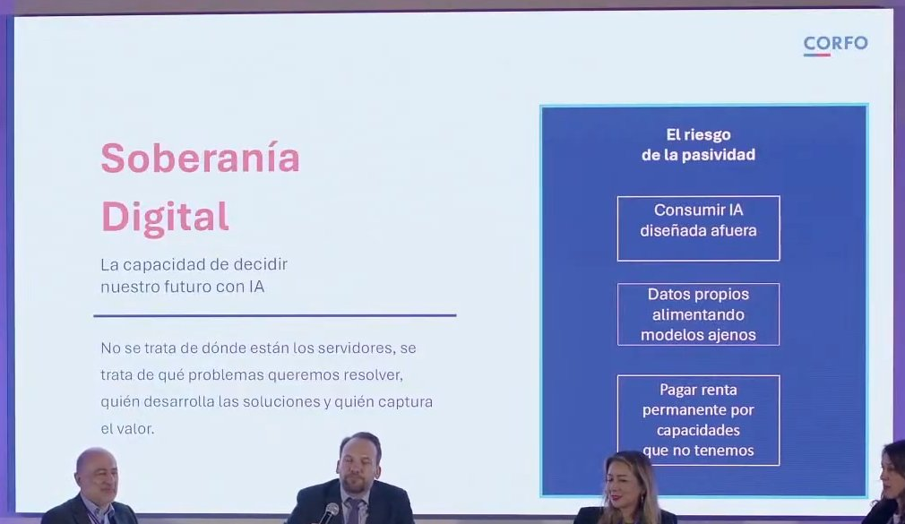
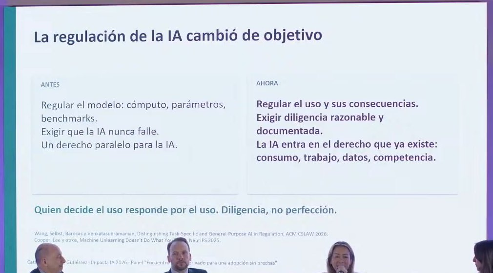
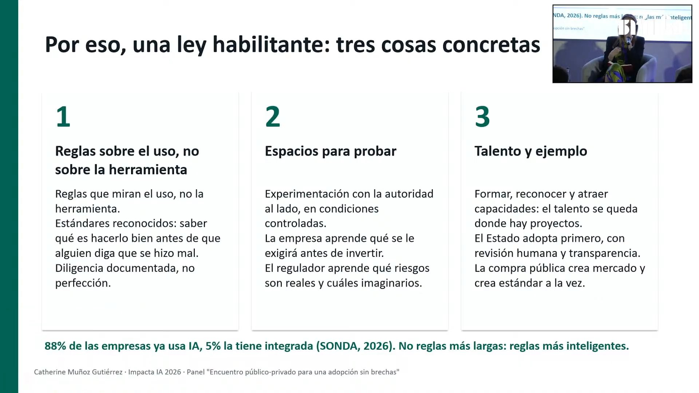

# Panel «Encuentro público-privado para una adopción sin brechas» · Impacta IA Chile 2026

Chile lidera la región en IA, pero solo el 9 % de sus empresas logra escalarla, y el panel discute cómo alinear al Estado, las empresas y las personas para cerrar esa brecha. Los tres panelistas coinciden en que la respuesta no es más regulación sino una política que habilite: infraestructura de cómputo propia, talento y gobernanza de datos al mismo tiempo (Hentzschel), reglas sobre el uso y no sobre la herramienta (Muñoz) y autorregulación con una estrategia país que hoy no incluye a la IA (Lever). El riesgo que más se repite es que las pymes se queden atrás: la destrucción de empleo puede venir de la no adopción.

## Ficha
| | |
|---|---|
| Evento | Impacta IA Chile 2026, día 1, miércoles 2 de septiembre de 2026, Fundación Chile |
| Modera | Carolina Garlick, gerenta de Marketing e Innovación del Grupo DF (Diario Financiero) |
| Speakers | Fernando Hentzschel, gerente de Capacidades Tecnológicas de CORFO · Catherine Muñoz, abogada, CEO de Idónea Consultores, especialista en gobernanza de IA y protección de datos · George Lever, economista, gerente de Estudios e Innovación de la Cámara de Comercio de Santiago |
| Conduce | Juan Pablo Silva, host del evento |
| Duración | 57 min (2 min de presentación, 3 min de encuadre, 20 min de primera ronda, 15 min de segunda ronda, 4 min de tercera ronda, 12 min de cierre con recomendaciones, 1 min de cierre de la moderadora y del host) |
| Idioma | español |
| Video | [YouTube desde 0:56:40](https://www.youtube.com/watch?v=4N6I6PXycMw&t=3400s) |
| Fuente | Whisper large-v3 (coincidencia 91,1 % con los subtítulos del stream), voces separadas con SpeechBrain ECAPA; revisión en tres pasadas: transcripción, idioma y lo dicho mal |

## Estructura
| Capítulo | Tramo | Quién |
|---|---|---|
| Presentación del panel | [00:00–01:45](https://www.youtube.com/watch?v=4N6I6PXycMw&t=3400s) | Juan Pablo Silva, host del evento |
| Encuadre de la moderadora | [01:45–04:59](https://www.youtube.com/watch?v=4N6I6PXycMw&t=3505s) | Carolina Garlick (Diario Financiero) |
| Primera ronda: una idea de cada panelista | [04:59–24:50](https://www.youtube.com/watch?v=4N6I6PXycMw&t=3699s) | Fernando Hentzschel (CORFO), Catherine Muñoz (Idónea), George Lever (CCS) |
| Segunda ronda: el cuello de botella | [24:50–39:40](https://www.youtube.com/watch?v=4N6I6PXycMw&t=4890s) | Hentzschel, Muñoz, Lever |
| Tercera ronda: pymes, empleo y quién financia la reconversión | [39:40–43:53](https://www.youtube.com/watch?v=4N6I6PXycMw&t=5780s) | Hentzschel |
| Cierre: decisiones para los próximos 90 días | [43:53–55:28](https://www.youtube.com/watch?v=4N6I6PXycMw&t=6033s) | Muñoz, Lever, Hentzschel |
| Cierre de la moderadora | [55:28–56:47](https://www.youtube.com/watch?v=4N6I6PXycMw&t=6728s) | Carolina Garlick; Juan Pablo Silva, host del evento |

## Tesis

La brecha de adopción de IA en Chile no se cierra con herramientas ni con más leyes, sino con una alianza público-privada que habilite. Garlick abre con el dato del índice de CORFO, la Cámara de Comercio de Santiago y KPMG: Chile lidera la región, pero solo el 9 % de las empresas escala con IA y en el sector industrial el país cae al lugar doce [02:31]. Hentzschel lo plantea como un tema de soberanía digital: si la IA es como la electricidad o el agua, depender de cómputo, algoritmos y precios ajenos es un riesgo país, y hay que avanzar en infraestructura, talento y gobernanza de datos en paralelo [06:01] [28:42]. Muñoz y Lever coinciden en que la sobrerregulación es una brecha en sí misma: hay que regular el uso y no la herramienta, con leyes habilitantes, *sandbox* y autorregulación [12:40] [23:28]. Lever agrega que la IA es la gran ausente de la estrategia de crecimiento del país [21:12], y todos ponen el foco en las pymes: si no adoptan, la crisis de empleo vendrá de la no adopción [41:36]. Garlick lo cierra: las brechas no se resuelven con herramientas, sino con colaboración entre el sector público y el privado, y con «que nos creamos el cuento» [55:28].

## Resumen

### Presentación del panel [00:00–01:45]
- **Juan Pablo Silva, host del evento [00:06]: tres relojes.** El Estado avanza a un ritmo, las empresas a otro, y en el medio queda la gente que no entra en la conversación. El panel discute cómo alinear esos tres relojes para que la adopción no deje a nadie atrás.

### Encuadre de la moderadora [01:45–04:59]
- **Carolina Garlick (Diario Financiero) [01:45]: casos prácticos, lo que funciona y lo que falla.** Pide concentrarse en lo práctico en los 45 minutos del panel.
- **[02:31]: cuatro señales.** El índice de IA 2026 de CORFO, la CCS y KPMG muestra a Chile liderando en Latinoamérica, pero solo el 9 % de las empresas escala con IA y en el sector industrial Chile pasa del primer lugar al doce. Suma el análisis reciente de Bill Gates en su blog sobre el impacto en trabajadores, empresas y jóvenes, y el «fallo de Meta» de la semana anterior, que reabre la pregunta de cuándo regular. Pide a cada panelista una idea en cuatro minutos.

### Primera ronda: una idea de cada panelista [04:59–24:50]
- **Fernando Hentzschel (CORFO) [05:05]: la adopción ocurre parcelada y en zigzag.** Cambió su presentación dos días antes porque lo que ve es una adopción fragmentada; la lámina falla y luego avanza a «Soberanía Digital» (ver imágenes).
- **[06:01]: soberanía digital, o compradores de tecnología ajena.** La IA está transformando la forma de producir y de competir de un país que basó su competitividad en los recursos naturales: Chile puede aumentar hasta un 10 % su productividad o limitarse a comprar tecnología desarrollada afuera. La soberanía digital «debiese tener al menos cuatro pilares»; nombra tres: infraestructura de cómputo, talento y capacidad de adopción de las empresas. La gobernanza de datos aparece después [27:16].
- **[07:24]: los tokens no están hechos de aire.** Recuerda el corte de gas argentino de los 2000: si la IA es como la electricidad o el agua, depender de terceros es un riesgo. Hoy los tokens son baratos, pero el precio no lo pone Chile, y están hechos de energía, materiales y centrales de cómputo. CORFO instala dos centros de supercómputo con financiamiento público-privado.
- **[08:23]: programas tecnológicos por sector.** Tres consorcios tecnológicos instalados (salud, alimentos) y otro en concurso (construcción, agroindustria). Sin adopción en los sectores clave, en menos de un par de años vendrá una «crisis de soberanía» de la capacidad productiva, y la abundancia de recursos naturales se volverá un freno.
- **Catherine Muñoz (Idónea) [09:49]: la confianza es certeza jurídica.** La regulación europea, que sirve de marco, se hizo para modelos de propósito específico que ya no se usan. Los modelos de propósito general sirven «para escribir cuentos infantiles como para crear ciberataques», y nadie sabe de antemano cuál será su uso [11:04].
- **[11:46]: no existe el desaprendizaje algorítmico.** No se le puede pedir a un modelo que olvide un dato: es como sacarle el azúcar a un queque ya horneado. Por eso muchos problemas de privacidad o de *deepfakes* no se resuelven como antes.
- **[12:40]: regular el uso, no la herramienta.** Un modelo más grande no es necesariamente más peligroso. No se regula la Tramontina porque un cuchillo sirve para una ensalada o para un asalto. La sobrerregulación es una brecha en sí misma: en Centroamérica vio cómo golpeaba de inmediato la inversión.
- **[14:05]: la IA ya está regulada.** En Chile la regulan las normas sectoriales: dispositivos médicos, delitos informáticos, protección de datos, materia laboral y *scoring* crediticio. No hace falta una ley que agregue cargas.
- **[15:09]: una ley habilitante.** Hay otros modelos además del europeo basado en riesgo: principios sectoriales en el Reino Unido, y los de Singapur, Corea y Japón, que son habilitantes. Chile no produce IA, la consume, y una ley gravosa es un desincentivo total. Se necesita certeza jurídica, normas habilitantes y espacios de prueba (*sandbox*) en salud o finanzas.
- **[16:57]: talento y ejemplo.** Invertir en talento es caro, y también es cultural. Pone como ejemplo la llegada de Intel a Costa Rica, que exigió cambiar mallas universitarias y crear centros de capacitación, y dejó un «ADN emprendedor» en las generaciones siguientes.
- **Carolina Garlick [18:09]:** retoma el 9 % de empresas que escalan y pregunta a Lever por la brecha de adopción y por regulación o autorregulación, dado que la CCS tiene un sello y un protocolo de uso de IA.
- **George Lever (CCS) [18:59]: mirada micro y macro.** Cultura y liderazgo también tienen una dimensión macro, donde actúan instituciones y gremios. Lo primero es una visión estratégica como ecosistema: si la adopción ocurre de forma espontánea, en los países en desarrollo es más difícil, por el costo y por el cambio cultural.
- **[20:17]: tokens contra mano de obra.** Esta vez subirse a la ola es barato: el costo de los tokens bajó un 99 % en cuatro años, mientras la mano de obra subió más de un 30 %.
- **[21:12]: la IA, la gran ausente.** No hay coherencia en la política pública: el plan de reconstrucción nacional, que busca duplicar el crecimiento potencial, aplica las recetas de los noventa (atraer inversión, certeza jurídica, permisología) y deja fuera a la IA. Sin ella, dice, es imposible lograr el objetivo [22:35]. Hay que pasar de una adopción espontánea a una acelerada por políticas públicas y alianzas público-privadas [22:46].
- **[23:28]: autorregulación, como con el comercio electrónico.** El proyecto de ley inicial, aún en el Parlamento, estuvo a punto de ser «un error garrafal» al aprisionar la IA con sobrerregulación: un delito cometido con IA ya está tipificado. La CCS optó por la autorregulación, e invita a adherir al primer código de autorregulación de uso responsable de IA del país.

### Segunda ronda: el cuello de botella [24:50–39:40]
- **Fernando Hentzschel [25:18]: tres pilares a la vez.** Para cosechar el 10 % de productividad no bastan los emprendimientos individuales. Hacen falta: infraestructura de cómputo y resiliencia (la banca o la minería no deberían depender de una nube «que quizás dónde diablos está»); capacidad para desarrollar algoritmos propios [26:44]; y gobernanza de datos, porque las empresas de IA vienen a Chile por los datos, «el nuevo oro» [27:16]. Da el ejemplo de los programas de IA para seguimiento de pacientes, con UC Christus, y para diagnóstico de cáncer [27:45].
- **[28:42]: ninguno destraba a los otros.** Si solo avanza el talento, termina en Silicon Valley «en tres semanas». Tienen que ir en vías paralelas.
- **Catherine Muñoz [29:08]: infraestructura primero, y datos propios.** Solo Estados Unidos y China deciden en IA, y los beneficios no son automáticos. Los sesgos son sociotécnicos y están en los modelos y en los datos: un sistema entrenado con iris de ojos claros para detectar glaucoma probablemente no funcione aquí [30:35]. El cómputo cuesta montos «estratosféricos» y hace falta cómputo compartido para académicos, emprendedores y startups. Pide salir del *hype* y centrarse en adaptar los sistemas a los problemas propios [31:57].
- **George Lever [32:59]: cuatro pilares en otra dimensión.** **Industria local**: no hay adopción sin buenos proveedores que compitan afuera; la CCS ha catastrado 400 empresas chilenas de IA y estima más de 500, con más de 8.500 empleos y más de 1.500 millones de dólares en ventas [34:35]. **Adopción** en todo el ecosistema, con brechas entre grandes y pequeñas empresas, e incluso invertidas: la pyme se adapta más rápido a ciertos usos [33:44]. **Institucionalidad**: Chile quiso ser «récord Guinness de regulación» y fue un error; hay que liderar la IA, no regularla [35:36].
- **[36:55]: el empleo, el cuarto pilar.** Chile vive una crisis de empleo tremenda. En broma, la mejor política de adopción de IA ha sido la regulación laboral, porque el alza del costo de la mano de obra empujó a automatizar. La IA primero destruye, luego sostiene y después crea empleo, y hay que acelerar la creación porque el país no puede soportar el golpe. Y la educación, que se salvó de la ola del e-commerce, «de esta no se salva» [38:47].

### Tercera ronda: pymes, empleo y quién financia la reconversión [39:40–43:53]
- **Carolina Garlick [39:40]:** el empleo afectado es sobre todo el de entrada, y emplear es más caro que automatizar. ¿Cómo se evita la brecha entre empresas y quién financia la reconversión?
- **Fernando Hentzschel [40:31]: el token a precio de huevo es por un rato.** Los tokens están subsidiados y en algún momento traspasarán el costo; es el *freemium* del momento y hay que aprovecharlo para ayudar a las pymes con su «transformación IA».
- **[41:36]: el empleo se puede destruir por no adoptar.** La banca, la minería, la forestal y la acuicultura ya están en su transformación; las pymes, «súper lejos». Como las pymes son el gran empleador de Chile, la destrucción de empleo puede venir de la no adopción masiva. CORFO empuja el talento en algoritmos para grandes empresas y una escuela *bottom-up* de digitalización e IA para pymes.
- **[43:06]: el responsable es Chile.** CORFO lo financia con los impuestos de todos. Hay *champions* como Runway, con dos fundadores chilenos, mientras otros sectores, como el reparto, se quedan atrás.

### Cierre: decisiones para los próximos 90 días [43:53–55:28]
- **Catherine Muñoz [44:41]: ecosistemas de triple hélice.** La innovación lineal de la universidad a la empresa, como en Estados Unidos, es muy difícil en Latinoamérica; lo que genera innovación a corto plazo son los ecosistemas de empresas, universidades, centros de investigación y Estado. Invita a salir del propio círculo y vincularse con otras industrias y otras experiencias.
- **[46:49]: reconocer las certificaciones.** Mucha gente que trabaja en IA no pasa por la universidad, porque la IA «no te va a esperar cinco años»: se forma en *bootcamps* y certificaciones, y las empresas deben reconocerlas al contratar.
- **George Lever [48:09]: pasarse el escáner.** Como llegar guiado por Waze, la forma de hacer las cosas cambió: «no hay nada que estemos haciendo antes que no se pueda hacer de una manera más eficiente con IA». Lo primero es hacerse la radiografía.
- **[49:20]: todos tienen que contribuir.** Cualquiera que se quede atrás es un lastre sistémico. Pide autorregularse con el código de IA de la CCS y sumarse a su mesa de IA, que ahora trabaja la estrategia micro y macro; la ausencia de esa señal genera desconfianza y luego sobrerregulación.
- **[50:39]: bienes públicos.** La CCS trabaja con *partners* para que soluciones de vanguardia lleguen *pro bono* a las empresas más pequeñas, y llama a usar los instrumentos de CORFO.
- **Fernando Hentzschel [52:00]: lo que falta es tiempo.** La estrechez obliga a innovar, pero esta ola avanza más rápido que otras, y el rezago de los proveedores privados merma la competitividad de todos. CORFO ofrece bienes públicos para la competitividad (mapas estratégicos sectoriales) y dos centros de supercómputo como «gimnasios subsidiados» con la barrera de acceso «literalmente en el suelo».
- **[53:50]: la IA ya es lo que más postula a CORFO.** La lámina que traía mostraba el salto de la IA en los instrumentos de emprendimiento: antes dominaban biotecnología, minería y energía; hoy, IA. Y pide no olvidar las regiones, donde está desplegada la matriz productiva y de proveedores, con sus propios ecosistemas y zonas de innovación [54:37].

### Cierre de la moderadora [55:28–56:47]
- **Carolina Garlick [55:28]:** las brechas de adopción no se resuelven con herramientas sino con colaboración público-privada para consolidar infraestructura, gobernanza de datos y cultura, «y también que nos creamos el cuento».
- **Juan Pablo Silva, host del evento [56:04]:** foto oficial, regalo de CCU y el dato de que Uber acaba de anunciar el despido del 10 % de su personal.

## Ideas que se llevan
1. La brecha está en escalar: Chile lidera la región en IA, pero solo el 9 % de las empresas escala (Garlick).
2. Soberanía digital: infraestructura de cómputo, talento y gobernanza de datos en paralelo; ninguno destraba solo a los otros (Hentzschel, Muñoz).
3. Regular el uso y no la herramienta: la IA ya está regulada por normas sectoriales, y la sobrerregulación es una brecha en sí misma; mejor leyes habilitantes, *sandbox* y autorregulación (Muñoz, Lever).
4. La IA debe entrar en la estrategia de crecimiento del país, hoy ausente del plan de reconstrucción nacional (Lever).
5. El empleo se puede perder por no adoptar: el foco está en las pymes, con escuelas de IA, bienes públicos y cómputo subsidiado (Hentzschel, Lever).
6. En 90 días: pasarse el escáner, sumarse a ecosistemas de innovación y reconocer el talento formado fuera de la universidad (Lever, Muñoz).

## Frases citables
> «Los tokens tampoco están hechos de aire: están hechos de energía, materiales, centrales de cómputo, y en algún momento van a empezar a escasear.» — Fernando Hentzschel (CORFO), [07:53](https://www.youtube.com/watch?v=4N6I6PXycMw&t=3873s)

> «No hay que regular la herramienta, sino que hay que regular el uso.» — Catherine Muñoz (Idónea), [13:21](https://www.youtube.com/watch?v=4N6I6PXycMw&t=4201s)

> «La sobrerregulación (estamos hablando de brecha) es una brecha en sí misma.» — Catherine Muñoz (Idónea), [13:44](https://www.youtube.com/watch?v=4N6I6PXycMw&t=4224s)

> «Tenemos que ser primeros en la región como líderes de la IA, no como reguladores de la IA.» — George Lever (Cámara de Comercio de Santiago), [36:38](https://www.youtube.com/watch?v=4N6I6PXycMw&t=5598s)

> «La destrucción del empleo puede ir no por la adopción masiva de la IA, sino por la no adopción masiva de la IA.» — Fernando Hentzschel (CORFO), [42:23](https://www.youtube.com/watch?v=4N6I6PXycMw&t=5943s)

> «No hay nada que estemos haciendo antes que no se pueda hacer de una manera más eficiente con IA.» — George Lever (Cámara de Comercio de Santiago), [48:53](https://www.youtube.com/watch?v=4N6I6PXycMw&t=6333s)

> «La adopción en IA y las brechas no se resuelven con herramientas.» — Carolina Garlick (Diario Financiero), [55:34](https://www.youtube.com/watch?v=4N6I6PXycMw&t=6734s)

## Imágenes notables

*«Soberanía Digital: la capacidad de decidir nuestro futuro con IA» · presentada por Fernando Hentzschel (CORFO) · [05:54](https://www.youtube.com/watch?v=4N6I6PXycMw&t=3754s) · parcial: se vio solo en la pantalla del escenario, recortada del plano general; todo el texto se lee*

*«La regulación de la IA cambió de objetivo» · presentada por Catherine Muñoz (Idónea) · [11:14](https://www.youtube.com/watch?v=4N6I6PXycMw&t=4074s) · parcial: se vio en la pantalla del escenario; las cabezas de los panelistas tapan parte del pie con las fuentes*

*«Por eso, una ley habilitante: tres cosas concretas» · presentada por Catherine Muñoz (Idónea) · [15:09](https://www.youtube.com/watch?v=4N6I6PXycMw&t=4309s)*

## Menciones a Brinca
- [05:05](https://www.youtube.com/watch?v=4N6I6PXycMw&t=3705s) Fernando Hentzschel arranca «a propósito de lo que decía Francisco» (Francisco Martínez, en la apertura) sobre cómo Chile absorbe esta ola tecnológica, y en [06:01] retoma su comparación de la IA con la electricidad y las máquinas de vapor.
- [09:49](https://www.youtube.com/watch?v=4N6I6PXycMw&t=3989s) Catherine Muñoz: «tal como comentaba Francisco al inicio», esto cambia muy rápido.
- [20:17](https://www.youtube.com/watch?v=4N6I6PXycMw&t=4617s) George Lever: «me parece que fue Francisco en la introducción», sobre lo distinto que es hoy subirse a la ola de la innovación.

## Archivos
- `transcripcion.md`: el texto completo, revisado y limpio, por turnos.
- `imagenes/`: las imágenes notables.
