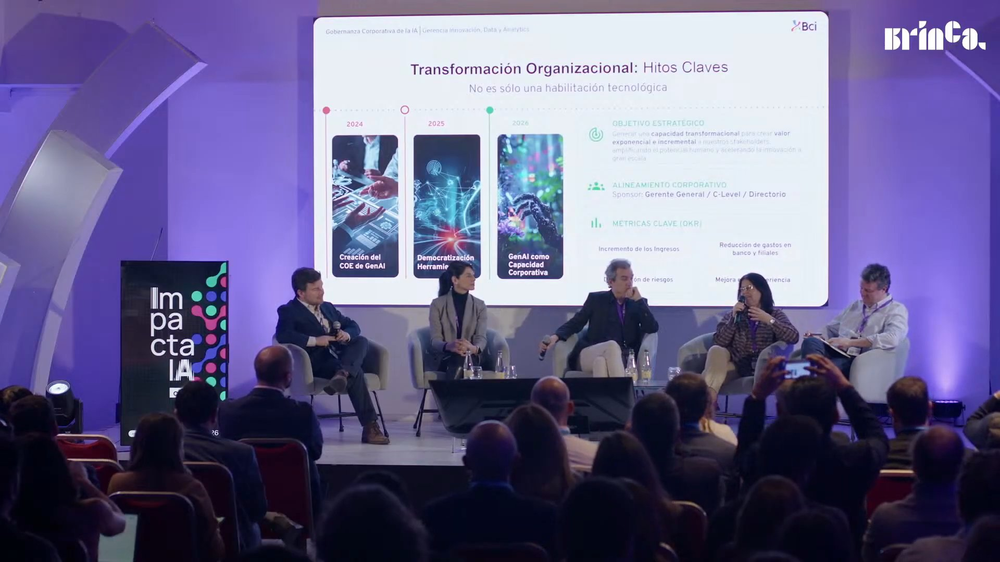
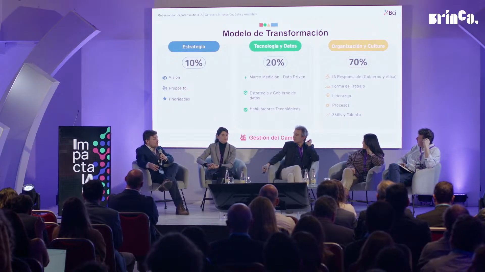
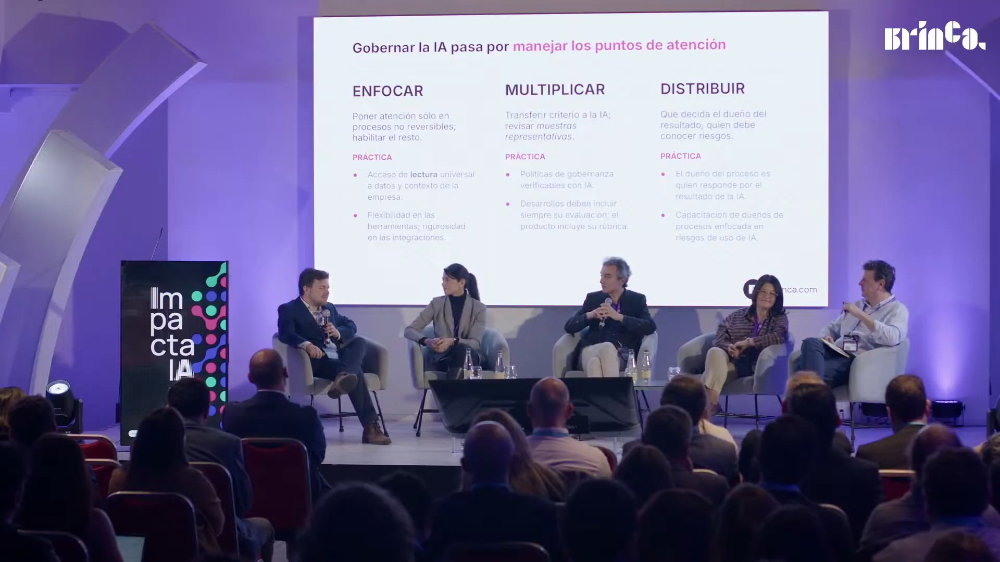
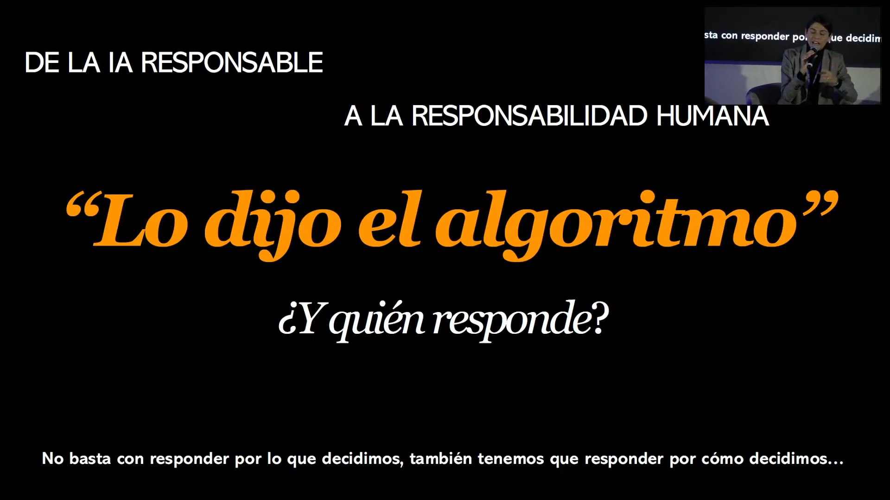
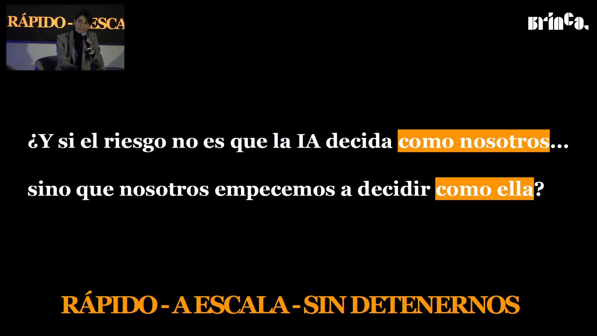

# Panel «Gobernanza Corporativa de la IA» · Impacta IA Chile 2026

La IA no se puede gobernar como se gobernó la informática, con permiso previo, comité y control: llega desde abajo, cambia cada pocos meses y nadie tiene todavía la mejor práctica. Los cuatro panelistas, desde un banco, un *retailer*, la ética empresarial y la consultoría, llegan a lo mismo: el gobierno de la IA es un problema de cultura, liderazgo y responsabilidad humana antes que de tecnología, y tiene que ser adaptativo. Las propuestas concretas van de registrar todo y gobernar a posteriori, a usar la propia IA para revisar el cumplimiento, y a puntuar cada caso de uso en una mesa diversa.

## Ficha
| | |
|---|---|
| Evento | Impacta IA Chile 2026, día 1, miércoles 2 de septiembre de 2026, Fundación Chile |
| Modera | José Manuel Morales, CEO y cofundador de Brinca |
| Speakers | Claudia Ramos, Chief Data Officer de Banco Bci · Macarena MacKay, directora ejecutiva de Alumni UC y directora de la Asociación de Ética Empresarial y Organizacional · Felipe Morales, gerente de Datos y Analítica de Walmart Chile · Nicolás Rivas, gerente de Soluciones de IA de Brinca, cofundador de Salesia y doctor en física |
| Presenta | Juan Pablo Silva, host del evento |
| Duración | 53 min (1,5 min de presentación del panel, 4,5 min de encuadre del moderador, 23,5 min de primera ronda, 12 min de segunda ronda, 10 min de tercera vuelta, 1 min de cierre) |
| Idioma | español |
| Video | [YouTube desde 2:09:10](https://www.youtube.com/watch?v=4N6I6PXycMw&t=7750s) |
| Fuente | Whisper large-v3 (coincidencia 92,2 % con los subtítulos del stream), voces separadas con SpeechBrain ECAPA; revisión en tres pasadas: transcripción, idioma y lo dicho mal |

## Estructura
| Capítulo | Tramo | Quién |
|---|---|---|
| Presentación del panel | [00:00–01:39](https://www.youtube.com/watch?v=4N6I6PXycMw&t=7750s) | Juan Pablo Silva, host del evento |
| Encuadre del moderador | [01:39–06:12](https://www.youtube.com/watch?v=4N6I6PXycMw&t=7849s) | José Manuel Morales (Brinca) |
| Primera ronda: cómo construye cada uno su gobernanza | [06:12–29:49](https://www.youtube.com/watch?v=4N6I6PXycMw&t=8122s) | Felipe Morales, Claudia Ramos, Nicolás Rivas, Macarena MacKay |
| Segunda ronda: cómo gobernar algo a lo que llegamos tarde y que cambia cada tres meses | [29:49–41:38](https://www.youtube.com/watch?v=4N6I6PXycMw&t=9539s) | Claudia Ramos, Felipe Morales, Nicolás Rivas, Macarena MacKay, Claudia Ramos |
| Tercera vuelta: dónde se aloja el liderazgo de la gobernanza | [41:38–51:32](https://www.youtube.com/watch?v=4N6I6PXycMw&t=10248s) | Macarena MacKay, Nicolás Rivas, Felipe Morales, Claudia Ramos |
| Cierre | [51:32–52:39](https://www.youtube.com/watch?v=4N6I6PXycMw&t=10842s) | José Manuel Morales (Brinca) |

## Tesis

La IA no se puede gobernar como se gobernó la informática. Felipe Morales lo plantea de entrada: es la cuarta disrupción del mundo moderno, la de la cognición, no tiene todavía una mejor práctica y «el AI no puede ser domesticado» [10:03]. Claudia Ramos agrega que tiene una fuerza *bottom-up* que las empresas no van a poder controlar al estilo tradicional [14:47], y Nicolás Rivas, que lo escaso ya no es el software sino la atención de quien gobierna [18:25]. De ahí salen tres respuestas que se complementan: gobernar a posteriori y con la propia IA (Rivas, Morales), poner responsables con nombre y apellido y condiciones para detener un proceso (MacKay) y codificar la cultura en una mesa diversa que puntúa cada caso de uso y prefiere experimentar a planificar (Ramos). El moderador lo resume al cierre [51:32]: una tecnología distinta requiere un gobierno distinto, con foco en el liderazgo, la adaptación y la agilidad estratégica, «gobiernos ágiles y flexibles que no quiten sino que aumenten el impacto», siempre sobre el criterio humano.

## Resumen

### Presentación del panel [00:00–01:39]
- **Juan Pablo Silva, host del evento [00:04]: del experimento informal a las reglas claras.** Casi todas las empresas tienen algún piloto andando, y probablemente agentes, pero muy pocas tienen reglas claras y escritas para esos experimentos. Esa distancia, entre el experimento informal y un modelo de gobierno con reglas, ética y control de riesgo, es el tema del panel.

### Encuadre del moderador [01:39–06:12]
- **José Manuel Morales (Brinca) [02:48]: lo que se escucha en las empresas.** La empresa pasó por mirar la tecnología con un «ok, veamos cómo se desarrolla», por las cuentas gratuitas, que son «las más caras, porque se pagan con información de la empresa» [03:15], y por mil licencias de Copilot para escribir correos. Ahora vive un «momento de epifanía» en directorios y gerencias [03:48]: la herramienta construye y escala valor, pero también puede destruirlo. Como las tecnologías son moralmente neutras, la gobernanza importa.
- **[04:25]: tres invitaciones de las sesiones anteriores.** El autogobierno que propuso George en el panel anterior (que las organizaciones armen su propia gobernanza sin esperar límites externos); la advertencia de Francisco Martínez, en su apertura, de que fuera de las empresas que construyen los modelos de punta nadie tiene recetas, en la paráfrasis del moderador «estamos todos igual de perdidos, no hay regla» [04:51], y la propuesta de Catherine de una gobernanza que también ayude a explorar, con *sandboxes* [05:05].

### Primera ronda: cómo construye cada uno su gobernanza [06:12–29:49]
- **Felipe Morales (Walmart Chile) [06:12]: no se puede domesticar.** Estamos en la cuarta disrupción del mundo moderno, cada una nacida de una escasez: la fuerza física (mecanización), la energía, la información (digitalización) y ahora la cognición. Lo que se externaliza es la capacidad de pensar: «puedo partir del 80 % hoy, puedo partir del 90 % mañana» [08:49]. Por eso no sirve copiar el gobierno de datos, el corporativo o el de las PMO; no hay consenso ni mejor práctica, y sesiones como esta ayudan a construirlos. «El AI no puede ser domesticado» [10:03]: los incentivos para romper el corral son demasiado grandes, así que hay que pensar la gobernanza sin esas restricciones.
- **Claudia Ramos (Bci) [11:26]: volver a los valores fundantes.** Bci construyó hace casi 30 años el primer *data warehouse* de Sudamérica [12:03], lo que creó una mentalidad de gestión con datos. En 2024 creó el Centro de Excelencia de IA Generativa como capacidad corporativa [12:18] y con él nació el concepto de IA responsable: política, valores, transparencia, ética. Una mesa diversa (fiscalía, personas, negocios, áreas técnicas y de riesgo) evalúa permanentemente los casos de uso [13:19], porque pasan cosas que nadie imagina; cuenta un caso europeo, las cámaras en las casas de reposo que terminaron alejando a los familiares.
- **[14:13]: el modelo de transformación.** Proyecta el modelo de Bci, que reparte el esfuerzo en 10 % estrategia, 20 % tecnología y datos y 70 % organización y cultura (ver la imagen): política corporativa, trabajo con el directorio, marco ético, cursos con el CENIA y la Católica. «Pensar que vas a poder gobernar como lo has hecho tradicionalmente es imposible» [14:47]. El tema de fondo no es la adopción sino la adaptación [15:28].
- **Nicolás Rivas (Brinca) [16:30]: que el director la use.** Para sensibilizar a un directorio, lo mejor es que el director use la IA él mismo para sus decisiones: ahí obtiene un valor que nunca sacó del *data warehouse* [16:38].
- **[18:25]: lo escaso es la atención, no el software.** El software pasó de escaso a abundante, barato, rápido y distribuido. La gobernanza de TI se construyó cuando cada solución tardaba meses y se podía mirar una por una; hoy es imposible. Propone pasar de bloquear a registrar y gobernar a posteriori, en vez de «ponernos el parche antes de la herida». Como «una riqueza de información crea una pobreza de atención» [20:02], las empresas pueden copiar la lógica de los *feeds*: resaltar y filtrar con algoritmos.
- **[21:17]: enfocar, multiplicar y distribuir la atención.** **Enfocar**: no preocuparse de lo reversible, como decía Jeff Bezos, y sí de lo irreversible [21:39]. **Multiplicar**: gobernar con la propia IA; «le puedo pasar la ley entera […], le puedo pasar mi solución y preguntarle si lo cumple» [22:20]. **Distribuir**: quien construye la solución es responsable de ella [22:40].
- **Macarena MacKay (Alumni UC) [24:05]: de la IA responsable a la responsabilidad humana.** Adelanta que participó en el capítulo de IA responsable del Índice Latinoamericano de IA 2026, que sale en octubre. «Lo dijo el algoritmo» se volvió el punto final de una discusión que no se da [25:24]: diluye la responsabilidad y ya no hay responsables con nombre y apellido. Ahora no basta responder por lo que decidimos, hay que responder también por cómo llegamos a la decisión [26:41].
- **[26:51]: decidir como la IA.** Le preocupa menos que la IA se parezca a nosotros que empezar a decidir como ella: rápido, a escala, sin detenernos, con *copy-paste* de lo que no leímos. Formar para usar IA no es formar para decidir con IA, es decir, con criterio, contexto y valores [27:56]. Y de poco sirve gente criteriosa si la cultura no le da condiciones para detener un proceso y decir «esto no está alineado con lo que somos» [28:17]. Pone a Bci como ejemplo de organización que entendió que el tema es cultural y no tecnológico. Cierra: «mientras más inteligencia artificial usemos, más inteligencia emocional, más humanidad, más criterio y más responsabilidad necesitamos» [29:33].

### Segunda ronda: cómo gobernar algo a lo que llegamos tarde y que cambia cada tres meses [29:49–41:38]
- **José Manuel Morales [29:49]: la pregunta transversal.** Llegamos tarde porque la gente ya usa la IA con sus cuentas personales, o porque se escribe una política y después Anthropic lanza Mythos o Fable [30:38]. ¿Cómo gobernar algo así si el gobierno puede quedar obsoleto en tres o seis meses?
- **Claudia Ramos [31:16]: flexibilidad y una mesa cada dos semanas.** Lo que decidiste ayer, hoy ya tiene otra capacidad. Distingue el *top down* (estrategia, iniciativas, *big bets*), que es más fácil, del *bottom-up* (todas las personas aumentando sus capacidades y automatizando lo suyo), que también hay que gobernar y que disrumpe los roles tradicionales. La respuesta es flexibilidad, colaboración y una mesa corporativa que sesiona cada dos semanas [32:56]: «el gobierno antiguo que queda en piedra, eso ya no existe» [33:25].
- **Felipe Morales [33:32]: el sello al revés y gobernar por etapas.** Uno de los fundadores de Runway le dio vuelta la idea del sello: en dos años el *watermark* debería ir en lo que hicieron humanos, no en lo que hizo la IA [34:19]. Propone gobernar por etapas [34:36]: primero **registrar** (en Walmart, «si decimos “oye, tenemos 4.000 agentes”, creo que te estaría mintiendo», porque en la mañana ya son 4.100 [35:02]); luego controlar desde la prueba de concepto; luego decisiones con *human in the loop*, y finalmente decisiones autónomas supervisadas *ex post*.
- **Nicolás Rivas [36:16]: perder la ilusión de control y gobernar con IA.** Controlar y gobernar no son lo mismo. Propone hacer escalable el juicio ético pasándole a la IA los principios y valores de la empresa junto con la iniciativa, para que detecte conflictos: «lo hace muy bien». La confianza se construye con *tests*, como se entrena un modelo: revisar sus primeras decisiones y soltar cuando lo hace tan bien como nosotros o mejor [37:48].
- **Macarena MacKay [38:28]: la gobernanza es liderazgo.** Las empresas creen que gobernar es crear protocolos y comités, e imaginan cómo debería usarse la IA en vez de mirar cómo se usa hoy: el *shadow AI*, las herramientas que la gente trae de la casa [39:09]. «Supervisión humana no es lo mismo que presencia humana» [39:18]: sin condiciones para detener procesos, la supervisión es de comillas. Y autonomía no es ausencia de control: una persona con todas las libertades que hace *copy-paste* puede ser «cero autónoma» [39:54].
- **Claudia Ramos [40:20]: codificar la cultura.** El diseño del trabajo asume una capacidad humana limitada, y hoy es ilimitada. Por eso hay que documentar cómo decidimos y nuestros valores, y enseñárselo a la IA para que ejerza ese gobierno dentro de los procesos [40:53]. El trabajo se volverá el diseño del trabajo, no su ejecución [41:28].

### Tercera vuelta: dónde se aloja el liderazgo de la gobernanza [41:38–51:32]
- **José Manuel Morales [41:38]: no es un tema de TI.** Ante un tema tecnológico la reacción es «llamemos a TI», o a datos, o a administración y finanzas [42:15]; pero lo que se discute son decisiones éticas y de criterio con efecto en el negocio, la sostenibilidad, los *stakeholders* y los colaboradores. ¿Dónde se aloja ese liderazgo?
- **Macarena MacKay [43:14]: nombre y apellido, y diversidad.** Cuando se pregunta quién es el último responsable del marco ético, todos se mandan de un área a otra [43:33]. Los directorios compran herramientas o *tokens* sin preguntarles a colaboradores y clientes qué necesitaban. Desde la encíclica del Papa sobre custodiar lo humano [44:18], valora la diversidad: las decisiones son más lentas y engorrosas, pero la gente se hace responsable porque fue parte.
- **Nicolás Rivas [44:57]: decidir más lento y hacerse cargo del reemplazo.** Si la ejecución se volvió rápida, la decisión debe ser más lenta y reflexiva: «con gran poder […] viene gran responsabilidad» [45:14]. Además, la gente sabe que está entrenando a su reemplazo [45:49]. El líder tiene la responsabilidad moral de encontrarle un nuevo rol, innovando en vez de hacer lo mismo de antes más rápido, como cuando internet solo puso el diario en línea.
- **Felipe Morales [47:24]: las cuatro preguntas antes de escalar.** Después de la prueba de concepto, Walmart pregunta: ¿qué valor genera? (no quemar *tokens* «porque puedo» [47:47]); ¿qué podría salir mal?; ¿qué impacto tiene en las personas (colaboradores, clientes, comunidades, proveedores)?; y ¿quién es el responsable con cara visible?, para evitar el «me lo dijo el algoritmo», que «es inaceptable» [48:43]. La quinta es cultural [48:46]: eliminar el *slop*, la presentación hecha con IA que nadie leyó. La IA te lleva al 80 % [49:27]; el tiempo que antes iba a ejecutar debe ir ahora al 20 % restante.
- **Claudia Ramos [49:46]: el índice de responsabilidad de Bci.** La mesa puntúa cada caso de uso por valor, calidad (sesgos, ética y un *golden set* de datos para controlar alucinaciones [50:10]), seguridad, autonomía (si hay humano en el *loop* y quién responde) y sostenibilidad (cuánto consume, por qué ese modelo). El puntaje enseña a quienes presentan. Y la clave es experimentar [50:50]: la planificación se volvió cara y pierde valor; cinco experimentos dan datos con los que evaluar hipótesis y riesgos con mucha más objetividad.

### Cierre [51:32–52:39]
- **José Manuel Morales [51:32]: innovar en el gobierno.** Así como la IA invita a innovar en todo, una de las innovaciones más importantes será el propio gobierno: ágil, flexible, que aumente el impacto y descanse en el criterio humano [52:02].

## Ideas que se llevan
1. Gobernar no es controlar: registrar todo, gobernar a posteriori y soltar donde la IA ya decide tan bien como nosotros (Rivas, F. Morales).
2. Lo escaso es la atención: enfocarla en lo irreversible, multiplicarla con la propia IA y distribuirla a quien construye la solución (Rivas).
3. Responsabilidad con nombre y apellido: responder por cómo se decide, no solo por lo que se decide; «lo dijo el algoritmo» es inaceptable (MacKay, F. Morales).
4. Es cultura y liderazgo antes que tecnología: 70 % del esfuerzo va a organización y cultura, una mesa diversa sesiona cada dos semanas y la cultura se codifica para enseñársela a la IA (Ramos, MacKay).
5. Antes de escalar, cuatro preguntas (valor, riesgo, impacto en personas, responsable) y un índice que puntúa cada caso; experimentar vale más que planificar (F. Morales, Ramos).

## Frases citables
> «Las cuentas gratuitas no existen, esas son las más caras, porque se pagan con información de la empresa.» — José Manuel Morales (Brinca), [03:15](https://www.youtube.com/watch?v=4N6I6PXycMw&t=7945s)

> «Esta disrupción implica que el AI no puede ser domesticado.» — Felipe Morales (Walmart Chile), [10:03](https://www.youtube.com/watch?v=4N6I6PXycMw&t=8353s)

> «Pensar que vas a poder gobernar como lo has hecho tradicionalmente es imposible.» — Claudia Ramos (Bci), [14:47](https://www.youtube.com/watch?v=4N6I6PXycMw&t=8637s)

> «Me gusta mucho esta frase de que una riqueza de información crea una pobreza de atención.» — Nicolás Rivas (Brinca), [19:58](https://www.youtube.com/watch?v=4N6I6PXycMw&t=8948s)

> «No es suficiente que respondamos solo por lo que decidimos, sino que ahora tenemos que responder también por cómo llegamos a esa decisión.» — Macarena MacKay (Alumni UC), [26:36](https://www.youtube.com/watch?v=4N6I6PXycMw&t=9346s)

> «Mientras más inteligencia artificial usemos, más inteligencia emocional, más humanidad, más criterio y más responsabilidad necesitamos.» — Macarena MacKay (Alumni UC), [29:33](https://www.youtube.com/watch?v=4N6I6PXycMw&t=9523s)

> «Si decimos “oye, tenemos 4.000 agentes”, creo que te estaría mintiendo hoy día, porque pueden ser 4.100.» — Felipe Morales (Walmart Chile), [35:01](https://www.youtube.com/watch?v=4N6I6PXycMw&t=9851s)

> «Supervisión humana no es lo mismo que presencia humana.» — Macarena MacKay (Alumni UC), [39:18](https://www.youtube.com/watch?v=4N6I6PXycMw&t=10108s)

> «El gobierno antiguo que queda en piedra, eso ya no existe.» — Claudia Ramos (Bci), [33:25](https://www.youtube.com/watch?v=4N6I6PXycMw&t=9755s)

## Imágenes notables

Las láminas de Bci y de Nicolás Rivas solo se vieron en la pantalla del escenario, detrás de los panelistas; las de Macarena MacKay se mostraron a pantalla completa en el stream. No se incluyen las láminas de Nicolás Rivas que se vieron solo a trozos (una pregunta, una frase y una captura de un post de LinkedIn) ni la placa del panel.

*«Transformación Organizacional: Hitos Claves» · presentada por Claudia Ramos (Bci) · [11:44](https://www.youtube.com/watch?v=4N6I6PXycMw&t=8454s) · parcial: proyectada desde 11:25 en la pantalla del escenario; las cabezas de los panelistas tapan dos de los cuatro OKR («D[…]n de riesgos», «Mejora e[…]eriencia»). Línea de tiempo 2024 (Creación del COE de GenAI), 2025 («Democratización Herramie[…]», cortado), 2026 (GenAI como capacidad corporativa), con el sponsor (gerente general, C-Level, directorio) y los OKR.*

*«Modelo de Transformación» · presentada por Claudia Ramos (Bci) · [16:14](https://www.youtube.com/watch?v=4N6I6PXycMw&t=8724s) · parcial: Claudia la pide en 14:13, pero la cámara sigue en primer plano de ella y la pantalla solo se ve en plano general desde 15:37, cuando termina su turno. Estrategia 10 %, Tecnología y Datos 20 %, Organización y Cultura 70 %, con la gestión del cambio como eje transversal (el rótulo queda cortado: «Gestión del Cam[…]»).*

*«Gobernar la IA pasa por manejar los puntos de atención» · presentada por Nicolás Rivas (Brinca) · [23:16](https://www.youtube.com/watch?v=4N6I6PXycMw&t=9146s) · parcial: la desarrolla en 21:17, pero la cámara sigue en primer plano de Rivas y la pantalla solo se ve completa, en plano general, apenas termina su turno, cuando el moderador retoma la palabra (23:10). Enfocar, multiplicar y distribuir, cada uno con dos prácticas; una panelista tapa solo el pie con la URL de Brinca.*

*«De la IA responsable a la responsabilidad humana: “Lo dijo el algoritmo”» · presentada por Macarena MacKay (Alumni UC) · [25:22](https://www.youtube.com/watch?v=4N6I6PXycMw&t=9272s) · completa, desde 25:07: «¿Y quién responde? No basta con responder por lo que decidimos, también tenemos que responder por cómo decidimos…».*

*«¿Y si el riesgo no es que la IA decida como nosotros… sino que nosotros empecemos a decidir como ella?» · presentada por Macarena MacKay (Alumni UC) · [29:24](https://www.youtube.com/watch?v=4N6I6PXycMw&t=9514s) · completa; la pide en 26:51 y queda proyectada hasta el final de su intervención. Al pie: «Rápido - a escala - sin detenernos».*

## Menciones a Brinca
- [01:07](https://www.youtube.com/watch?v=4N6I6PXycMw&t=7817s) El host presenta a Nicolás Rivas como gerente de soluciones de IA en Brinca y a José Manuel Morales como CEO y cofundador de Brinca.
- [02:48](https://www.youtube.com/watch?v=4N6I6PXycMw&t=7918s) José Manuel Morales se presenta como consultor que dirige una empresa de consultoría.
- [04:51](https://www.youtube.com/watch?v=4N6I6PXycMw&t=8041s) José Manuel Morales parafrasea la introducción de Francisco Martínez («si no eres Google, Alphabet o Microsoft, estamos todos igual de perdidos, no hay regla»); en la apertura (dia1-01, 05:39) Francisco dijo «si tú no eres Google, no eres Anthropic, no eres OpenAI, estamos todos exactamente en las mismas».
- [19:17](https://www.youtube.com/watch?v=4N6I6PXycMw&t=8907s) Nicolás Rivas presenta la propuesta de Brinca para gobernar la proliferación del software («lo que estamos proponiendo nosotros»): registrar y gobernar a posteriori, y enfocar, multiplicar y distribuir la atención; su lámina lleva la marca de Brinca.
- [47:09](https://www.youtube.com/watch?v=4N6I6PXycMw&t=10579s) Nicolás Rivas cita a Francisco Martínez sobre la responsabilidad moral de innovar.

## Archivos
- `transcripcion.md`: el texto completo, revisado y limpio, por turnos.
- `imagenes/`: las imágenes notables.
