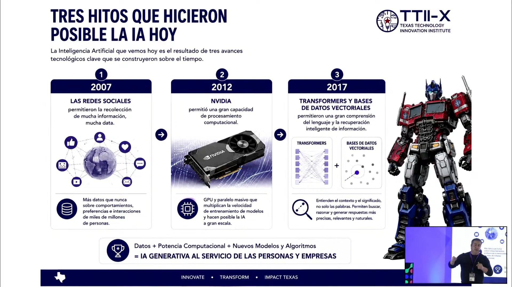
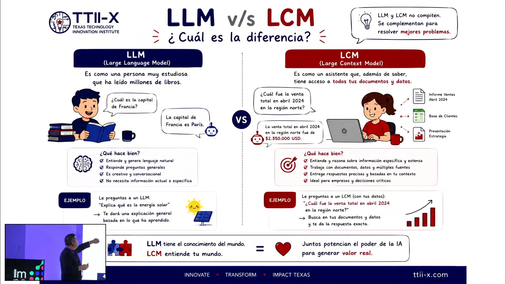
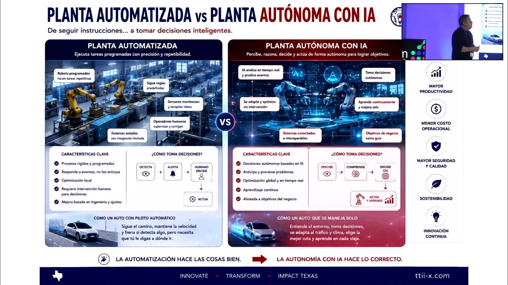
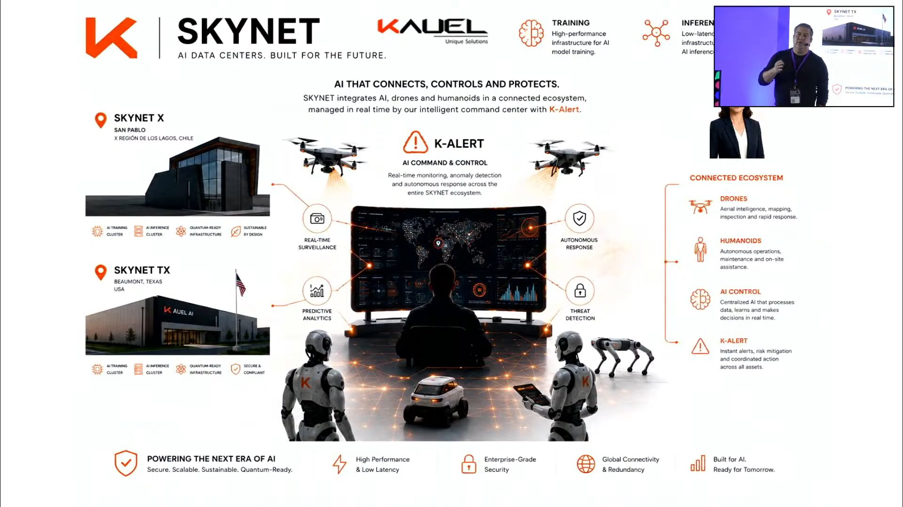
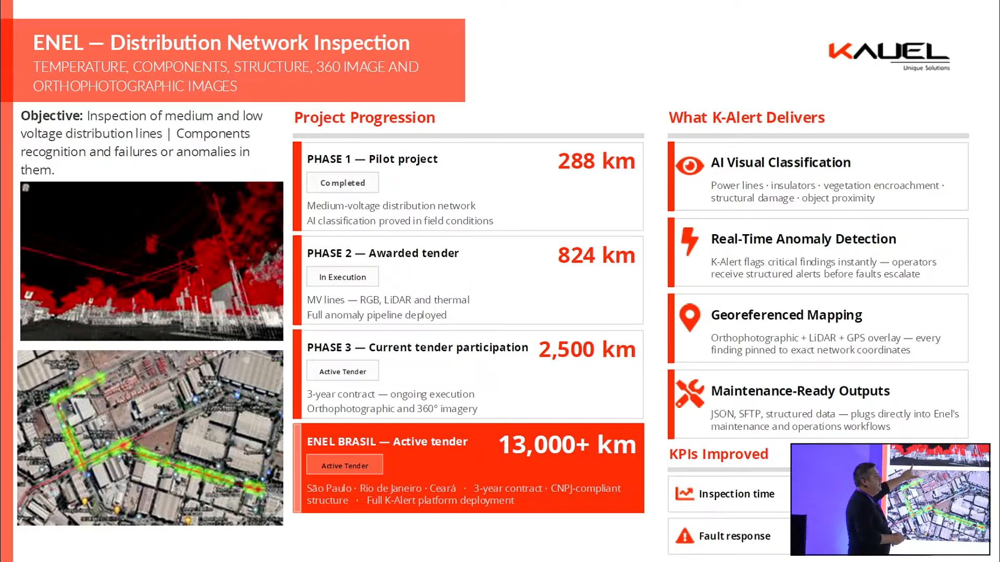
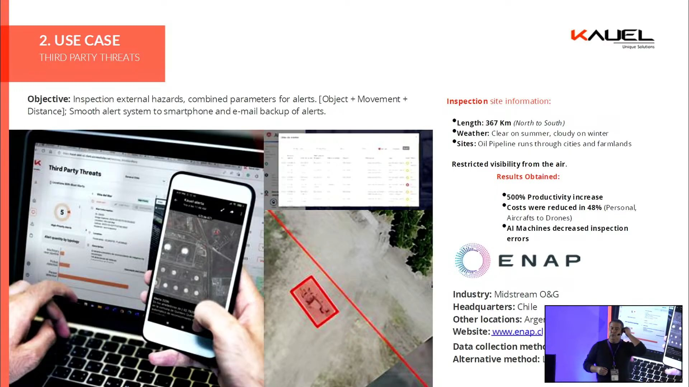
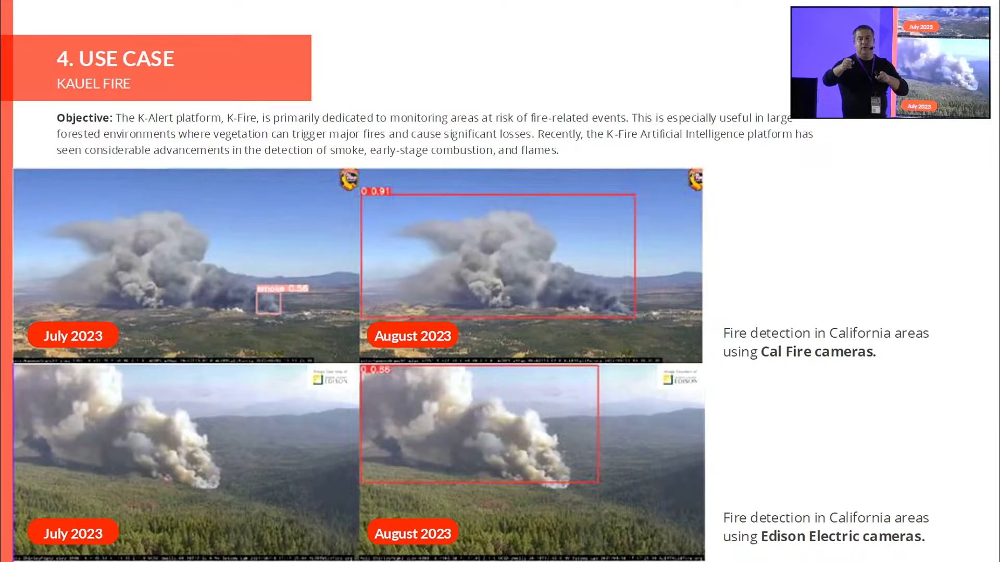

# Charla «El ROI real de la IA: impacto en la rentabilidad del negocio» · Impacta IA Chile 2026

Edmundo Casas, fundador y CEO de Kauel, responde a la pregunta del ROI con la experiencia de su empresa: modelos de IA que inspeccionan activos industriales (ductos, líneas eléctricas, minería) y que reemplazan meses de inspección manual por vuelos de dron analizados en tiempo real. Más de la mitad de la charla es un repaso de conceptos de IA y la historia de Kauel. Las cifras de impacto llegan en pocos casos: ENAP, Enel y una estimación de litio para Soquimich.

## Ficha
| | |
|---|---|
| Evento | Impacta IA Chile 2026, día 1, miércoles 2 de septiembre de 2026, Fundación Chile |
| Presenta | Juan Pablo Silva, host del evento |
| Speakers | Edmundo Casas, fundador y CEO de Kauel (radicado en Houston, Texas) |
| Duración | 34 min (2 min de presentación del host, 31 min de charla, 30 s de cierre del host); estaba programada para 20 min |
| Idioma | español |
| Video | [YouTube desde 3:02:20](https://www.youtube.com/watch?v=4N6I6PXycMw&t=10940s) |
| Fuente | Whisper large-v3 (coincidencia 93,4 % con los subtítulos del stream), voces separadas con SpeechBrain ECAPA; revisión en tres pasadas: transcripción, idioma y lo dicho mal |

## Estructura
| Capítulo | Tramo | Quién |
|---|---|---|
| Presentación del host | [00:00–01:52](https://www.youtube.com/watch?v=4N6I6PXycMw&t=10940s) | Juan Pablo Silva, host del evento |
| Qué hace Kauel, en dos minutos | [01:52–04:36](https://www.youtube.com/watch?v=4N6I6PXycMw&t=11052s) | Edmundo Casas (Kauel) |
| Una historia corta de la IA y sus conceptos | [04:36–09:31](https://www.youtube.com/watch?v=4N6I6PXycMw&t=11216s) | Edmundo Casas (Kauel) |
| Lo que viene: humanoides, plantas autónomas y biotecnología | [09:31–13:23](https://www.youtube.com/watch?v=4N6I6PXycMw&t=11511s) | Edmundo Casas (Kauel) |
| La historia de Kauel | [13:23–18:18](https://www.youtube.com/watch?v=4N6I6PXycMw&t=11743s) | Edmundo Casas (Kauel) |
| Inspección de activos con IA: el negocio de Kauel | [18:18–23:18](https://www.youtube.com/watch?v=4N6I6PXycMw&t=12038s) | Edmundo Casas (Kauel) |
| Casos: del dron al litio | [23:18–29:54](https://www.youtube.com/watch?v=4N6I6PXycMw&t=12338s) | Edmundo Casas (Kauel) |
| Avatares, salud y cierre | [29:54–33:39](https://www.youtube.com/watch?v=4N6I6PXycMw&t=12734s) | Edmundo Casas (Kauel); cierre del host |

## Tesis

Para Casas, el retorno de la IA está en aplicarla a procesos físicos e industriales concretos, no en conversar con un chatbot. Hoy una máquina ya puede hacer cualquier trabajo digital [10:03], y el paso siguiente es llevar esa inteligencia a robots, plantas y refinerías que operan solas. Por eso recomienda contratar modelos conectados al contexto de la empresa (LCM) y no modelos de lenguaje genéricos (LLM) [08:42]. En el negocio de Kauel, el ROI viene de reemplazar inspecciones lentas por drones e IA: un vuelo de 15 minutos analizado en tiempo real hace lo que antes tomaba un semestre o un año de caminatas [19:08]. La slide del caso ENAP muestra un 500 % más de productividad y un 48 % menos de costos [25:08]. El ejemplo que él mismo liga al título de la charla es el litio: si la estimación de cuánto litio hay bajo el agua pasa de un 20 % de error a un 1 %, según su cálculo la facturación de un productor como Soquimich sube en el mismo orden [28:00]. También advierte que los permisos en Chile hacen perder inversión tecnológica frente a Estados Unidos [20:18].

## Resumen

### Presentación del host [00:00–01:52]
- **Juan Pablo Silva, host del evento [00:05]: «show me the money».** Tras las sesiones de gobernanza y de estrategia público-privada, falta el tema del impacto real de la IA en la rentabilidad, y esta charla está «100 % enfocada en eso». Presenta a Edmundo Casas como fundador y CEO de Kauel, referente chileno en IA y ganador del Internet 2.0 Award en Dubái, radicado en Estados Unidos y con negocios en Dubái.

### Qué hace Kauel, en dos minutos [01:52–04:36]
- **Edmundo Casas (Kauel) [01:57]: 80 páginas en 20 minutos.** Advierte que pasará cuatro slides por minuto. Kauel construye modelos de IA a partir de datos que recolecta; distingue entrenamiento (*training*) e inferencia, y dice que la empresa lleva unos 25.000 modelos en 20 años, con foco en IA desde 2012 [03:04].
- **[03:14]: petróleo, energía y minería.** La parte fuerte es *oil and gas*, por eso vive en Houston; también inspección de líneas eléctricas y un *spin-off* nuevo en minería para operar en Chile. Todo se conecta a sus centros de datos propios, Skynet, y a los «AI Human Box».
- **[04:03]: los agentes ya pasaron.** Ahora vienen los *digital workers*, que pueden hacer la tarea de cualquier persona y formar equipos digitales; su plataforma de alertas K-Alert se conecta con ellos.

### Una historia corta de la IA y sus conceptos [04:36–09:31]
- **[04:36]: tres hitos.** La IA fuerte es reciente: las redes sociales (2007) acumularon datos, Nvidia (2012) dio capacidad de cómputo (con su socio Cristian Romero necesitaban 12 computadores en red para lo que después hizo una sola GPU) y los *transformers* (2017) permitieron construir lenguaje [05:53] (ver imagen 1).
- **[06:36]: tipos de aprendizaje.** Supervisado, no supervisado y por refuerzo; hoy «las máquinas aprenden por sí solas». Pide que compartan las presentaciones para estudiarlas.
- **[07:36]: LLM versus LCM.** Un *large language model* es como una persona que leyó millones de libros y responde preguntas generales; un *large context model* se conecta a los sistemas y documentos de la empresa y trabaja con su contexto. Su consejo: «si contratan algo para su empresa, no contraten un LLM: un LCM» [08:42] (ver imagen 2).
- **[08:53]: autos autónomos.** Ya operan en Estados Unidos (Waymo, Tesla): perciben, entienden, deciden y actúan.

### Lo que viene: humanoides, plantas autónomas y biotecnología [09:31–13:23]
- **[09:35]: por qué humanoides.** Todo lo digital ya lo puede hacer un *worker* de IA: contabilidad, análisis financiero, correos, llamadas, ventas, marketing [10:12]. Lo que falta es lo físico, y por eso la industria pone la inteligencia en cuerpos con forma humana, «porque van a reemplazarnos físicamente» [10:57].
- **[11:03]: de planta automatizada a planta autónoma.** La planta con IA lo hace todo sola (ver imagen 3). Como ejemplo cita una refinería autónoma, sin humanos, que según él se inauguró en Houston en febrero de 2026 [11:31].
- **[11:48]: biotecnología.** En Silicon Valley la inversión en IA y en biotecnología con IA es «brutal»; habla de tratamientos para rejuvenecer y de un test para medir la edad biológica que atribuye a la FDA [12:35]. Recomienda una lista de películas sobre IA [12:50].

### La historia de Kauel [13:23–18:18]
- **[13:43]: de San Pablo a Stanford.** Estudió con Cristian Romero en la Universidad Técnica Federico Santa María; pasaron por Plug and Play, StartX (la aceleradora de Stanford) y Y Combinator, y cuenta que Elon Musk fue su *advisor* en Plug and Play [14:28]. Su mensaje para emprendedores: hay becas y oportunidades, «el que la sigue la consigue» [15:19].
- **[15:25]: Kauel en un listado global.** Muestra una tabla donde Kauel aparece junto a Aleph Alpha, Anthropic, Mistral, G42, OpenAI y Cohere como la especialista industrial; Kauel se constituyó en Chile en 2007 y en Estados Unidos en 2019.
- **[16:43] (resumen):** Casas cuenta que Kauel vale 350 millones de dólares y que apunta a ventas de 300 millones al 2030, y presenta a sus líderes en Europa y Brasil y a sus fundadores (Cristian Romero y Alejandra Mustakis); es promoción de la empresa, sin argumento sobre el ROI.

### Inspección de activos con IA: el negocio de Kauel [18:18–23:18]
- **[18:25]: el foco es la inspección de activos.** Trabajan para ENAP, Sonacol, Electrogas, Enel y Transelec, entre otras. Un dron vuela 10 a 15 km en 15 minutos y la IA marca en tiempo real los componentes sanos y los con falla; antes eso tomaba «un semestre entero, incluso un año entero» de personas caminando y tomando fotos [19:31].
- **[19:53]: los permisos como advertencia para Chile.** Kauel construye dos centros de datos (ver imagen 4): el de Texas ya tiene todo aprobado (y, según dice, es mucho más grande que el de Chile) y el del sur de Chile sigue esperando permisos. «Los permisos bloquean y Estados Unidos de nuevo toma la delantera» [20:18].
- **[20:50]: conversar con la IA.** Un gerente de ENAP le pregunta a «Kaira» qué problemas hay en los ductos; la IA responde que hay una posible fuga en el kilómetro 203 y envía el correo al encargado [21:08].
- **[22:18]: venta automatizada.** Ya no necesitan tanta gente para vender: el cliente contrata en línea con tarjeta de crédito y solo los casos grandes llegan a la empresa, también atendidos por IA. Muestra además sus opciones de salida como empresa, entre ellas llegar a la bolsa [22:50].

### Casos: del dron al litio [23:18–29:54]
- **[23:38]: ver, alertar, actuar.** K-Alert reconoce fallas, las marca y manda la alerta a los inspectores; vuelan con satélites, aviones, drones y UAV, y patentaron un *gimbal* inteligente para fotografiar ductos desde avión [24:00].
- **[24:36]: Enel y ENAP.** En Enel trabajan en varios países, con mapas de calor, listados automáticos de fallas y nubes de puntos LiDAR que detectan árboles cerca de las líneas (ver imagen 5); en ENAP detectan maquinaria cerca del ducto (ver imagen 6, con los resultados que muestra la slide: 500 % más de productividad y 48 % menos de costos). La IA también audita los vuelos: puede decir que los pilotos volaron solo el 82 % de la ruta [25:50].
- **[26:05]: detección de incendios.** Con CAL FIRE, Edison y NASA hicieron un modelo de detección de incendios cuyo paper publicaron abierto (ver imagen 7). También muestra un radar que mira hasta 200 m bajo tierra [26:51].
- **[27:39]: litio, el ejemplo del ROI.** Un sistema mide el volumen de material bajo el agua en los salares. Según su cálculo, si el error de estimación baja del 20 % al 1 %, un productor como Soquimich podría aumentar su facturación en torno a un 19 % [28:15]: «ahí tiene un impacto directo de cómo la inteligencia artificial pega» [28:39].
- **[28:49]: minería.** Granulometría para dosificar explosivos (con Enaex), vibraciones en taludes, altura de pretiles, uso de casco y chaleco y mantenimiento de camiones: «la IA es un ayudante» [29:49].

### Avatares, salud y cierre [29:54–33:39]
- **[29:54] (resumen):** Casas presenta su línea de avatares conversacionales (K-PAES y K-SIMCE para estudiantes, *advisors* técnicos y K-Eternal, que «clona» a personas fallecidas), un proyecto para atender pacientes de cáncer de Sudamérica desde Chile, un curso de IA para ejecutivos y la Alianza por la Innovación Tecnológica, que lo invitó; es promoción, sin cifras de impacto.
- **[32:31]: cierre.** Se disculpa por pasarse «como cinco minutos» del tiempo.

## Ideas que se llevan
1. El ROI aparece cuando la IA reemplaza un proceso físico lento y caro: inspeccionar con drones e IA lo que antes tomaba meses de trabajo en terreno (Casas).
2. Lo que hay que contratar es IA conectada al contexto de la empresa (sus sistemas y documentos), no un modelo de lenguaje genérico (Casas).
3. El trabajo digital ya es reemplazable; lo que viene son robots, plantas y refinerías autónomas (Casas).
4. La precisión de un modelo tiene un efecto directo en los ingresos: en el ejemplo del litio, menos error de estimación se traduce, en su cuenta, en más facturación (Casas).
5. La regulación también pesa en el ROI: los permisos en Chile retrasan inversión tecnológica que Estados Unidos aprueba antes (Casas).

## Frases citables
> «Entonces, si contratan algo para su empresa, no contraten un LLM: un LCM.» — Edmundo Casas (Kauel), [08:42](https://www.youtube.com/watch?v=4N6I6PXycMw&t=11462s)

> «Hoy día uno puede reemplazar a cualquier humano ya en sistemas digitales.» — Edmundo Casas (Kauel), [10:03](https://www.youtube.com/watch?v=4N6I6PXycMw&t=11543s)

> «Antiguamente se demoraba un semestre entero, incluso un año entero, caminantes tomando fotografías y haciendo análisis de aquello.» — Edmundo Casas (Kauel), [19:31](https://www.youtube.com/watch?v=4N6I6PXycMw&t=12111s)

> «Ese es un *warning* para Chile: nosotros, al ser chilenos, queremos invertir en Chile para desarrollar tecnología, pero los permisos bloquean y Estados Unidos de nuevo toma la delantera.» — Edmundo Casas (Kauel), [20:18](https://www.youtube.com/watch?v=4N6I6PXycMw&t=12158s)

> «Nosotros decimos que nos vamos a transformar en un unicornio, pero no de inversión: en un unicornio de ventas.» — Edmundo Casas (Kauel), [16:48](https://www.youtube.com/watch?v=4N6I6PXycMw&t=11948s)

> «Y no es magia, no es película: así funciona hoy día.» — Edmundo Casas (Kauel), [21:29](https://www.youtube.com/watch?v=4N6I6PXycMw&t=12229s)

## Imágenes notables

Casas proyectó 42 slides distintas. Las de conceptos llevan el logo de TTII-X (Texas Technology Innovation Institute) y las de casos el de Kauel. Se eligieron las que sostienen el argumento o traen cifras; quedaron fuera la portada, las de equipo y premios, la estrategia de salida, los avatares y los afiches de cursos y de la alianza.

*«Tres hitos que hicieron posible la IA hoy» (2007 redes sociales, 2012 Nvidia, 2017 *transformers* y bases de datos vectoriales) · presentada por Edmundo Casas (Kauel) · [04:39](https://www.youtube.com/watch?v=4N6I6PXycMw&t=11219s)*

*«LLM v/s LCM: ¿cuál es la diferencia?» · presentada por Edmundo Casas (Kauel) · [07:54](https://www.youtube.com/watch?v=4N6I6PXycMw&t=11414s)*

*«Planta automatizada vs planta autónoma con IA» · presentada por Edmundo Casas (Kauel) · [11:02](https://www.youtube.com/watch?v=4N6I6PXycMw&t=11602s)*

*«Skynet: AI data centers» (Skynet X en San Pablo, Región de Los Lagos, y Skynet TX en Beaumont, Texas, con la plataforma K-Alert al centro) · presentada por Edmundo Casas (Kauel) · [18:52](https://www.youtube.com/watch?v=4N6I6PXycMw&t=12072s)*

*«Enel: Distribution Network Inspection» (piloto de 288 km, licitación de 824 km en ejecución, 2.500 km y 13.000 km en Brasil en licitación) · presentada por Edmundo Casas (Kauel) · [24:51](https://www.youtube.com/watch?v=4N6I6PXycMw&t=12431s)*

*«Use case: third party threats» (ENAP, 367 km de oleoducto; resultados: 500 % más de productividad, 48 % menos de costos) · presentada por Edmundo Casas (Kauel) · [25:07](https://www.youtube.com/watch?v=4N6I6PXycMw&t=12447s)*

*«Use case: Kauel Fire» (detección de humo con cámaras de CAL FIRE y de Edison, julio y agosto de 2023) · presentada por Edmundo Casas (Kauel) · [26:10](https://www.youtube.com/watch?v=4N6I6PXycMw&t=12510s)*

## Menciones a Brinca
Sin menciones.

## Archivos
- `transcripcion.md`: el texto completo, revisado y limpio, por turnos.
- `imagenes/`: las imágenes notables.
