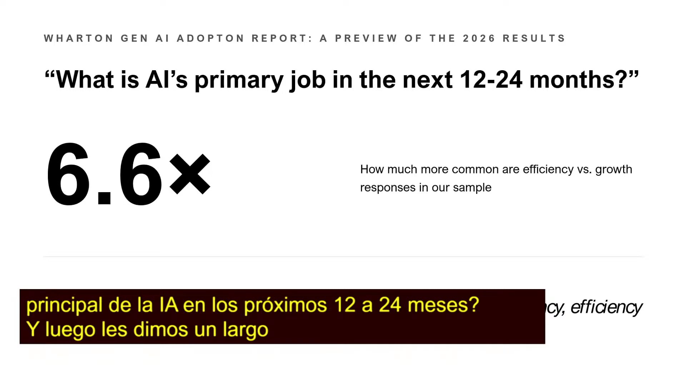
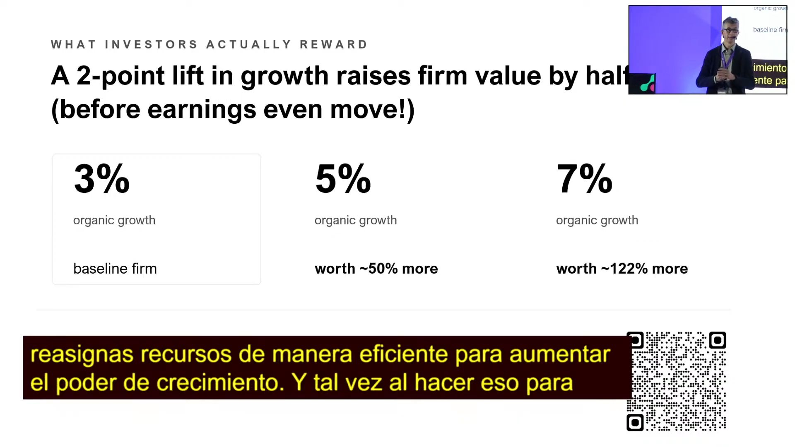
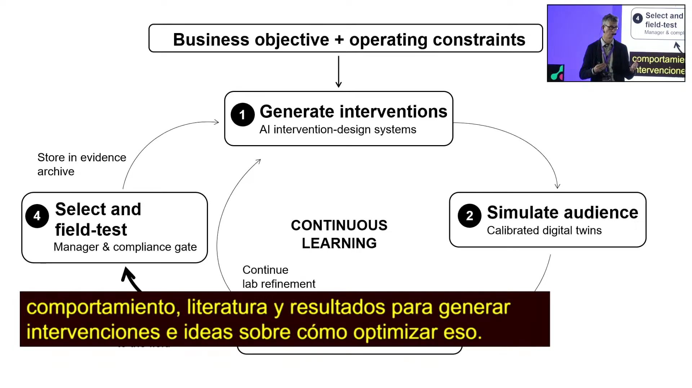
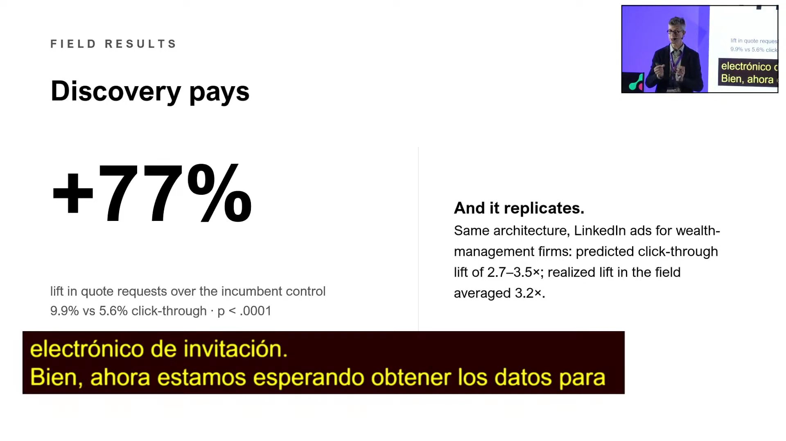
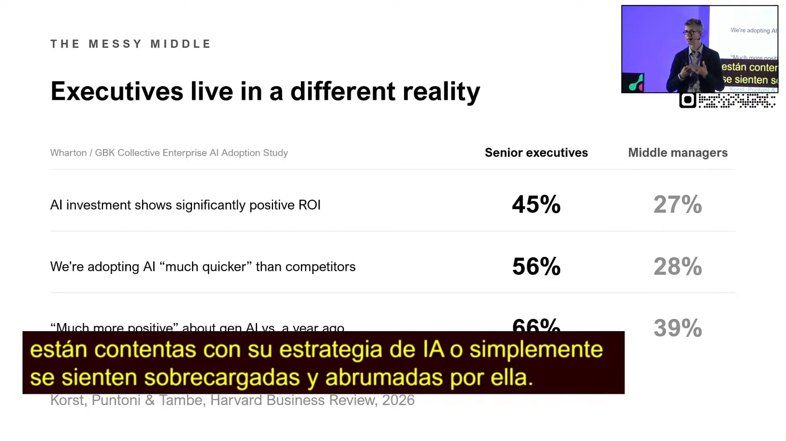
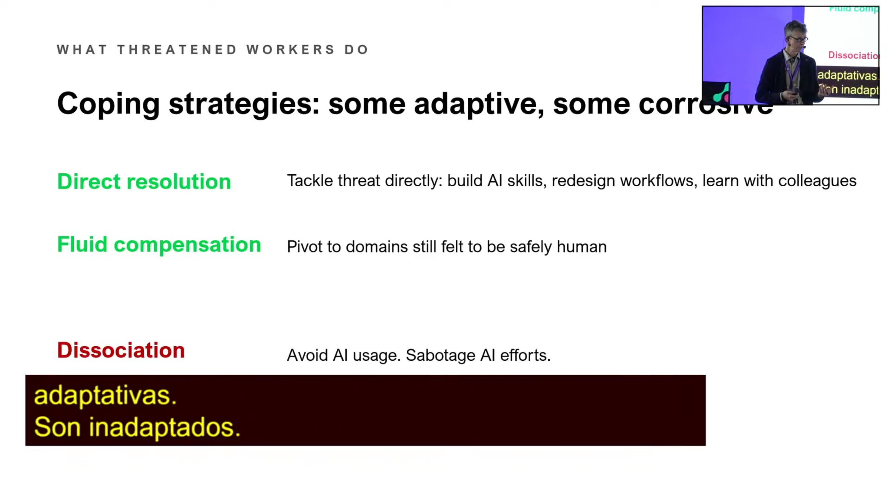
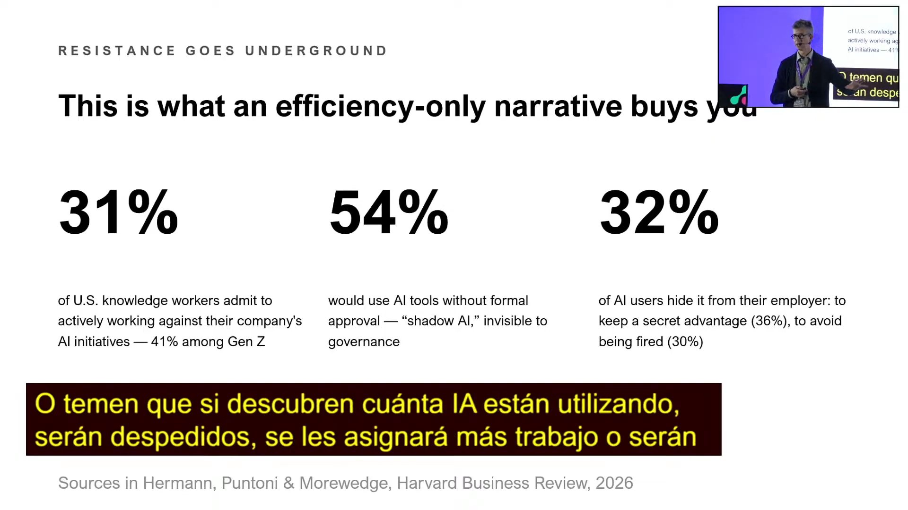
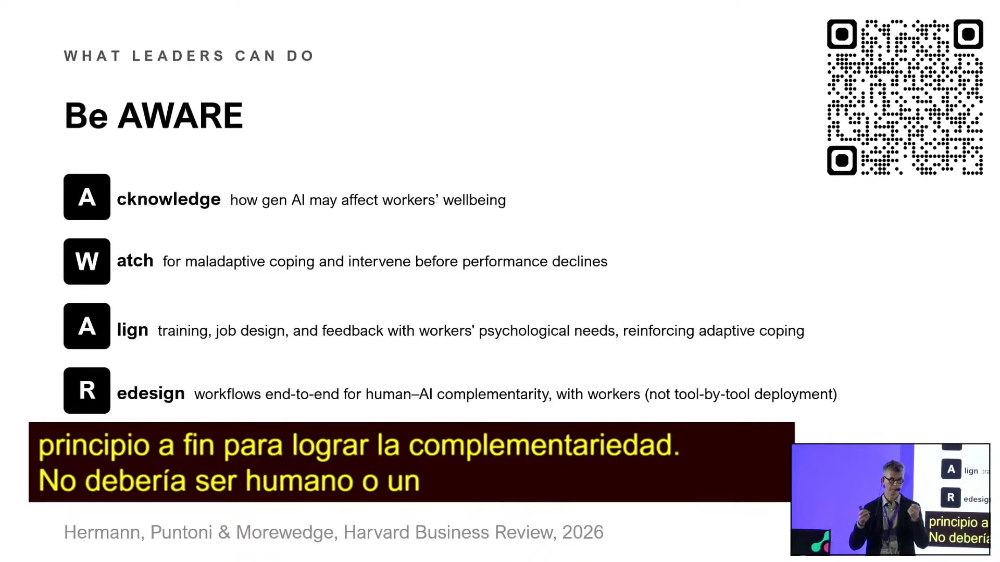

# Keynote «Against Productivity: Reaping the rewards of the AI revolution» · Impacta IA Chile 2026

Stefano Puntoni (Wharton) no está contra la productividad, sino contra que sea lo único que las empresas buscan con la IA. Esa obsesión cuesta por dos lados: hacia afuera deja pasar el crecimiento, que es donde está casi todo el valor, y hacia adentro produce ansiedad, sabotaje y uso escondido de la IA en la fuerza laboral. Su propuesta es una agenda afirmativa de IA para el crecimiento, con un «motor de descubrimiento conductual» que explora cientos de ideas con científicos y audiencias virtuales, y con una pista de personas en paralelo a la técnica en cada despliegue (el marco AWARE).

## Ficha
| | |
|---|---|
| Evento | Impacta IA Chile 2026, día 1, miércoles 2 de septiembre de 2026, Fundación Chile |
| Modera | Juan Pablo Silva, host del evento: presenta al speaker y modera las preguntas del público |
| Speakers | Stefano Puntoni, profesor de The Wharton School y director de Wharton Human-AI Research |
| Duración | 45 min (1 min de presentación del host, 34 min de keynote, 10 min de preguntas del público) |
| Idioma | inglés (keynote y las tres preguntas del público); la presentación y la moderación del host, en español, con frases en inglés para Puntoni |
| Video | [YouTube desde 4:02:18](https://www.youtube.com/watch?v=4N6I6PXycMw&t=14538s) |
| Fuente | Whisper large-v3 (coincidencia 95 % con los subtítulos del stream), voces separadas con SpeechBrain ECAPA; revisión en tres pasadas: transcripción, idioma y lo dicho mal |

## Estructura
| Capítulo | Tramo | Quién |
|---|---|---|
| Presentación del host | [00:03–01:26](https://www.youtube.com/watch?v=4N6I6PXycMw&t=14538s) | Juan Pablo Silva, host del evento |
| «Against productivity»: el sesgo hacia la eficiencia | [01:26–06:46](https://www.youtube.com/watch?v=4N6I6PXycMw&t=14621s) | Stefano Puntoni (Wharton) |
| Parte I · El punto ciego del crecimiento | [06:46–12:42](https://www.youtube.com/watch?v=4N6I6PXycMw&t=14941s) | Stefano Puntoni (Wharton) |
| De subir colinas a escalar montañas: el motor de descubrimiento conductual | [12:42–21:40](https://www.youtube.com/watch?v=4N6I6PXycMw&t=15297s) | Stefano Puntoni (Wharton) |
| Parte II · La fuerza laboral ansiosa | [21:40–26:49](https://www.youtube.com/watch?v=4N6I6PXycMw&t=15835s) | Stefano Puntoni (Wharton) |
| Estrategias de afrontamiento y el marco AWARE | [26:49–33:37](https://www.youtube.com/watch?v=4N6I6PXycMw&t=16144s) | Stefano Puntoni (Wharton) |
| Cierre: la idea clave | [33:37–35:13](https://www.youtube.com/watch?v=4N6I6PXycMw&t=16552s) | Stefano Puntoni (Wharton) |
| Preguntas del público | [35:13–45:07](https://www.youtube.com/watch?v=4N6I6PXycMw&t=16648s) | Público, Stefano Puntoni; modera el host |

## Tesis

Las empresas usan la IA casi solo para bajar costos: en la nueva ola del estudio de adopción de Wharton, las respuestas sobre eficiencia superan a las de crecimiento por siete a uno [05:29]. Puntoni lo llama «punto ciego del crecimiento» y lo ataca con aritmética: el costo solo puede bajar hasta cero [07:32], así que recortar un 10 % de la mitad de los costos sube el valor de la firma un 10 %, mientras que subir dos puntos el crecimiento orgánico lo sube un 50 % [09:38]. Para crecer propone dejar de «subir colinas» con A/B testing y explorar el espacio de ideas completo con un motor de descubrimiento conductual, que en una aseguradora de vida encontró una idea que nadie había propuesto y logró casi un 80 % más de solicitudes de cotización [20:18]. El segundo costo es interno: «Leaders say efficiency, workers hear layoffs» [22:21]. Los mandos medios, donde la estrategia se vuelve implementación, son mucho menos optimistas que los ejecutivos, y la amenaza a la competencia, la autonomía y la relación empuja a la gente a afrontamientos que corroen: cerca de un tercio de los trabajadores del conocimiento en EE. UU. admite sabotear la estrategia de IA [29:35]. Un foco de crecimiento convierte a los trabajadores en socios del cambio, no en víctimas. Con solo eficiencia, la IA hace de la empresa una versión más delgada de lo que ya es; con descubrimiento, la hace mejor en lo que importa: servir a los clientes [34:32].

## Resumen

### Presentación del host [00:03–01:26]
- **Juan Pablo Silva, host del evento [00:25]: presentación.** Tras los avisos (el QR de la credencial y el link de la traducción simultánea), presenta a Puntoni en español, «I'm going to say it in Spanish, Stefano»: profesor de Wharton, director de Wharton Human-AI Research, con publicaciones en Nature Human Behaviour, Management Science y Harvard Business Review sobre cómo la automatización y la IA generativa cambian la productividad. Cuenta que Puntoni aterrizó en Chile seis horas antes y se va al día siguiente.

### «Against productivity»: el sesgo hacia la eficiencia [01:26–06:46]
- **Stefano Puntoni (Wharton) [01:26]: un título deliberadamente raro.** Agradece a Francisco y al equipo de Brinca, y adelanta dos papers que aún no se publican y que presenta por primera vez. No está contra la productividad: está contra cómo las empresas usan hoy la IA para buscarla.
- **[02:40]: la lista de programas de IA.** Si cada asistente clasificara los programas de IA de su empresa entre productividad o costos y crecimiento o innovación, la gran mayoría saldría cargada a la productividad. Lo que dicen los ejecutivos es «bajar costos, operaciones más livianas, más rápido, menos dotación». No sorprende: la IA la manejan TI y operaciones con «una buena dosis de finanzas», funciones cuyo KPI es el costo, y el roadmap de IA termina pareciendo un plan de reducción de costos.
- **[04:11]: el estudio de adopción de Wharton.** Adelanta resultados de la cuarta ola del estudio de adopción de IA generativa de Wharton, una encuesta a líderes de grandes empresas de EE. UU. que comenzó tras el lanzamiento de ChatGPT y cuyo informe sale en uno o dos meses. A la pregunta abierta por el trabajo principal de la IA en los próximos 12 a 24 meses, hay unas siete veces más menciones de productividad que de crecimiento, y solo un 10 % habla de crecimiento [05:29].
- **[05:53]: dos argumentos.** Uno externo, el punto ciego del crecimiento: enfocarse solo en eficiencia desplaza el tiempo para pensar en cómo crecer con IA. Otro interno: el énfasis en productividad genera ansiedad y hace más difícil que la gente se sume a los esfuerzos de IA.

### Parte I · El punto ciego del crecimiento [06:46–12:42]
- **Stefano Puntoni (Wharton) [06:46]: la brecha entre lo que se cree y lo que se hace.** Los ejecutivos creen que la IA es transformacional, pero la usan para hacer lo de hoy más rápido, más barato o mejor. Eso tiene un límite intrínseco: «You can drive cost only down to zero» [07:32], lo que llama «la verdad obvia».
- **[07:54]: la aritmética del valor.** Con un modelo simple de valoración (ingresos, costos y un múltiplo de las utilidades): si la IA afecta la mitad de los costos y los baja un 10 %, supuestos que él mismo llama generosos, el valor de la firma sube un 10 % en tres años, «not nothing, but it's not transformational». Si en cambio la IA lleva el crecimiento orgánico de 3 % a 5 %, buscando clientes nuevos, upselling y cross-selling, el valor sube un 50 % en tres años [09:38]. Y si se combinan las dos cosas, por ejemplo con vendedores que hacen su trabajo en el 80 % del tiempo y en vez de despedir al 20 % hacen cuatro llamadas más, y el crecimiento llega a 7 %, el valor se más que duplica. Conclusión: «if you care about the value of your firm, you've got to pursue an AI for growth agenda» [10:39].
- **[10:46]: los datos acompañan.** Una encuesta reciente de PwC a más de mil ejecutivos muestra que el 75 % del valor económico de la IA lo captura un 20 % de las empresas, las que la usan para crecer e innovar. En la encuesta de Wharton, más de un tercio de las empresas que miden la IA con métricas de crecimiento reporta un ROI fuertemente positivo, contra menos del 20 % de las que miden solo eficiencia [12:11]. Advierte que es correlación, no causalidad.

### De subir colinas a escalar montañas: el motor de descubrimiento conductual [12:42–21:40]
- **Stefano Puntoni (Wharton) [12:42]: colinas y montañas.** Aprovecha una foto de la cordillera para el cambio de mentalidad: pasar de subir colinas a escalar montañas. El A/B testing optimiza sobre lo que ya se hace (cambiar la foto, el titular, el asunto de un correo) y sube una colina chica; puede haber una mucho más alta en otra parte del espacio de ideas que nunca se miró porque las pruebas son demasiado estrechas [13:48].
- **[14:53]: cómo funciona el motor.** Parte de un objetivo de negocio ligado al crecimiento y monta un laboratorio virtual con dos componentes: científicos virtuales, modelos de lenguaje entrenados en la literatura de ciencias del comportamiento que pueden generar 500 intervenciones donde un A/B test prueba una o dos, y audiencias virtuales, gemelos digitales de clientes reales, porque 500 ideas son imposibles de probar en terreno.
- **[16:03]: gemelos calibrados y retroalimentación.** Recomienda el simulador de Brinca instalado afuera de la sala, que simula cómo responde una dotación a los mensajes sobre IA; ellos aplican la misma idea a clientes. Los gemelos se calibran con datos de la empresa hasta que reproducen las tasas históricas; después se les pueden aplicar cientos de intervenciones, porque «they never get tired, they never say no» [16:52], y además explican qué les gustó y qué no. Esa retroalimentación vuelve al científico virtual, que itera. Al final se prueba en terreno una sola idea.
- **[17:31]: el caso de una gran aseguradora de vida de EE. UU.** Quería convertir pólizas temporales en permanentes por correo. Probaron 36 variantes sobre 30.000 gemelos digitales, en seis semanas y dos rondas. La primera ronda, basada en principios como prueba social y aversión a la pérdida, mejoró poco [18:36]; los gemelos dijeron que los mensajes eran «too pushy, too salesy» [18:41]. En la segunda, los científicos virtuales propusieron un mensaje sin persuasión alguna: «revise los detalles de su cobertura».
- **[19:42]: el «empujón de verificación».** La idea no estaba en la literatura, no la habían entrenado y nadie del equipo la había propuesto. En un experimento de campo contra la campaña que la empresa llevaba años afinando, logró casi un 80 % más de solicitudes de cotización [20:18]; todavía esperan saber cuántas se convirtieron en clientes.
- **[20:38]: se replica.** Con anuncios de LinkedIn para firmas de gestión patrimonial, el laboratorio predijo unas 3 veces el rendimiento base y en terreno se obtuvo 3,2 veces. La herramienta no entrega una estimación puntual exacta, entrega dirección. Insiste en que no hay nada malo con la productividad; el problema es el foco «relentless and unique» en ella, que desplaza lo más importante.

### Parte II · La fuerza laboral ansiosa [21:40–26:49]
- **Stefano Puntoni (Wharton) [21:40]: lo que oyen los trabajadores.** Cuando un CEO anuncia en la prensa que reducirá la dotación un 20 % por la IA, crece la ansiedad y se drena el compromiso: muchos empleados van a estar felices de ver fracasar los esfuerzos de IA [22:12]. «Leaders say efficiency, workers hear layoffs» [22:21].
- **[22:30]: los ejecutivos viven en otra realidad.** En el estudio de Wharton, casi la mitad de los ejecutivos senior ve un ROI significativamente positivo, contra menos de un tercio de los mandos medios; dos tercios de los ejecutivos están mucho más positivos que hace un año, contra un 39 % de los mandos medios [23:15]. Este año sumaron trabajadores de primera línea y la tendencia empeora hacia abajo.
- **[23:36]: el problema está en el medio.** Los mandos medios son donde la estrategia de IA se convierte en implementación. Si no la entienden, no les gusta o los sobrepasa, la estrategia «will never really survive contact with reality». Manejan lo de siempre más una transformación sin manual [24:11], presionados desde arriba y desde abajo. En la primera línea es peor: según datos del Wall Street Journal [24:31], la alta dirección está entusiasmada y los trabajadores, ansiosos y sobrepasados.
- **[24:47]: tres necesidades psicológicas.** El bienestar se apoya en competencia (sentirse capaz), autonomía (sentirse en control) y relación (conexión significativa con otros). La IA puede reforzar o amenazar cada una [25:28]: amplía las capacidades (hacer una app con *vibe coding*) o te hace reemplazable; te libera del trabajo tedioso o te encierra en una «jaula algorítmica»; te deja tiempo para las personas o te aísla, como al cliente que llama a una empresa y solo encuentra un chatbot.

### Estrategias de afrontamiento y el marco AWARE [26:49–33:37]
- **Stefano Puntoni (Wharton) [26:49]: dos estrategias adaptativas.** Quien se siente amenazado por la IA reacciona de formas predecibles. La resolución directa enfrenta la amenaza: aprender IA y volverse un buen complemento de la tecnología. Cuenta que su grupo de investigación en Wharton estudia con Brinca y un cliente de Brinca el efecto, a lo largo del tiempo, de un programa de formación en IA para toda la empresa, con apoyo psicológico y técnico, sobre confianza, uso, desempeño y bienestar [27:27]. La compensación fluida es pivotar hacia la parte del trabajo que no se automatiza, como el gerente de contenidos que pasa de escribir a la estrategia del contenido [28:00].
- **[28:42]: dos estrategias que corroen.** La disociación es evitar la IA o sabotearla, usándola mal para demostrar que no sirve. El escapismo es dejar de pensar y volverse «a copy and paste machine». El trabajo del líder es subir la probabilidad de las primeras y bajar la de las segundas.
- **[29:35]: lo que compra una narrativa de solo eficiencia.** Con encuestas de terceros que revisaron en Harvard Business Review: cerca de un tercio de los trabajadores del conocimiento de EE. UU. admite sabotear la estrategia de IA (más del 40 % en la generación Z), una mayoría usa herramientas no aprobadas a escondidas (*shadow AI*) y un tercio esconde cuánto la usa, por ventaja o por miedo a que lo despidan o le carguen más trabajo. «If about a third of your employees are trying to make a program fail, that program will fail» (si un tercio de tus empleados intenta que un programa fracase, ese programa va a fracasar).
- **[30:47]: el crecimiento como antídoto, y el marco AWARE.** Un foco de crecimiento convierte a los empleados en socios de la transformación y no en sus víctimas, y eso hace más probable que los programas funcionen. Todo despliegue de IA necesita dos pistas: la técnica (ingenieros, datos, cumplimiento, proveedores) y la de personas. AWARE [32:04]: reconocer de frente cómo la IA afecta el bienestar (*acknowledge*); vigilar las señales de afrontamiento que corroe (*watch*); alinear formación, diseño de cargos y retroalimentación con lo adaptativo, por ejemplo con presupuesto para reentrenar (*align*); rediseñar los flujos de punta a punta para la complementariedad, «it shouldn't be human or AI, it should be human and AI» [32:56] (*redesign*), y dar voz a quienes hacen el trabajo, que son los verdaderos expertos (*empower*).

### Cierre: la idea clave [33:37–35:13]
- **Stefano Puntoni (Wharton) [33:37]: la obsesión cuesta.** Si lo único que importa es desplegar la IA para productividad, se pierden oportunidades de crecimiento y se crea tensión adentro. Una agenda afirmativa de IA para el crecimiento resuelve las dos cosas: no se trata de cómo deshacerse de gente sino de cómo aprovecharla al máximo. Con solo eficiencia, la IA hace de la empresa una versión más delgada de lo que ya es; con descubrimiento y crecimiento, la hace mejor en lo que importa, que es servir a los clientes [34:32].

### Preguntas del público [35:13–45:07]
- **Público [35:41]: ¿cómo se evalúa la exactitud de los gemelos digitales, si el error puede crecer con cada iteración?** Puntoni [36:11]: «the proof is in the pudding»: el último paso siempre es la prueba en terreno y hoy nada se despliega a escala sin ella. Han publicado tres artículos en Harvard Business Review sobre gemelos digitales y datos sintéticos, y el vaso está medio lleno y medio vacío: parte de los límites se irá con la práctica y parte puede ser estructural. El método [37:20]: calibrar con datos de la empresa y supuestos distribucionales (por ejemplo, cómo se reparte la aversión a la pérdida), comprobar que los gemelos reproducen los resultados de campañas pasadas y solo entonces probar ideas nuevas. El riesgo principal es el sobreajuste.
- **Público [38:49]: ¿cómo se lleva a los equipos de «human in the loop» a «human in the system»?** Puntoni [39:22]: el cambio es difícil, y quienes mejor implementan estrategias de IA probablemente son expertos en gestión del cambio. «I don't think that everybody can thrive in the world of AI» [39:34]: habrá fricción y reasignación de trabajo. La clave son las complementariedades: lo que pueden hacer los dos lo hará la IA por barata y rápida, pero quedan capacidades humanas únicas, como la confianza en la venta, y restricciones regulatorias en salud o servicios financieros. No cree en el «apocalipsis del empleo» al ritmo que anuncia Silicon Valley, que tiene un conflicto de interés porque cuenta esas historias para subir su valorización [40:52].
- **Público [41:32]: ¿cómo se implementan los científicos y las audiencias virtuales: modelo propio o prompting, y con qué datos?** Puntoni [42:15]: nadie entrena un modelo desde cero; se parte de un modelo fundacional, de pesos abiertos o uno estándar de los grandes laboratorios, y se le aportan datos, desde descripciones de cinco segmentos con supuestos distribucionales hasta datos individuales para gemelos de personas reales. Probablemente ya existen gemelos digitales de varios ejecutivos de la sala, hechos por quienes quieren venderles algo [43:15]. La evidencia académica es mixta [43:51]: información bastante precisa sobre la población, con buenos supuestos distribucionales, rinde tanto como los datos individuales, y los modelos fundacionales «know too much» [44:29] para simular a una persona real, porque se construyeron para buscar inteligencia general.

## Ideas que se llevan
1. El costo solo baja hasta cero; el crecimiento no tiene techo. En el modelo de Puntoni, dos puntos más de crecimiento orgánico valen cinco veces más que recortar un 10 % la mitad de los costos.
2. Las empresas que miden la IA con métricas de crecimiento reportan ROI fuertemente positivo casi el doble de veces que las que miden solo eficiencia, según los datos preliminares de septiembre (más de un tercio contra menos del 20 %) [12:11]. El informe publicado en octubre da 35 % contra 13 %, casi tres veces: está en el [webinar de Wharton](../../../../webinars/2026-10-20-wharton-adaptive-advantage/README.md).
3. La IA permite dejar el A/B testing incremental y explorar el espacio de ideas completo: científicos virtuales que generan cientos de intervenciones, gemelos digitales calibrados que las filtran y una sola prueba en terreno al final. La mejor idea puede ser una que nadie propuso.
4. Un discurso de eficiencia se oye como despidos. Los mandos medios, donde la estrategia se implementa, son los más escépticos, y la resistencia no desaparece: se esconde en sabotaje y *shadow AI*.
5. Cada despliegue de IA necesita una pista de personas en paralelo a la técnica: reconocer el efecto en el bienestar, vigilar el afrontamiento que corroe, alinear la formación, rediseñar para la complementariedad y dar voz a quienes hacen el trabajo (AWARE).
6. Los gemelos digitales sirven para tener dirección, no estimaciones puntuales, y nunca reemplazan la prueba en terreno.

## Frases citables
> «You can drive cost only down to zero.» (El costo solo se puede bajar hasta cero.) — Stefano Puntoni (Wharton), [07:32](https://www.youtube.com/watch?v=4N6I6PXycMw&t=14987s)

> «If you care about the value of your firm, you've got to pursue an AI for growth agenda.» (Si te importa el valor de tu empresa, tienes que seguir una agenda de IA para el crecimiento.) — Stefano Puntoni (Wharton), [10:39](https://www.youtube.com/watch?v=4N6I6PXycMw&t=15174s)

> «We really should change mindset from climbing hills to climbing mountains.» (Deberíamos cambiar la mentalidad: dejar de subir colinas y escalar montañas.) — Stefano Puntoni (Wharton), [12:50](https://www.youtube.com/watch?v=4N6I6PXycMw&t=15305s)

> «Leaders say efficiency, workers hear layoffs.» (Los líderes dicen eficiencia; los trabajadores oyen despidos.) — Stefano Puntoni (Wharton), [22:21](https://www.youtube.com/watch?v=4N6I6PXycMw&t=15876s)

> «Senior executives, I don't know if that hurts to hear this or not, but you guys live in a different reality. You don't live on the same planet as everybody else.» (Ejecutivos senior, no sé si les duele oírlo, pero ustedes viven en otra realidad. No viven en el mismo planeta que el resto.) — Stefano Puntoni (Wharton), [22:30](https://www.youtube.com/watch?v=4N6I6PXycMw&t=15885s)

> «Your job as leaders is not to make human intelligence replaced and obsolete. It's to optimize the collective intelligence of the organization. Intelligence from silicon, but also intelligence from carbon.» (Su trabajo como líderes no es reemplazar la inteligencia humana y volverla obsoleta, sino optimizar la inteligencia colectiva de la organización: la del silicio, pero también la del carbono.) — Stefano Puntoni (Wharton), [33:01](https://www.youtube.com/watch?v=4N6I6PXycMw&t=16516s)

> «If you focus only on efficiency, AI will make your company a leaner version of what it is already today.» (Si te enfocas solo en la eficiencia, la IA hará de tu empresa una versión más delgada de lo que ya es.) — Stefano Puntoni (Wharton), [34:32](https://www.youtube.com/watch?v=4N6I6PXycMw&t=16607s)

> «This job apocalypse that everybody is talking about, honestly, I don't see this happening at the scale and speed that people in Silicon Valley say will.» (Este apocalipsis del empleo del que todos hablan, honestamente, no lo veo ocurrir a la escala y la velocidad que dice la gente de Silicon Valley.) — Stefano Puntoni (Wharton), [40:52](https://www.youtube.com/watch?v=4N6I6PXycMw&t=16987s)

## Imágenes notables

Puntoni proyectó su presentación y el stream la mostró a pantalla completa. Todas las capturas tienen encima la banda de subtítulos en español de la traducción simultánea, abajo a la izquierda, y casi todas un recuadro con el expositor en una esquina; el contenido de la slide se lee completo salvo donde se indica.

*«What is AI's primary job in the next 12-24 months?»: en la nueva ola del estudio de Wharton, las respuestas sobre eficiencia son 6,6 veces más comunes que las de crecimiento · presentada por Stefano Puntoni (Wharton) · [05:03](https://www.youtube.com/watch?v=4N6I6PXycMw&t=14838s)*

*«A 2-point lift in growth raises firm value by half (before earnings even move!)»: con 5 % de crecimiento orgánico la firma vale un 50 % más que con 3 %, y con 7 %, un 122 % más · presentada por Stefano Puntoni (Wharton) · [09:06](https://www.youtube.com/watch?v=4N6I6PXycMw&t=15081s)*

*El ciclo del motor de descubrimiento conductual: objetivo de negocio, generar intervenciones, simular la audiencia con gemelos calibrados y seleccionar y probar en terreno, con aprendizaje continuo al centro. La banda de subtítulos tapa el paso 3 · presentada por Stefano Puntoni (Wharton) · [14:56](https://www.youtube.com/watch?v=4N6I6PXycMw&t=15431s)*

*«Discovery pays»: +77 % de solicitudes de cotización frente a la campaña de control de la aseguradora (9,9 % contra 5,6 % de clics, p < 0,0001), y la réplica en LinkedIn para gestión patrimonial (predicción de 2,7 a 3,5 veces; 3,2 veces en terreno) · presentada por Stefano Puntoni (Wharton) · [20:19](https://www.youtube.com/watch?v=4N6I6PXycMw&t=15754s)*

*«Executives live in a different reality»: ejecutivos senior contra mandos medios en el estudio Wharton/GBK Collective (ROI significativamente positivo, 45 % contra 27 %; adopción «mucho más rápida» que la competencia, 56 % contra 28 %; «mucho más positivos» que hace un año, 66 % contra 39 %). Fuente en la slide: Korst, Puntoni y Tambe, Harvard Business Review, 2026 · presentada por Stefano Puntoni (Wharton) · [22:29](https://www.youtube.com/watch?v=4N6I6PXycMw&t=15884s)*

*«Coping strategies: some adaptive, some corrosive»: resolución directa, compensación fluida y disociación; la cuarta fila, que por la charla sería el escapismo, queda bajo la banda de subtítulos · presentada por Stefano Puntoni (Wharton) · [26:49](https://www.youtube.com/watch?v=4N6I6PXycMw&t=16144s)*

*«This is what an efficiency-only narrative buys you»: 31 % de los trabajadores del conocimiento de EE. UU. admite trabajar en contra de las iniciativas de IA de su empresa (41 % en la generación Z), 54 % usaría herramientas sin aprobación (*shadow AI*) y 32 % esconde que usa IA. Fuente: Hermann, Puntoni y Morewedge, Harvard Business Review, 2026 · presentada por Stefano Puntoni (Wharton) · [29:35](https://www.youtube.com/watch?v=4N6I6PXycMw&t=16310s)*

*«Be AWARE»: el marco para los líderes (Acknowledge, Watch, Align, Redesign; la quinta fila, la E de Empower que él explica, queda bajo la banda de subtítulos). Fuente: Hermann, Puntoni y Morewedge, Harvard Business Review, 2026 · presentada por Stefano Puntoni (Wharton) · [31:18](https://www.youtube.com/watch?v=4N6I6PXycMw&t=16413s)*

## Menciones a Brinca
- [01:38](https://www.youtube.com/watch?v=4N6I6PXycMw&t=14633s) Puntoni agradece «to Francisco and the team at Brinca» por traerlo a Chile.
- [16:03](https://www.youtube.com/watch?v=4N6I6PXycMw&t=15498s) Recomienda probar el simulador que Brinca instaló afuera de la sala, que simula cómo responde una dotación a los mensajes sobre IA: «a wonderful example… put together by our friends at Brinca».
- [27:27](https://www.youtube.com/watch?v=4N6I6PXycMw&t=16182s) Cuenta que su grupo de investigación en Wharton estudia «together with Brinca and one of their clients» el efecto de un programa de formación en IA para toda una empresa sobre confianza, uso, desempeño y bienestar.

## Archivos
- `transcripcion.md`: el texto completo, revisado y limpio, por turnos.
- `imagenes/`: las imágenes notables.

## Conexiones

- `reencuadra` [Charla «El ROI real de la IA»](../dia1-04-charla-roi-real-ia-impacto-rentabilidad-negocio/README.md) · [27:39] · Edmundo Casas (Kauel) muestra el ROI de la IA sobre todo como eficiencia (en ENAP, 500 % más de productividad y 48 % menos de costos) y deja como ejemplo de impacto directo el litio, donde, según su cálculo, bajar el error de estimación del 20 % al 1 % subiría la facturación de un productor como Soquimich en torno a un 19 %. Con la aritmética de Stefano Puntoni (Wharton), en que recortar costos sube el valor de la firma un 10 % y dos puntos más de crecimiento lo suben un 50 %, ese ejemplo, que mueve ingresos, vale más que los ahorros de inspección que Casas pone al frente.

## Referido por

<!-- AUTO-GENERADO por metodo/grafo/grafo.py · no editar a mano · el «por qué» vive en el origen (## Conexiones) -->

- `confirma` ← [The Quiet Reckoning for Leaders: What Remains When AI Peels Back the Rest](../dia1-07-keynote-quiet-reckoning-leaders-what-remains-when-ai-peels-back-rest/README.md)
- `confirma` ← [Sociedad del futuro: de la escasez a la abundancia](../dia1-08-panel-sociedad-futuro-escasez-abundancia/README.md)
- `analogo-a` ← [IA Industrial, gemelos digitales y logística](../dia2-04-panel-ia-industrial-gemelos-digitales-logistica/README.md)
- `sostiene`, `sustituye-a` ← [The Adaptive Advantage: Who's Winning With AI and How](../../../../webinars/2026-10-20-wharton-adaptive-advantage/README.md)
