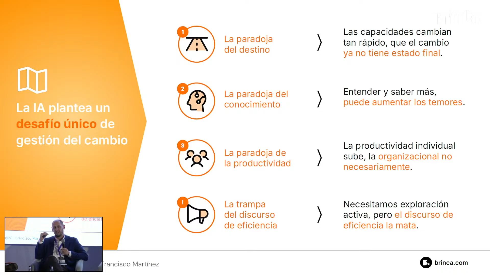
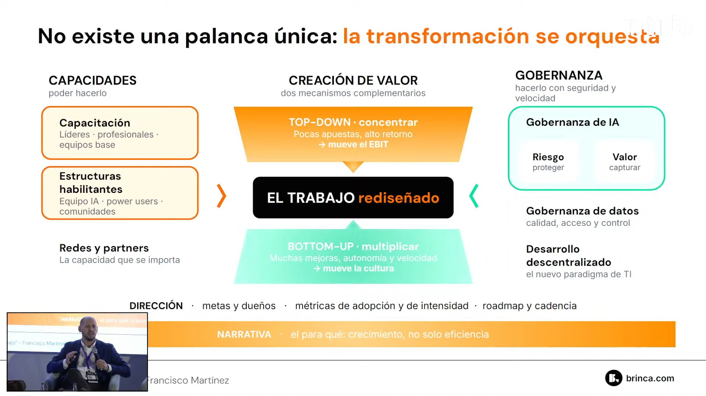
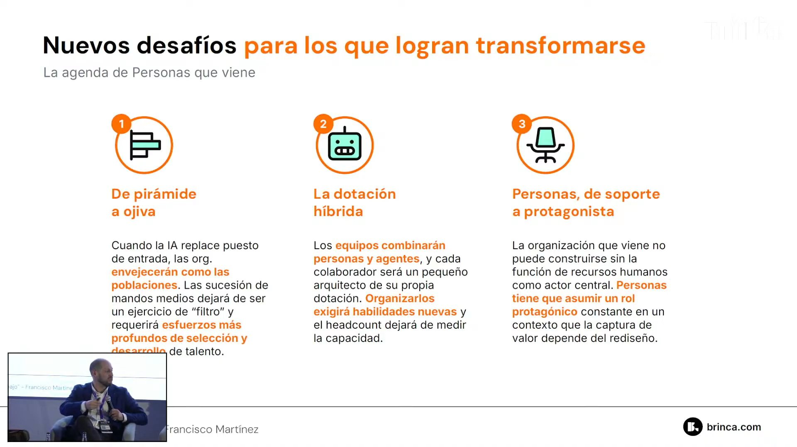
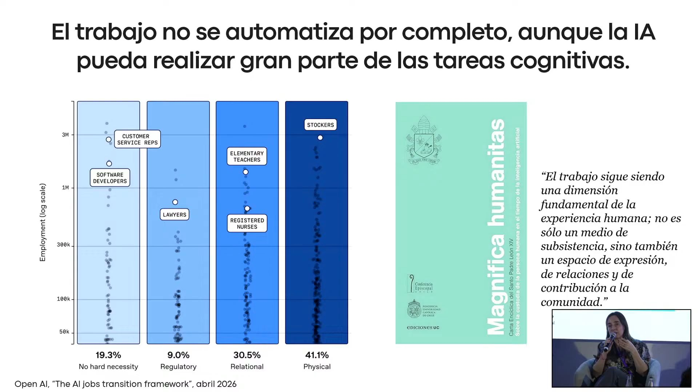
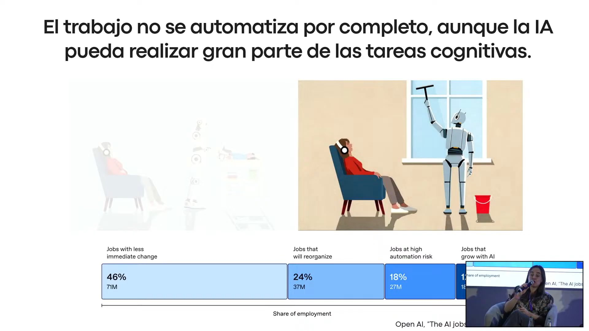
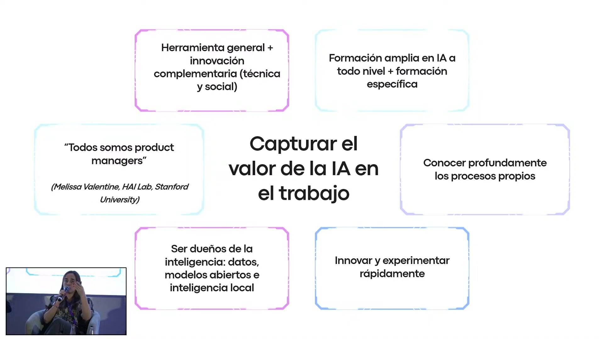
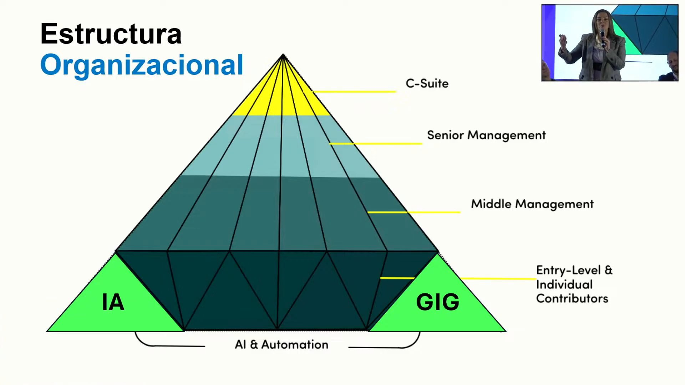
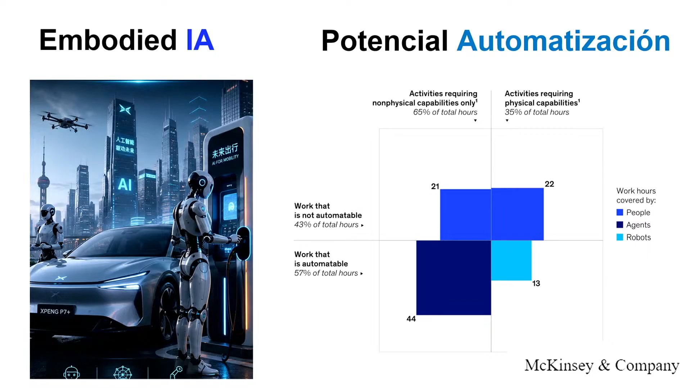
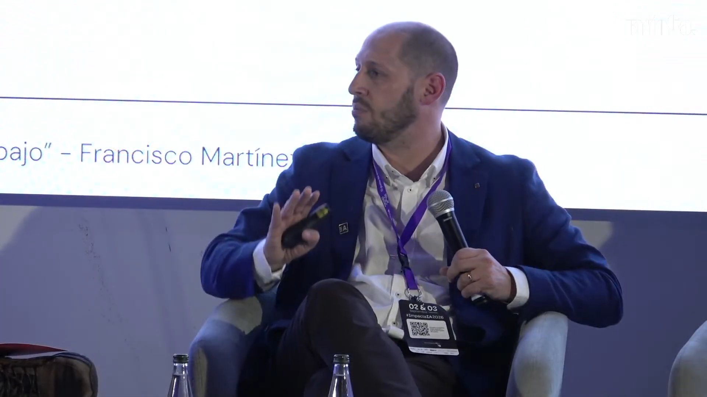

# Panel «El Futuro del Trabajo con IA: impacto en personas y gestión del cambio» · Impacta IA Chile 2026

Los tres panelistas descartan tanto el fin del trabajo como la idea de que nada cambia: la IA no reemplaza los trabajos de golpe, pero los reorganiza y vacía la base de la pirámide organizacional. Francisco Martínez plantea que esto exige una gestión del cambio distinta a todas las anteriores, sin estado final y que no se resuelve con una sola palanca. Paula Aguirre (UC) separa lo que la IA puede hacer de lo que de verdad se automatiza, y Denisse Goldfarb (The People Future) pregunta quién formará a los mandos medios si desaparecen los cargos de entrada.

## Ficha
| | |
|---|---|
| Evento | Impacta IA Chile 2026, día 1, miércoles 2 de septiembre de 2026, Fundación Chile |
| Modera | Patricio Millar, director de empresas y especialista en recursos humanos (organización sin confirmar) |
| Speakers | Francisco Martínez, socio fundador y gerente de Estrategia, Innovación y Cultura de Brinca · Paula Aguirre, vicerrectora de Inteligencia Digital de la Pontificia Universidad Católica de Chile y doctora en astrofísica · Denisse Goldfarb, CEO de The People Future, ex vicepresidenta de Personas de Walmart y de Microsoft |
| Duración | 44 min (4 min de presentación, 6 min de exposición de Francisco Martínez, 8 min de exposición de Paula Aguirre, 13 min de ronda de escenarios con 2 min de problemas técnicos, 7 min de exposición de Denisse Goldfarb y 5 min de recomendaciones finales y cierre) |
| Idioma | español |
| Video | [YouTube desde 6:19:56](https://www.youtube.com/watch?v=4N6I6PXycMw&t=22796s) |
| Fuente | Whisper large-v3 (coincidencia 92,2 % con los subtítulos del stream), voces separadas con SpeechBrain ECAPA; revisión en tres pasadas: transcripción, idioma y lo dicho mal |

## Estructura
| Capítulo | Tramo | Quién |
|---|---|---|
| Presentación del panel | [00:06](https://www.youtube.com/watch?v=4N6I6PXycMw&t=22796s)–03:52 | Juan Pablo Silva, host del evento; Patricio Millar |
| Exposición de Francisco Martínez: un desafío único de gestión del cambio | [03:52](https://www.youtube.com/watch?v=4N6I6PXycMw&t=23022s)–09:42 | Francisco Martínez (Brinca) |
| Exposición de Paula Aguirre: el trabajo no desaparece, se transforma | [09:42](https://www.youtube.com/watch?v=4N6I6PXycMw&t=23372s)–17:55 | Paula Aguirre (UC) |
| Ronda de escenarios: el más positivo y el más negativo | [17:55](https://www.youtube.com/watch?v=4N6I6PXycMw&t=23865s)–31:18 | Francisco Martínez, Denisse Goldfarb y Paula Aguirre, tras una pausa técnica |
| Exposición de Denisse Goldfarb: fuerza de trabajo humana y digital | [31:18](https://www.youtube.com/watch?v=4N6I6PXycMw&t=24668s)–38:40 | Denisse Goldfarb (The People Future) |
| Recomendación final de cada panelista y cierre | [38:40](https://www.youtube.com/watch?v=4N6I6PXycMw&t=25110s)–43:34 | los tres panelistas; Patricio Millar; el host |

## Tesis

El trabajo no se va a acabar, pero tampoco se va a quedar igual. Los tres panelistas se ubican en el centro entre el apocalipsis laboral y la abundancia: Paula Aguirre muestra que, aunque la IA puede hacer gran parte de las tareas cognitivas, solo cerca del 18 % de los empleos está en riesgo de automatización muy alto [14:19], y Denisse Goldfarb insiste en que el potencial de reemplazo tecnológico no es lo mismo que lo que ocurre en la realidad [25:24]. Lo urgente, entonces, es organizacional y humano. Francisco Martínez sostiene que la IA plantea un desafío de gestión del cambio único: el destino cambia cada cuatro o seis meses, saber más a veces aumenta el miedo y la productividad individual no se traduce en productividad de la empresa [04:30]; por eso no hay una palanca, sino que hay que orquestar varias a la vez [07:28]. Para él, el futuro apocalíptico del que hay que preocuparse es el de una mala adopción que deje un trabajo más precario y con menos sentido [22:18]. Denisse Goldfarb y la lámina de Francisco Martínez coinciden en un mismo efecto: la base de la pirámide se reduce [09:22] [33:57], y con ella el lugar donde se formaban los futuros líderes. Paula Aguirre agrega el riesgo intelectual: que deleguemos las capacidades cognitivas y dejemos de pensar [30:24]. El cierre converge en diagnosticar, formar y repartir el trabajo entre lo humano, lo asistido y lo automatizado.

## Resumen

### Presentación del panel [00:06–03:52]
- **Juan Pablo Silva, host del evento [00:06]: la brecha cultural.** La tecnología avanza más rápido que las organizaciones; el panel tratará esa brecha, el rediseño de los roles y la gestión del cambio en personas a las que se les pide hacer su trabajo de otra manera. Menciona la entrevista de Elon Musk en *The Economist*.
- **Patricio Millar [01:37]: opiniones del extranjero, voces locales.** Recuerda el «apocalipsis laboral» que mencionó Stefano Puntoni en la mañana y un ensayo de Bill Gates del 27 de agosto sobre la falta de plan frente a la IA, que la describe como «el período más turbulento de la historia humana». Da cuatro minutos a cada panelista.

### Exposición de Francisco Martínez: un desafío único de gestión del cambio [03:52–09:42]
- **Francisco Martínez (Brinca) [03:52]: un desafío único.** Habla desde su práctica: la gestión del cambio asociada a la transformación de IA en empresas grandes. No sabe si es el cambio más revolucionario de la humanidad, pero sí que es un desafío de gestión del cambio distinto a los anteriores, por tres paradojas y una «trampita» [04:30] (ver la imagen 1).
- **[04:40]: la paradoja del destino.** La gestión del cambio clásica lleva de un estado actual a un estado futuro conocido. Con la IA, la visión del futuro del trabajo cambia cada cuatro o seis meses, así que se gestiona el cambio sin saber a dónde se quiere llegar.
- **[05:21]: la paradoja del conocimiento.** Antes, más conocimiento de la herramienta reducía el miedo. Con la IA ocurre lo contrario: quien más sabe descubre más capacidades y entiende que podría reemplazarlo. Dice que no lo había visto antes.
- **[05:56]: la paradoja de la productividad.** Cuando las personas se vuelven más productivas individualmente, muchas veces no se ve un cambio en la productividad de la empresa, y es difícil gestionar un cambio cuya promesa de valor no se cumple de inmediato.
- **[06:34]: la trampa del discurso de eficiencia.** Retomando a Stefano Puntoni, advierte que abordar la adopción con un discurso de eficiencia «mata las neuronas creativas de las personas», cuando lo que se necesita es una actitud de descubrimiento, difícil de tener si uno se siente amenazado.
- **[07:14]: no hay palanca única.** A un gerente que le pidió la palanca que debía mover, le respondió que no la conoce: los procesos de transformación compleja consisten en orquestar el cambio, activar varias palancas a la vez, de manera coherente y en una dirección. Mover tres o cuatro palancas al 50 % tiene más efecto que mover una al 100 % [08:11].
- **[08:30]: orquestar con foco en el valor.** Presenta una lámina con capacidades, creación de valor y gobernanza (imagen 2). Lo que hay que articular es que aparezcan los grandes proyectos transformacionales, que suelen descubrirse de arriba hacia abajo, y a la vez crear condiciones de gobernanza y de conocimiento para que las personas creen y descubran valor desde abajo; sin esos espacios *bottom-up*, difícilmente participarán del cambio [09:08].
- **[09:18]: lo que viene para Personas.** Al cortar por tiempo, deja planteado que las empresas que logren transformarse enfrentarán desafíos inéditos para la gestión de personas. Su lámina (imagen 3) los nombra, aunque no alcanzó a explicarlos: de pirámide a ojiva, la dotación híbrida de personas y agentes, y Personas como protagonista.

### Exposición de Paula Aguirre: el trabajo no desaparece, se transforma [09:42–17:55]
- **Paula Aguirre (UC) [09:52]: lo que trajo de Silicon Valley.** Vuelve de una misión de una delegación chilena al ecosistema de IA de Silicon Valley. Frente a la tesis de Elon Musk de que el trabajo desaparecerá en una época de abundancia infinita, se convenció de que no ocurrirá así.
- **[11:14]: la exposición no basta.** Con el marco de OpenAI (*The AI jobs transition framework*, ver imagen 4), explica que cuánto de un trabajo se puede automatizar es solo un factor: también pesan la regulación (los abogados), la necesidad humana de relación (enfermeras, profesores) y el trabajo físico, donde la IA física aún no llega.
- **[12:28]: qué formar en la universidad.** Esos factores orientan dónde poner el foco de formación de los futuros profesionales. Y como universidad católica, la pregunta también es qué es deseable y no solo qué es posible: cita la encíclica *Magnifica humanitas* de León XIV sobre el sentido del trabajo como experiencia de desarrollo personal y de comunidad [13:33].
- **[14:19]: 18 % en riesgo muy alto.** Solo cerca del 18 % de los trabajos está en riesgo muy alto de automatización; una parte importante puede incluso crecer con la IA, y muchos se reorganizarán o cambiarán en forma no inmediata (imagen 5).
- **[14:50]: capturar el valor.** El desafío es pasar de la productividad personal al valor para la organización (imagen 6): la IA es una herramienta general que necesita innovación complementaria, técnica y social, como la electricidad necesitó ampolletas, cables y motores; requiere formación amplia y también específica de cada disciplina.
- **[16:07]: todos somos *product managers*.** Del HAI Lab de Stanford rescata la idea de que todos debemos ser una especie de *product manager*, revisando constantemente un proceso que conocemos en detalle. Por eso la capa disciplinar sigue siendo clave: el abogado tiene que conocer a fondo su ámbito para innovar con IA.
- **[17:04]: ser dueños de la inteligencia.** Chile no es dueño de los grandes modelos, pero puede apropiárselos combinándolos con datos locales, modelos abiertos, ojalá infraestructura propia y, sobre todo, conocimiento profundo del entorno, para no depender del modelo de turno ni de que «nos corten la llave».

### Ronda de escenarios: el más positivo y el más negativo [17:55–31:18]
- Tras dos minutos de problemas técnicos con la presentación de Denisse Goldfarb [18:14], el moderador adelanta la pregunta: ¿cómo se imaginan el futuro del trabajo, en su escenario más positivo y en el más negativo? [20:32]
- **Francisco Martínez [21:11]: el apocalipsis que importa.** Cree que las opiniones moderadas son probablemente las más correctas: ni el fin del trabajo ni mucho trabajo nuevo. Lo que hay que preguntarse es el rol de nuestra humanidad en el trabajo: ve riesgos fuertes de desindividuación y de un trabajo deshumanizado por una mala adopción. Ese es el futuro apocalíptico del que preocuparse de inmediato: un trabajo más precario, con menos sentido y que cueste más a nivel personal [22:18].
- **Denisse Goldfarb [22:49]: cuatro escenarios.** Una matriz cruza el avance de la tecnología con la velocidad a la que las personas desarrollan habilidades. Lo mejor es mucha tecnología con personas que avanzan al mismo ritmo, con *power skills*; lo segundo, el escenario del *copilot*; lo peor, mucha tecnología sin desarrollo de las personas, con altísimo desempleo. Cita la predicción de Roman Yampolskiy de un 99 % de desempleo, que ella ubica en 2030 [24:17] (dijo 2027; ver la nota de la transcripción). Dice que «marea» tanta información radicalmente opuesta, como la abundancia de Peter Diamandis y Elon Musk o la semana laboral de dos días que anticipa Bill Gates.
- **[25:24]: potencial no es realidad.** Que la tecnología pueda hacer una tarea no significa que reemplace el cargo: al cliente que genera el 60 % de los ingresos no se lo atiende con un chatbot, y a la economía no le conviene un desempleo masivo, porque se frena. No cree en el ingreso básico universal, que le parece «muy subsidiarista».
- **[26:57]: el caso de China.** Visitó China en mayo: el país lidera 66 de 74 tecnologías de frontera (dijo 69; la cifra del ASPI es 66), y por su problema demográfico, una generación que no nació por la política del hijo único, impulsa robots humanoides para el cuidado y el hogar, que «salieron de la fábrica» al mundo real.
- **Paula Aguirre [28:14]: lo mejor y lo peor del conocimiento.** Lo más positivo: resolver problemas pivotales para la humanidad, como medicamentos, terapias o la fusión nuclear, y una colaboración interdisciplinaria mucho más fácil, porque la IA permite entrar rápido en otros mundos. Lo más negativo: que deleguemos todas nuestras capacidades cognitivas y dejemos de pensar, algo que «desvela» a la universidad [30:24].

### Exposición de Denisse Goldfarb: fuerza de trabajo humana y digital [31:18–38:40]
- **Denisse Goldfarb [31:35]: equipos que ya no son 100 % humanos.** Los equipos combinan fuerza de trabajo humana y digital, con asistentes y ahora agentes, y no hay manual. Cita la predicción de Dario Amodei (Anthropic), que fue vicepresidente de investigación de OpenAI (dijo «socio»), de que la IA eliminará la mitad de los cargos de entrada [32:48]; ella no cree que llegue al 50 %, pero sí que algo impactará.
- **[33:27]: de pirámide a diamante.** La base ancha de la organización se reduce por la IA, la automatización y la economía *gig* (trabajo por horas, fraccional o para varios empleadores), y la estructura toma forma de diamante (imagen 7).
- **[34:56]: ¿quién formará a los mandos medios?** Todos empezaron como «analista pelao», cometiendo los primeros errores con un jefe que les enseñaba. Si hay menos roles de entrada, ¿cómo se suplirá esa experiencia?
- **[35:27]: *Embodied AI*.** La IA sale de los computadores al mundo físico: robots humanoides, drones de *delivery*, autos autónomos. Con un estudio de McKinsey (imagen 8) separa potencial técnico de realidad: del 65 % de las horas de trabajo que son cognitivas, 44 puntos ya se podrían automatizar; del 35 % físico, 13 puntos [36:49].
- **[37:26]: lo que está bajo nuestro control.** Adaptabilidad, aprendizaje permanente, liderazgo e influencia (que todos deben ejercer, no solo el jefe) y creatividad humana.

### Recomendación final de cada panelista y cierre [38:40–43:34]
- **Francisco Martínez [39:26]: partir por entender.** Hacer un diagnóstico profundo de cómo la empresa está viviendo la IA hoy, porque hay un gran desconocimiento de cómo la gente la usa y la enfrenta, y muchas realidades distintas dentro de cada organización.
- **Paula Aguirre [39:54]: diagnosticar, enseñar y nivelar.** Coincide con Francisco Martínez y agrega formar: una base común sobre cómo funciona la IA y por qué mirarla con ojos críticos, más una capa profunda según el rol. Lo mismo con las herramientas, pese a que el acceso es caro y cambiante.
- **Denisse Goldfarb [41:15]: tres maneras de hacer el trabajo.** Identificar lo que debe seguir siendo 100 % humano (feedback, inspirar, crear, conectar), lo que se hace con la tecnología (informes, análisis, con criterio humano) y lo repetitivo, que ojalá automaticen agentes para devolver tiempo. Estudiar y aprender seguirá siendo 100 % humano [42:39].

## Ideas que se llevan
1. La IA reorganiza el trabajo más que eliminarlo: lo que puede hacer la tecnología no es lo mismo que lo que se automatiza en la realidad (Aguirre, Goldfarb).
2. Gestionar el cambio con IA es distinto: no hay estado final, saber más puede dar más miedo y la productividad individual no llega sola a la empresa; el discurso de eficiencia mata la exploración (Martínez).
3. No hay una palanca: hay que orquestar varias a la vez, proyectos transformacionales de arriba y descubrimiento de valor desde abajo (Martínez).
4. La base de la pirámide se reduce; el desafío de Personas es formar a los futuros mandos medios sin los cargos de entrada que los formaban (Goldfarb; lámina de Martínez).
5. El riesgo a vigilar es humano: un trabajo deshumanizado por una mala adopción y personas que dejan de pensar (Martínez, Aguirre).
6. Para empezar: diagnosticar cómo se vive hoy la IA, formar en capas y separar lo humano, lo asistido y lo automatizable (los tres).

## Frases citables
> «Cuando la gente más sabe de inteligencia artificial, a veces le genera más ansiedad y más miedo, porque descubren más capacidades de la herramienta y empiezan a entender que quizás podría reemplazarlos.» — Francisco Martínez (Brinca), [05:37](https://www.youtube.com/watch?v=4N6I6PXycMw&t=23127s)

> «Los procesos de transformación no tienen una palanca única, y los procesos de transformación compleja consisten en orquestar el cambio.» — Francisco Martínez (Brinca), [07:34](https://www.youtube.com/watch?v=4N6I6PXycMw&t=23244s)

> «No un futuro apocalíptico en el que se va a terminar el trabajo, sino un futuro apocalíptico en el que la mala adopción de inteligencia artificial nos lleva a un trabajo más precario, a un trabajo con menos sentido y a un trabajo que nos cueste más a nivel personal.» — Francisco Martínez (Brinca), [22:18](https://www.youtube.com/watch?v=4N6I6PXycMw&t=24128s)

> «El escenario más negativo que veo es que efectivamente deleguemos todas nuestras capacidades cognitivas en la inteligencia artificial y simplemente dejemos de pensar.» — Paula Aguirre (UC), [30:25](https://www.youtube.com/watch?v=4N6I6PXycMw&t=24615s)

> «Nuestros equipos dejaron hace un rato de ser 100 % humanos.» — Denisse Goldfarb (The People Future), [31:34](https://www.youtube.com/watch?v=4N6I6PXycMw&t=24684s)

> «¿Cómo vamos a formar a los futuros líderes? ¿Quiénes van a ser los mandos medios si cada vez hay menos roles de entrada?» — Denisse Goldfarb (The People Future), [34:56](https://www.youtube.com/watch?v=4N6I6PXycMw&t=24886s)

> «Estudiar y aprender va a seguir siendo una función 100 % humana.» — Denisse Goldfarb (The People Future), [42:39](https://www.youtube.com/watch?v=4N6I6PXycMw&t=25349s)

## Imágenes notables

Todas se vieron a pantalla completa en el stream, con un recuadro de cámara en una esquina. No se incluyen la portada de Denisse Goldfarb («Fuerza de trabajo Digital / Fuerza de trabajo Humana», que solo se vio en la pantalla del escenario), su lámina con la cita de Dario Amodei, la imagen de *Embodied AI* sin datos ni la del ojo con las habilidades (adaptabilidad, liderazgo e influencia, aprendizaje permanente, creatividad), porque su contenido ya está en el texto.

*«La IA plantea un desafío único de gestión del cambio» (tres paradojas y la trampa del discurso de eficiencia) · presentada por Francisco Martínez (Brinca) · [04:20](https://www.youtube.com/watch?v=4N6I6PXycMw&t=23050s)*

*«No existe una palanca única: la transformación se orquesta» (capacidades, creación de valor top-down y bottom-up, gobernanza, dirección y narrativa) · presentada por Francisco Martínez (Brinca) · [07:35](https://www.youtube.com/watch?v=4N6I6PXycMw&t=23245s)*

*«Nuevos desafíos para los que logran transformarse: la agenda de Personas que viene» · presentada por Francisco Martínez (Brinca) · [09:22](https://www.youtube.com/watch?v=4N6I6PXycMw&t=23352s)*

*«El trabajo no se automatiza por completo, aunque la IA pueda realizar gran parte de las tareas cognitivas» (marco de OpenAI, encíclica *Magnifica humanitas*) · presentada por Paula Aguirre (UC) · [13:45](https://www.youtube.com/watch?v=4N6I6PXycMw&t=23615s)*

*Proporción del empleo según el cambio esperado (46 % con cambios menos inmediatos, 24 % que se reorganizará, 18 % en alto riesgo de automatización; el recuadro de cámara tapa el último segmento) · presentada por Paula Aguirre (UC) · [14:07](https://www.youtube.com/watch?v=4N6I6PXycMw&t=23637s)*

*«Capturar el valor de la IA en el trabajo» · presentada por Paula Aguirre (UC) · [14:47](https://www.youtube.com/watch?v=4N6I6PXycMw&t=23677s)*

*«Estructura Organizacional»: la IA y la economía *gig* recortan la base de la pirámide · presentada por Denisse Goldfarb (The People Future) · [33:34](https://www.youtube.com/watch?v=4N6I6PXycMw&t=24804s)*

*«Potencial Automatización» (McKinsey & Company): horas de trabajo automatizables y no automatizables, cognitivas y físicas · presentada por Denisse Goldfarb (The People Future) · [36:12](https://www.youtube.com/watch?v=4N6I6PXycMw&t=24962s)*

*«…bajo» – Francisco Martínez · lámina de cierre presentada por Francisco Martínez (Brinca) · [09:38](https://www.youtube.com/watch?v=4N6I6PXycMw&t=23368s) · parcial: el stream solo la muestra de fondo, detrás de él, y se lee solo el final.*

## Menciones a Brinca
- [01:07](https://www.youtube.com/watch?v=4N6I6PXycMw&t=22857s) El host presenta a Francisco Martínez como «socio fundador y gerente de Estrategia, Innovación y Cultura en Brinca».
- [03:44](https://www.youtube.com/watch?v=4N6I6PXycMw&t=23014s) El moderador da la palabra a Francisco Martínez como «dueño de casa» (en el tramo resumido).
- [04:20](https://www.youtube.com/watch?v=4N6I6PXycMw&t=23050s) Las tres láminas de Francisco Martínez llevan su nombre y el logo de brinca.com.
- [39:54](https://www.youtube.com/watch?v=4N6I6PXycMw&t=25184s) Paula Aguirre parte su recomendación final diciendo que está de acuerdo con el punto de Francisco Martínez.

## Archivos
- `transcripcion.md`: el texto completo, revisado y limpio, por turnos.
- `imagenes/`: las imágenes notables.
