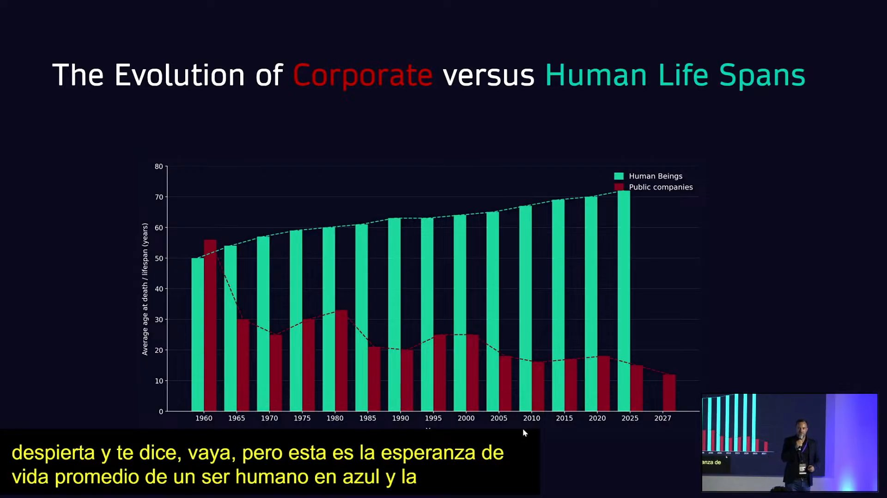
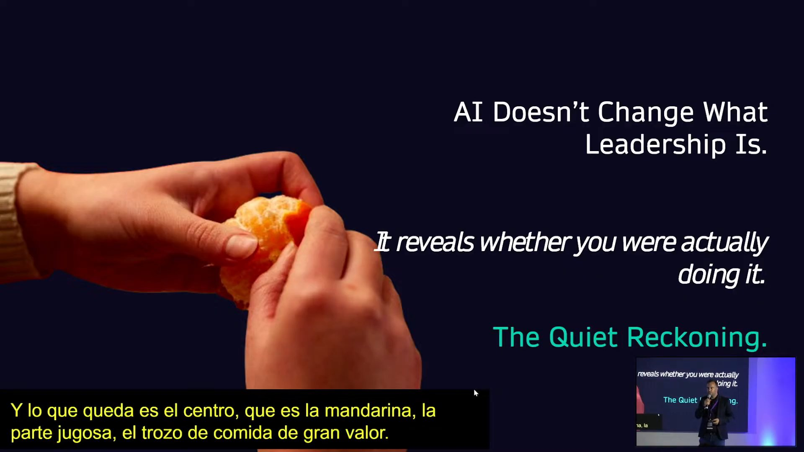
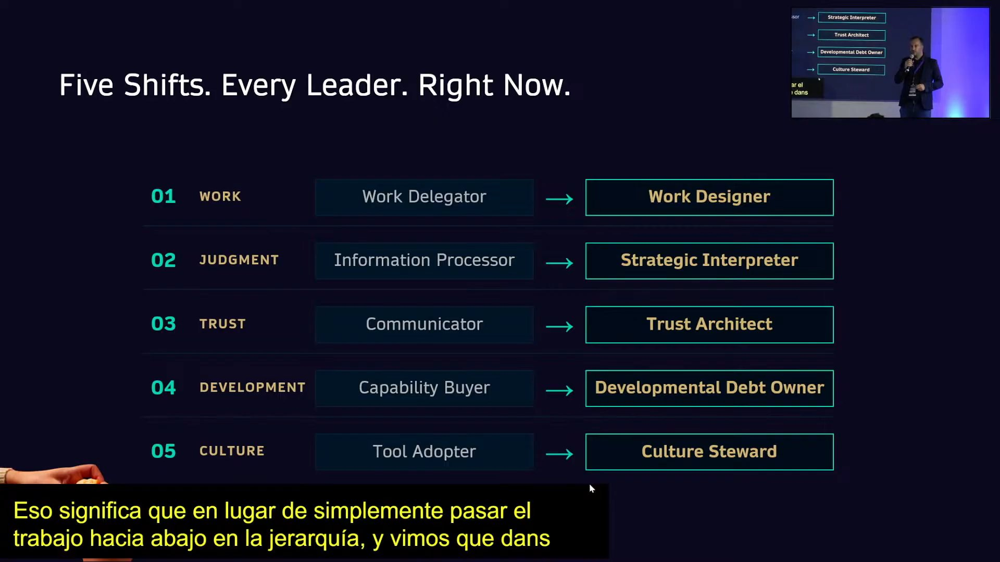
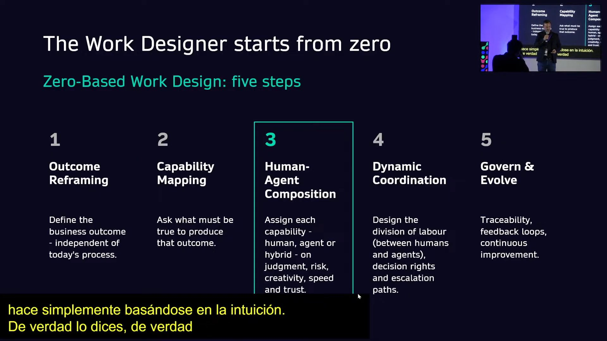
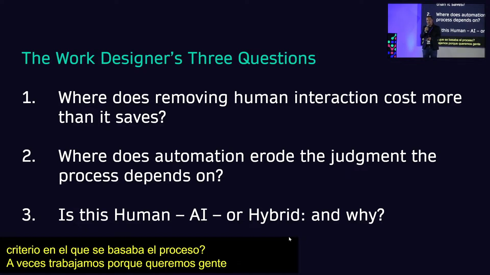
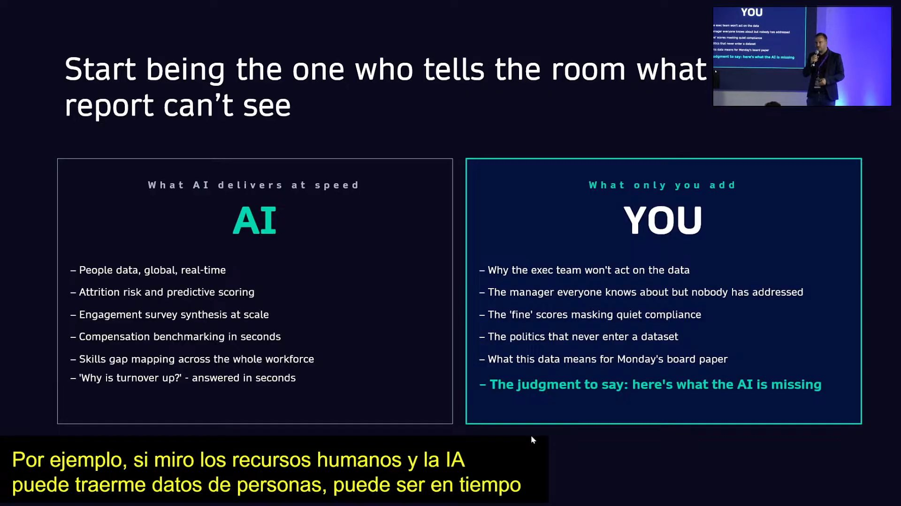
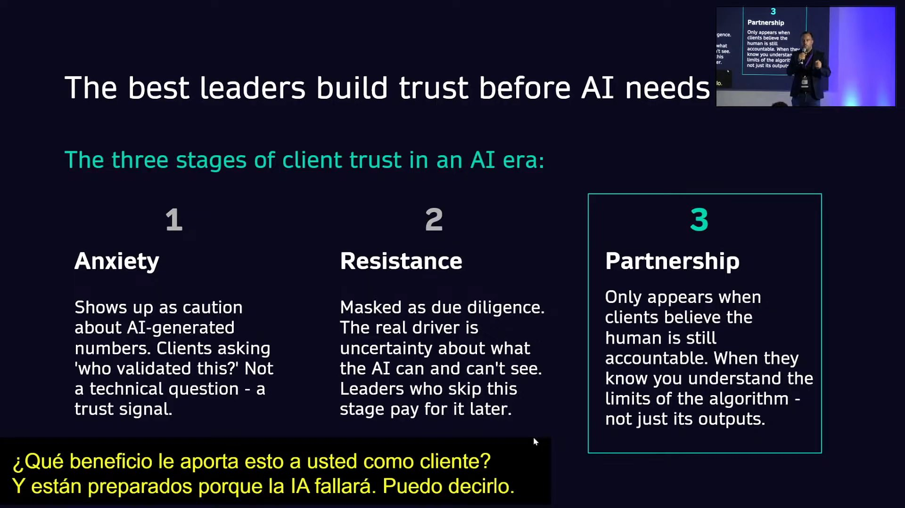
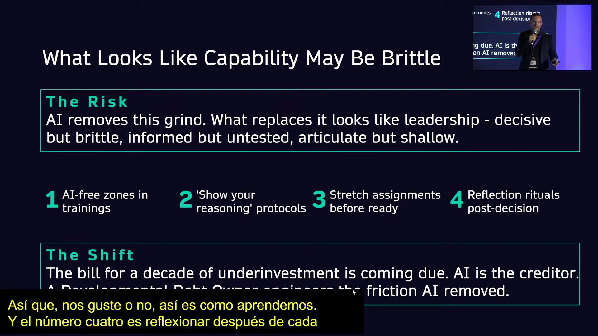

# Keynote «The Quiet Reckoning for Leaders: What Remains When AI Peels Back the Rest» · Impacta IA Chile 2026

Daniel Strode sostiene que la IA no cambia lo que es el liderazgo: lo deja a la vista. Como quien pela una mandarina, la IA saca las tareas repetitivas de bajo valor y deja expuesto el centro, lo que solo un líder puede hacer. Ese ajuste de cuentas silencioso se ordena en cinco cambios: diseñar el trabajo en vez de delegarlo, interpretar los datos en vez de procesarlos, construir confianza en vez de solo comunicar, hacerse cargo de la «deuda de desarrollo» y cuidar la cultura en vez de solo adoptar herramientas.

## Ficha
| | |
|---|---|
| Evento | Impacta IA Chile 2026, día 1, miércoles 2 de septiembre de 2026, Fundación Chile |
| Conduce | Juan Pablo Silva, host del evento |
| Speakers | Daniel Strode, profesor de Duke Corporate Education (Duke University), autor de *The Quiet Reckoning* y exejecutivo de Banco Santander |
| Duración | 42 min (3 min de presentación del host, 33 min de keynote, 6 min de preguntas, 1 min de cierre) |
| Idioma | inglés; la presentación y el cierre del host, en español; en las preguntas, el host alterna inglés y español |
| Video | [YouTube desde 7:03:20](https://www.youtube.com/watch?v=4N6I6PXycMw&t=25400s) |
| Fuente | Whisper large-v3 (coincidencia 96,7 % con los subtítulos del stream), voces separadas con SpeechBrain ECAPA; revisión en tres pasadas: transcripción, idioma y lo dicho mal |

## Estructura
| Capítulo | Tramo | Quién |
|---|---|---|
| Presentación del host | [00:03–02:40](https://www.youtube.com/watch?v=4N6I6PXycMw&t=25403s) | Juan Pablo Silva, host del evento |
| ¿Más rápido o mejor? La IA y el ritmo del cambio | [02:40–08:01](https://www.youtube.com/watch?v=4N6I6PXycMw&t=25560s) | Daniel Strode |
| La mandarina: lo que queda cuando la IA pela el resto, y los cinco cambios | [08:01–10:12](https://www.youtube.com/watch?v=4N6I6PXycMw&t=25881s) | Daniel Strode |
| Primer cambio, de delegar el trabajo a diseñarlo | [10:12–15:39](https://www.youtube.com/watch?v=4N6I6PXycMw&t=26012s) | Daniel Strode |
| Segundo cambio, de procesar información a interpretarla | [15:39–18:06](https://www.youtube.com/watch?v=4N6I6PXycMw&t=26339s) | Daniel Strode |
| Tercer cambio, de comunicar a construir confianza | [18:06–21:47](https://www.youtube.com/watch?v=4N6I6PXycMw&t=26486s) | Daniel Strode |
| Cuarto cambio, hacerse cargo de la deuda de desarrollo | [21:47–25:42](https://www.youtube.com/watch?v=4N6I6PXycMw&t=26707s) | Daniel Strode |
| Quinto cambio, de adoptar herramientas a cuidar la cultura | [25:42–33:22](https://www.youtube.com/watch?v=4N6I6PXycMw&t=26942s) | Daniel Strode |
| Cierre: la elección de cada líder | [33:22–35:16](https://www.youtube.com/watch?v=4N6I6PXycMw&t=27402s) | Daniel Strode |
| Preguntas del público | [35:20–41:23](https://www.youtube.com/watch?v=4N6I6PXycMw&t=27520s) | Público, el host y Daniel Strode |
| Cierre del host | [41:23–42:04](https://www.youtube.com/watch?v=4N6I6PXycMw&t=27883s) | Juan Pablo Silva, host del evento |

## Tesis

Todos usan IA en el trabajo, pero pocos se han preguntado si los hace más rápidos o mejores [03:24]. Si solo los hace más rápidos, el resultado son cien correos y diez presentaciones que nadie quería [07:37]. Strode propone mirar la IA como quien pela una mandarina: quita la cáscara de tareas repetitivas y de bajo valor y deja el centro, que es el trabajo propiamente humano del líder. Por eso la IA no cambia qué es liderar; revela si uno lo estaba haciendo [08:01]. Lo que queda a la vista son cinco cambios: de delegar a diseñar el trabajo, de procesar información a interpretarla, de comunicar a construir confianza, de comprar capacidades a hacerse cargo de la deuda de desarrollo, y de adoptar herramientas a cuidar la cultura [08:50]. Cierra con una elección: ser el líder al que la IA reemplaza, rápido y eficiente pero prescindible, o el líder al que la IA amplifica, que pone juicio, confianza y relaciones [34:11].

## Resumen

### Presentación del host [00:03–02:40]
- **Juan Pablo Silva, host del evento [00:03]: lo que la IA deja a la vista.** Presenta el bloque: cuando la IA automatiza lo operativo, queda expuesto el núcleo del liderazgo, y eso puede incomodar. Presenta a Strode como profesor de Duke Corporate Education, autor de *The Quiet Reckoning* y asesor de empresas globales en la integración de talento y tecnología. Pide preparar preguntas para el final.
- **[01:44]: hay mucha tecnología, pero no tanto talento.** Lo ilustra con el podcast *Founders* y su entrevista a Travis Kalanick, fundador de Uber, que habla de las personas que necesitan las empresas.

### ¿Más rápido o mejor? La IA y el ritmo del cambio [02:40–08:01]
- **Daniel Strode (Duke) [02:40]: todos son líderes.** De un equipo, de proyectos o de sí mismos, y el rol de liderar está cambiando por la IA.
- **[03:24]: ¿más rápido o mejor?** Pide levantar la mano a quien use IA en el trabajo; la levanta todo el público. Casi nadie se ha preguntado si la IA lo hace más rápido o mejor, y esa distinción es la pregunta de la charla.
- **[03:50]: la convergencia acelera todo.** En la cuarta revolución industrial lo nuevo no es cada tecnología (IA, 5G, sensores), sino que convergen al mismo tiempo. Las revoluciones anteriores traían una tecnología a la vez; esta trae muchas, y las expectativas de clientes y empleados se disparan.
- **[06:20]: las empresas viven menos que las personas.** Muestra la evolución de la vida promedio de una persona frente a la de una empresa del S&P 500. Según la tendencia, en 2027 una empresa del S&P 500 vivirá en promedio solo 12 años, así que cada persona sobrevivirá a varias de las empresas en que trabaje. La pregunta no es si sobrevivirá a su empresa, sino si como líder está listo para el cambio.
- **[07:19]: ser mejores, no solo más rápidos.** Si la IA solo da velocidad, produce cien correos y diez PowerPoints que nadie quiere. Hay que pasar de usarla para ir más rápido a usarla para hacer las cosas mejor y con más calidad.

### La mandarina: lo que queda cuando la IA pela el resto, y los cinco cambios [08:01–10:12]
- **Daniel Strode [08:01]: la IA revela si uno estaba liderando.** La IA no cambia en el fondo lo que es el liderazgo, sino que revela si uno era un buen líder desde el principio. Como al pelar una mandarina, quita las capas de tareas repetitivas y de bajo valor y deja el centro, la parte jugosa, y deja que los líderes lideren. Pero hay que saber qué hay debajo de la cáscara: ese es el *quiet reckoning*.
- **[08:50]: los cinco cambios.** Pide anotar cinco palabras. **Trabajo**: de delegar el trabajo hacia abajo en la jerarquía (retoma la pirámide de Denisse Goldfarb, del panel anterior) a rediseñarlo. **Juicio**: de procesar y reportar información al directorio a entenderla y aplicarle criterio. **Confianza**: de comunicar a construir confianza en la IA y en cómo se usa. **Desarrollo**: de comprar habilidades y tecnología a formar a la gente. **Cultura**: de adoptar herramientas a liderar con el ejemplo la cultura de la empresa.

### Primer cambio, de delegar el trabajo a diseñarlo [10:12–15:39]
- **Daniel Strode [10:15]: P&G en India.** Procter & Gamble redujo con IA un 60 % de los puntos de contacto humanos en su modelo de reposición a supermercados. En vez de convertir ese ahorro en recortes, pidió a los vendedores relaciones más profundas con sus clientes, y eso le dio un crecimiento anual compuesto de 8 % en tres años. Funcionó porque rediseñaron el rol.
- **[11:24]: Unilever.** Capacitó el año anterior a 23.000 empleados en IA, cerca de un cuarto de su dotación. Lo que importa no es la capacitación, sino qué se hace con la capacidad liberada: cada minuto ahorrado lo asignan los jefes a trabajo de más valor (relaciones, juicio, confianza).
- **[12:16]: el diseño del trabajo desde cero.** La mayoría de las empresas se equivoca. Así como el presupuesto base cero obliga a justificar cada dólar desde una hoja en blanco, hay que rediseñar el trabajo desde cero en vez de pegarle IA a un proceso existente: «si agregas IA a tu proceso actual, obtienes cien correos y diez PowerPoints» [13:01].
- **[13:13]: cinco pasos.** Redefinir el resultado que se busca; mapear las capacidades necesarias para lograrlo; decidir qué es humano, qué es IA y qué es híbrido según cinco criterios (juicio, riesgo, creatividad, velocidad y confianza), y ahí se libera valor; coordinar, sin dejar nunca al humano fuera del circuito; y gobernar y evolucionar, porque la IA y las personas mejoran cada día.
- **[14:49]: tres preguntas para el diseñador.** ¿Dónde quitar la interacción humana cuesta más de lo que ahorra? ¿Dónde la automatización erosiona el juicio del que dependía el proceso? (a veces el trabajo existe para que la gente aprenda) ¿Esto es humano, IA o híbrido, y por qué? Si no se explica el porqué, habrá problemas.

### Segundo cambio, de procesar información a interpretarla [15:39–18:06]
- **Daniel Strode [15:39]: unir los puntos.** Cita *Megatrends* (1982) de John Naisbitt: «we are drowning in information but starved for knowledge» (nos ahogamos en información, pero nos falta conocimiento). La IA no resolvió el problema; lo empeoró diez veces, porque junta muchos más puntos que antes.
- **[16:38]: traer los datos no es entenderlos.** En recursos humanos, la IA trae datos de personas en tiempo real, riesgo de fuga y análisis de encuestas de clima al instante. Lo que no puede ver es lo humano: por qué no se actúa sobre esos datos, qué jefe tiene buenos resultados de clima y no es buen jefe, qué política pasa en los pasillos. Los mejores líderes traen el dato y le suman juicio: «esta es mi recomendación».
- **[17:47]: una tarea.** Pide reflexionar sobre qué es lo único que la IA o el análisis de datos no sabe de un cliente o del equipo, y que solo uno sabe.

### Tercer cambio, de comunicar a construir confianza [18:06–21:47]
- **Daniel Strode [18:22]: Air Canada.** En 2024, el chatbot de Air Canada le dijo a un pasajero en duelo que podía comprar el pasaje y pedir después el descuento por fallecimiento; la aerolínea se lo negó. Ante la demanda, Air Canada argumentó que su chatbot era una entidad legal separada, y el fallo la obligó a dar el descuento: «tu IA eres tú como empresa».
- **[19:46]: DPD.** El chatbot de la empresa europea de despachos no supo responder dónde estaba un paquete; el cliente le pidió un poema sobre un chatbot inútil, luego que dijera garabatos, y lo hizo. Se volvió viral y tuvieron que bajarlo tras 1,3 millones de visualizaciones. «Tu chatbot es tu empresa […] No hay excusa» [20:30].
- **[20:46]: la confianza es humana.** Muchos se sienten cómodos escribiendo una presentación para un cliente con ayuda de IA, pero nadie la enviaría sin revisarla. Los mejores líderes construyen la confianza antes de que la IA la necesite [21:01]: reducen la ansiedad y la resistencia de los clientes, explican por qué usan un chatbot, qué datos guardan y qué gana el cliente, y están preparados para cuando la IA falle, que fallará. La respuesta entonces no es «entidad legal separada», sino «lo sentimos, es nuestra responsabilidad y lo vamos a arreglar».

### Cuarto cambio, hacerse cargo de la deuda de desarrollo [21:47–25:42]
- **Daniel Strode [22:05]: Klarna.** Según relata, el CEO de Klarna anunció que su chatbot atendía millones de conversaciones y que había sacado a 700 personas de servicio al cliente; subió la acción y lo elogiaron. Meses después admitió que la calidad había bajado e intentó volver a contratar, pagando más. Optimizó el costo de corto plazo a costa de la productividad de largo plazo (las cifras del relato no se pudieron verificar).
- **[23:18]: la deuda de desarrollo.** Es la brecha entre lo que la IA ahorra en el corto plazo y lo que va agotando en silencio en el largo plazo. La pregunta es si, cuando haya que decidir con juicio propio, el líder estará listo.
- **[23:41]: Banco Popular en quince minutos.** Cuenta que en Banco Santander tuvieron que comprar Banco Popular a las 6 de la mañana, con el Banco Central Europeo pidiendo la decisión antes de las 6:15. Esa decisión la toma un líder con experiencia, intuición e historia, no uno que externaliza todo a un chatbot.
- **[24:14]: gente frágil.** Se está formando gente que se ve muy bien en tiempos fáciles, que hace muchos reportes y genera contenido con IA, pero que no tiene respuesta cuando llega algo difícil.
- **[24:33]: cuatro remedios.** Zonas de formación sin IA; protocolos de «muestra tu razonamiento»; tareas desafiantes antes de que la persona esté lista, porque se aprende en la incomodidad; y reflexión después de cada decisión tomada con IA.

### Quinto cambio, de adoptar herramientas a cuidar la cultura [25:42–33:22]
- **Daniel Strode [25:42]: tener una herramienta digital no es ser digital.** Es el cambio más importante. «Somos digitales porque tenemos Copilot» o «porque usamos Claude 24/7» no basta: uno se vuelve digital cuando cambia la cultura y la forma de actuar.
- **[26:14]: lo que haces pesa más que lo que dices.** Cita a Stephen Covey. La gente no lee las políticas de IA de la intranet: mira cómo usa la IA el líder, a quién premia y qué oportunidades abre. Propone tres palancas: mentalidad de crecimiento, abrazar la tecnología en alianza y repensar el modelo de negocio.
- **[27:08]: mentalidad de crecimiento.** Retoma a Carol Dweck (*Mindset*): la mentalidad fija culpa a otros, se cubre las espaldas y no arriesga; la de crecimiento acepta fallar para aprender. Ejemplo: Ben & Jerry's [28:07], cuyos empleados en Vermont pasan cada día frente a un cementerio de sabores con lápidas de los sabores que fracasaron, lo que les dice que es seguro tomar riesgos.
- **[29:06]: abrazar la tecnología en alianza.** Con internet y con la IA, la primera reacción fue el miedo a perder empleos. Ferrari, cliente suyo, cuestionó sus supuestos (rojo, ruidoso, a bencina) y se asoció con muchas tecnológicas para crear el Luce [29:25], un Ferrari eléctrico y azul diseñado por Jony Ive: unos lo aman y otros lo odian, pero ya está vendido.
- **[30:55]: romper lo que funciona.** «If it ain't broke, don't fix it» es el peor consejo de negocios: si no está roto, hay que romperlo para mejorarlo [31:03], o se sigue la curva descendente del gráfico de vida de las empresas. Ejemplo: LEGO [31:34], que fabricaba juguetes desde los años treinta con la cultura de «solo lo mejor es suficientemente bueno», se estancó cerca del 2000. Jørgen Vig Knudstorp, el nuevo CEO, preguntó a qué juego jugaban y redefinió el negocio como entretenimiento infantil (colaboraciones, películas, propiedad intelectual, parques temáticos) [32:26]; la empresa pasó de estar cerca de la quiebra a ser un gigante. El mejor momento para cambiar es cuando no hace falta, porque hay presupuesto, tiempo y gente [33:11].

### Cierre: la elección de cada líder [33:22–35:16]
- **Daniel Strode [33:22]: los cinco cambios como elección.** La IA está pelando la cáscara de la mandarina y cada líder debe elegir: diseñar el trabajo o solo empujarlo hacia abajo, interpretar los datos o solo presentarlos, construir confianza en la IA o solo hablar de ella, desarrollar capacidades o solo comprar cursos, construir una cultura de innovación.
- **[34:11]: reemplazado o amplificado.** El líder rápido con la IA, bueno con los datos y eficiente con las herramientas será prescindible, porque eso se aprende con capacitación. El líder al que la IA amplifica es el arquitecto de relaciones reales con clientes, que suma juicio, valor y confianza, y acumula esos beneficios en el tiempo [34:28].

### Preguntas del público [35:20–41:23]
- **Público [35:41]: ¿sigue valiendo el gráfico de vida de las empresas?** Las mayores del S&P 500, como Apple y Microsoft, son antiguas, y vienen SpaceX, xAI y la salida a bolsa de Anthropic. ¿Se mantiene la tendencia si se separan las empresas de punta de las que no construyen infraestructura de IA?
- **Daniel Strode [36:31]: todas las apuestas están abiertas.** Hace dos años se decía que Google iba a desaparecer y no pasó. Apuesta a que, de las diez empresas más grandes de hoy, cinco no estarán en el futuro, y le asusta la velocidad con que Anthropic y otras pasaron de cero a valer miles de millones. Para los incumbentes que no responden a estos desafíos el riesgo es real: «if you don't take risk, you're also taking risk» [37:46]. En Europa, Revolut ya se acerca a la capitalización de los grandes bancos.
- **Público [38:36]: ¿qué fue lo más difícil de cambiar en Santander?** **Strode [38:54]:** la cultura, en una organización de 150 años, muy regulada, que gana dinero con sucursales físicas y que se propone volverse digital. Algunos no quieren hacer el viaje y frenan la adopción, como el colega que prueba Copilot una vez y dice que no sirve. Como especie no nos gusta arriesgar, y por eso el cambio cultural es el más difícil.
- **Juan Pablo Silva, host del evento [40:12]: ¿qué es lo más difícil de transmitir a los CEO?** Como nadie levanta la mano, pregunta él. **Strode [40:33]:** hay dos tipos de CEO: los que aman la tecnología y vuelven loca a la organización exigiendo que todos la usen, y los que nunca la han usado. A estos últimos hay que empezar por el uso personal (ChatGPT para las compras o para recomendaciones de películas) y, cuando se enganchan, construir desde ahí; pero tienen que abogar por ella y aprenderla primero [41:01].

### Cierre del host [41:23–42:04]
- **Juan Pablo Silva, host del evento [41:23]:** cierra las preguntas, pide un aplauso para Strode y anuncia el break.

## Ideas que se llevan
1. La IA no cambia qué es liderar: lo revela. Al quitar lo repetitivo, deja a la vista si el líder pone juicio, confianza y relaciones (Strode).
2. Medir la IA por si hace mejor el trabajo, no solo más rápido; si no, el resultado son cien correos y diez PowerPoints (Strode).
3. Rediseñar el trabajo desde cero y decidir qué es humano, IA o híbrido según juicio, riesgo, creatividad, velocidad y confianza, en vez de pegarle IA al proceso actual; y reinvertir el tiempo liberado en trabajo de más valor, como P&G y Unilever (Strode).
4. Tu IA es tu empresa: la confianza se construye antes de que la IA falle, y cuando falla se responde «es nuestra responsabilidad», no «el chatbot es otra entidad» (Strode).
5. Cuidar la deuda de desarrollo: zonas sin IA, razonamiento explícito, desafíos antes de tiempo y reflexión después de cada decisión, para no formar gente frágil (Strode).
6. Ser digital es una cultura, no una licencia: la gente mira lo que hace el líder, no lo que dice la política de IA (Strode).

## Frases citables
> «AI doesn't actually change what leadership is fundamentally. It actually just reveals whether you were being a great leader in the first place.» (La IA no cambia en el fondo lo que es el liderazgo. Solo revela si eras un buen líder desde el principio.) — Daniel Strode (Duke), [08:01](https://www.youtube.com/watch?v=4N6I6PXycMw&t=25881s)

> «Do you want 10 PowerPoints and 100 emails? No, I don't think so.» (¿Quieren diez PowerPoints y cien correos? No lo creo.) — Daniel Strode (Duke), [07:37](https://www.youtube.com/watch?v=4N6I6PXycMw&t=25857s)

> «If you add AI to your existing process, you get 100 emails and 10 PowerPoints. If you start with a blank piece of paper, you reimagine the way of work.» (Si agregas IA a tu proceso actual, obtienes cien correos y diez PowerPoints. Si partes de una hoja en blanco, reimaginas la forma de trabajar.) — Daniel Strode (Duke), [13:01](https://www.youtube.com/watch?v=4N6I6PXycMw&t=26181s)

> «Just bringing the data is not the same as understanding it.» (Traer los datos no es lo mismo que entenderlos.) — Daniel Strode (Duke), [16:38](https://www.youtube.com/watch?v=4N6I6PXycMw&t=26398s)

> «Your chatbot is your company. Your AI is your company. There's no excuse.» (Tu chatbot es tu empresa. Tu IA es tu empresa. No hay excusa.) — Daniel Strode (Duke), [20:30](https://www.youtube.com/watch?v=4N6I6PXycMw&t=26630s)

> «Developmental debt is this gap between what AI is saving you in the short run and what it's quietly depleting in the long run.» (La deuda de desarrollo es la brecha entre lo que la IA te ahorra en el corto plazo y lo que va agotando en silencio en el largo plazo.) — Daniel Strode (Duke), [23:18](https://www.youtube.com/watch?v=4N6I6PXycMw&t=26798s)

> «No, you are not digital. You have a digital tool.» (No, no son digitales. Tienen una herramienta digital.) — Daniel Strode (Duke), [25:56](https://www.youtube.com/watch?v=4N6I6PXycMw&t=26956s)

> «If it ain't broke, go and break it so you can make it better.» (Si no está roto, rómpelo para poder mejorarlo.) — Daniel Strode (Duke), [31:03](https://www.youtube.com/watch?v=4N6I6PXycMw&t=27263s)

> «If you want to connect the dots, you first have to collect the dots.» (Si quieres unir los puntos, primero tienes que juntarlos.) — Daniel Strode (Duke), atribuida a John Naisbitt, [16:08](https://www.youtube.com/watch?v=4N6I6PXycMw&t=26368s)

## Imágenes notables

Todas las slides son de Daniel Strode y se vieron a pantalla completa en el stream. Las capturas llevan encima dos elementos del stream: arriba a la derecha, un recuadro con la toma del escenario, y abajo a la izquierda, los subtítulos en español de la interpretación en vivo.

*«The Evolution of Corporate versus Human Life Spans» · presentada por Daniel Strode (Duke) · [06:27](https://www.youtube.com/watch?v=4N6I6PXycMw&t=25787s)*

*«AI Doesn't Change What Leadership Is. It reveals whether you were actually doing it.» · presentada por Daniel Strode (Duke) · [08:38](https://www.youtube.com/watch?v=4N6I6PXycMw&t=25918s)*

*«Five Shifts. Every Leader. Right Now.» · presentada por Daniel Strode (Duke) · [09:15](https://www.youtube.com/watch?v=4N6I6PXycMw&t=25955s)*

*«The Work Designer starts from zero: Zero-Based Work Design, five steps» · presentada por Daniel Strode (Duke) · [14:02](https://www.youtube.com/watch?v=4N6I6PXycMw&t=26242s)*

*«The Work Designer's Three Questions» · presentada por Daniel Strode (Duke) · [15:26](https://www.youtube.com/watch?v=4N6I6PXycMw&t=26326s)*

*«Start being the one who tells the room what report can't see» (AI frente a YOU) · presentada por Daniel Strode (Duke) · [17:01](https://www.youtube.com/watch?v=4N6I6PXycMw&t=26421s)*

*«The best leaders build trust before AI needs it: the three stages of client trust in an AI era» (el título se corta en el borde derecho) · presentada por Daniel Strode (Duke) · [21:35](https://www.youtube.com/watch?v=4N6I6PXycMw&t=26695s)*

*«What Looks Like Capability May Be Brittle» (la última línea queda tapada en parte por los subtítulos) · presentada por Daniel Strode (Duke) · [25:18](https://www.youtube.com/watch?v=4N6I6PXycMw&t=26918s)*

## Menciones a Brinca
Sin menciones.

## Archivos
- `transcripcion.md`: el texto completo, revisado y limpio, por turnos.
- `imagenes/`: las imágenes notables.
