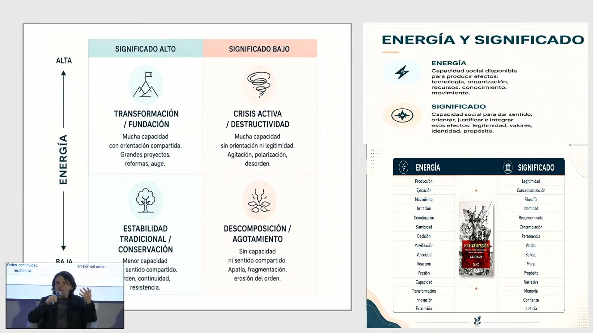
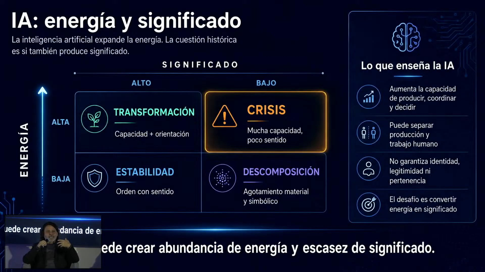
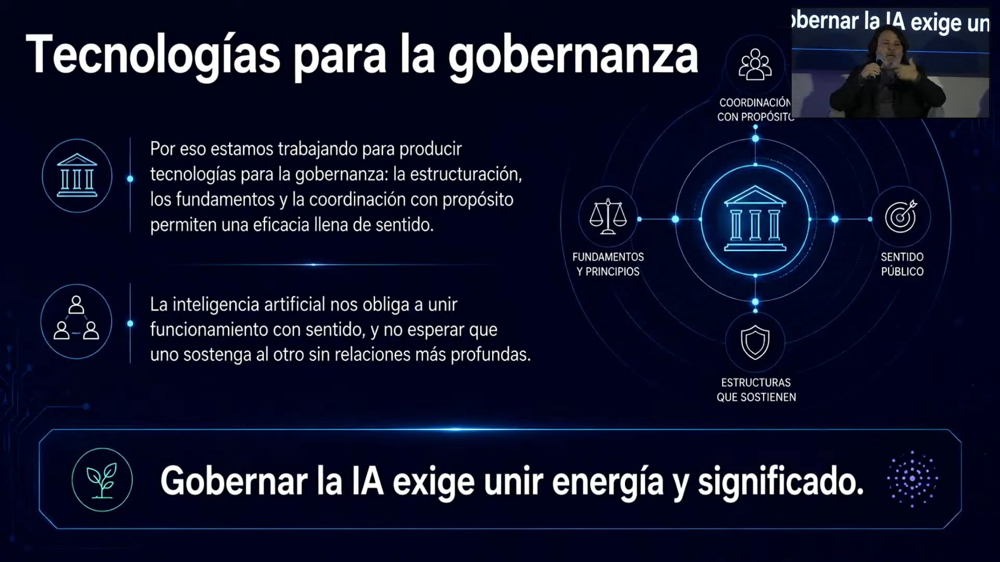

# Panel «Sociedad del futuro: de la escasez a la abundancia» · Impacta IA Chile 2026

El último panel del día 1 pone a un sociólogo, un economista y un especialista en prospectiva a imaginar 2035, y no llegan a la misma respuesta. Alberto Mayol ve una tecnología con muchísima energía y poco significado, y por eso anticipa una crisis y años inestables. Raphael Bergoeing cree que el resultado depende de decisiones de política y de organizaciones capaces de cambiar, y cierra optimista. Alfredo Pérsico advierte tres deudas (cognitiva, de control y de autonomía) y pone la esperanza en la imaginación humana, la naturaleza y la ética.

## Ficha
| | |
|---|---|
| Evento | Impacta IA Chile 2026, día 1, miércoles 2 de septiembre de 2026, Fundación Chile |
| Modera | Eduardo Gomien, principal de Venture Capital y Private Equity en Chile Global Ventures (Fundación Chile) y host del podcast Chile Nación Emprendedora |
| Speakers | Alberto Mayol, sociólogo, escritor y académico (Universidad de Santiago, USACH) · Raphael Bergoeing, economista, académico de la Universidad Adolfo Ibáñez y expresidente de la Comisión Nacional de Evaluación y Productividad · Alfredo Pérsico, CEO y fundador de Agents4Future, especialista en prospectiva tecnológica |
| Duración | 76 min, la sesión más larga del evento (2 min de presentación y pregunta inicial, 36 min de primera ronda, 24 min de segunda ronda, 13 min de cierre, 1 min de despedida del host) |
| Idioma | español |
| Video | [YouTube desde 8:04:55](https://www.youtube.com/watch?v=4N6I6PXycMw&t=29095s) |
| Fuente | Whisper large-v3 (coincidencia 95,7 % con los subtítulos del stream), voces separadas con SpeechBrain ECAPA; revisión en tres pasadas: transcripción, idioma y lo dicho mal |

## Estructura
| Capítulo | Tramo | Quién |
|---|---|---|
| Presentación y pregunta inicial | [00:05–02:09](https://www.youtube.com/watch?v=4N6I6PXycMw&t=29100s) | Juan Pablo Silva, host del evento; Eduardo Gomien |
| Primera ronda: la sociedad en 2035, ¿más próspera y distribuida o más desigual y concentrada? | [02:09–38:31](https://www.youtube.com/watch?v=4N6I6PXycMw&t=29224s) | Alberto Mayol (02:09), Raphael Bergoeing (10:21), Alfredo Pérsico (22:11) |
| Segunda ronda: ¿qué pasa cuando la escasez da paso a la abundancia? | [38:31–62:34](https://www.youtube.com/watch?v=4N6I6PXycMw&t=31406s) | Eduardo Gomien, Alberto Mayol, Raphael Bergoeing, Alfredo Pérsico |
| Cierre: dónde encuentran esperanza y cómo usan hoy la IA | [62:34–75:31](https://www.youtube.com/watch?v=4N6I6PXycMw&t=32849s) | Alberto Mayol, Alfredo Pérsico, Raphael Bergoeing |
| Despedida del host (resumida) | [75:31–76:24](https://www.youtube.com/watch?v=4N6I6PXycMw&t=33626s) | Juan Pablo Silva, host del evento |

## Tesis

El panel no responde con un sí o un no a la pregunta del moderador: ¿será 2035 una sociedad más próspera y distribuida, o más desigual y concentrada? Las tres posiciones son distintas.

- **Alberto Mayol, el sociólogo: crisis por exceso de energía.** La IA multiplica la energía de la sociedad (la capacidad de producir y transformar) más rápido que el significado que la orienta (legitimidad, identidad, propósito). Eso, en su matriz, es crisis [03:32](https://www.youtube.com/watch?v=4N6I6PXycMw&t=29307s). Lo normal en la historia es que algo así sea inestable [08:49](https://www.youtube.com/watch?v=4N6I6PXycMw&t=29624s). Gobernarlo no es llamar al abogado para que arme estructuras, es densificar conceptos [06:25](https://www.youtube.com/watch?v=4N6I6PXycMw&t=29480s).
- **Raphael Bergoeing, el economista: el resultado se decide.** Lo que pase depende de reglas y de política, no de una variable dada [10:46](https://www.youtube.com/watch?v=4N6I6PXycMw&t=29741s). Los datos muestran una brecha que crece entre organizaciones, no entre personas [16:24](https://www.youtube.com/watch?v=4N6I6PXycMw&t=30079s). La IA puede «subir a los de abajo» [20:41](https://www.youtube.com/watch?v=4N6I6PXycMw&t=30336s), pero solo si no se la llevan cinco para la casa. Con Acemoglu, cree que hasta ahora las empresas solo la usan para automatizar [51:01](https://www.youtube.com/watch?v=4N6I6PXycMw&t=32156s). Cierra con el optimismo más claro del panel [75:04](https://www.youtube.com/watch?v=4N6I6PXycMw&t=33599s).
- **Alfredo Pérsico, el prospectivista: tres deudas.** Pide «pensamiento apocalíptico para una acción esperanzadora» [22:45](https://www.youtube.com/watch?v=4N6I6PXycMw&t=30460s). Las deudas son la cognitiva, la de control y la de autonomía. Su peor escenario es una «heteronomía agéntica» en la que mandan los agentes [32:49](https://www.youtube.com/watch?v=4N6I6PXycMw&t=31064s). Lo que la IA no puede quitarnos es imaginar y definir problemas [55:11](https://www.youtube.com/watch?v=4N6I6PXycMw&t=32406s). América Latina tiene que pensar en futuros necesarios, desde la brecha [59:17](https://www.youtube.com/watch?v=4N6I6PXycMw&t=32652s).

**Dónde discrepan.**

- **¿Cuánto va a cambiar?** Mayol cree que las transformaciones no son por reemplazo y que «lo normal es que en realidad no pase nada» y la IA termine como una herramienta más [45:21](https://www.youtube.com/watch?v=4N6I6PXycMw&t=31816s). Pérsico, en cambio, anticipa seres humanos más «cyborgs», la fusión con la biotecnología y la inmortalidad biológica hacia 2033 [35:04](https://www.youtube.com/watch?v=4N6I6PXycMw&t=31199s), [67:38](https://www.youtube.com/watch?v=4N6I6PXycMw&t=33153s). Bergoeing se queda con la promesa de una vida más larga: «10 añitos» [73:21](https://www.youtube.com/watch?v=4N6I6PXycMw&t=33496s).
- **¿Significado o subjetividad?** Pérsico corrige a Mayol de frente: lo que une la realidad no es el significado, «es la subjetividad la que pega lo que no está conectado» [34:11](https://www.youtube.com/watch?v=4N6I6PXycMw&t=31146s).
- **¿Densificar o masificar?** Bergoeing dice que está de acuerdo con la densificación de Mayol, pero la saca de la élite. La IA tiene que llegar a todos, y hay que «validar la mediocridad» como el estado normal [10:46](https://www.youtube.com/watch?v=4N6I6PXycMw&t=29741s), [13:35](https://www.youtube.com/watch?v=4N6I6PXycMw&t=29910s).
- **¿Riesgo o potencial?** Mayol habla de crisis y Pérsico de tres deudas y de un 2035 «apocalíptico» si se delega demasiado. Bergoeing cierra contra ese tono: «Todos estamos hablando del riesgo porque el riesgo vende» [75:04](https://www.youtube.com/watch?v=4N6I6PXycMw&t=33599s).
- **¿Qué hacemos con el tiempo libre?** Los tres ven un riesgo en el tiempo libre sin sentido, pero no lo plantean igual. Mayol dice que no estamos preparados psicológicamente para un mundo sin trabajo y cita las ratas en ocio perfecto y el *spleen* [42:29](https://www.youtube.com/watch?v=4N6I6PXycMw&t=31644s). Bergoeing, que bajar de 1.600 horas a cero es otra cosa, con el aumento de suicidios tras el seguro de desempleo nórdico [49:27](https://www.youtube.com/watch?v=4N6I6PXycMw&t=32062s). Pérsico, el suicidio de quien lo tiene todo pero no se siente valioso [57:57](https://www.youtube.com/watch?v=4N6I6PXycMw&t=32572s). Lo que proponen es distinto: Bergoeing quiere tiempo libre con ingreso, Pérsico quiere ocio contemplativo dentro del trabajo y Mayol quiere aburrirse.

## Resumen

### Presentación y pregunta inicial [00:05–02:09]
- **Eduardo Gomien (Chile Global Ventures) [01:03]: tres miradas sobre 2035.** Reparte los papeles: Mayol hablará de instituciones, Bergoeing de productividad y empleo y Pérsico de la empresa y la organización. Reformula la provocación de la organización: si estamos en 2035, ¿la sociedad es más próspera y distribuida, o más desigual y concentrada?

### Primera ronda: la sociedad en 2035 [02:09–38:31]
- **Alberto Mayol [02:09]: energía y significado.** Divide la sociedad en energía (lo que produce efectos: tecnología, organización, recursos) y significado (la densidad de las comunicaciones, que se vuelve instituciones y legitimidad; «la legitimidad no es un fenómeno político, es un fenómeno cultural»). Con las dos arma una matriz (ver imagen 1) [03:32](https://www.youtube.com/watch?v=4N6I6PXycMw&t=29307s). Alta energía con alto significado es transformación conducida. Alta energía con bajo significado es disrupción «en el concepto original», como el niño que se tira contra la muralla. Baja energía con alto significado es tradicionalismo, y todo bajo es decadencia.
- **[05:01]: la IA es crisis.** Ninguna tecnología se adoptó tan rápido. La IA tiene una capa de significado, pero no alcanza para moderar su energía (ver imagen 2). De ahí la alta volatilidad: todos dicen cosas contrarias y todos tienen razón, o todos están equivocados. Es una crisis, aunque no «una crisis donde estamos todos llorando».
- **[06:25]: gobernar es densificar.** Que la gobernanza esté en todas partes muestra que la empresa entendió que el problema está afuera. Pero lo que se enseña de gobernanza es construir estructuras con normativistas y abogados, y ese no es el punto. Lo que se necesita es densificación conceptual y metodológica, la que cualquiera nota al darle a la IA una formalización robusta (ver imagen 3). Recuerda a Daniel Bell: el valor futuro de la economía está en la teoría [07:52](https://www.youtube.com/watch?v=4N6I6PXycMw&t=29567s).
- **[08:49]: 2035, inestable.** Cita a Keynes: el mercado se regula en el largo plazo, «pero en el largo plazo estamos todos muertos». Con la crisis climática y un cambio geopolítico encima, lo normal en la historia es la inestabilidad.
- **Raphael Bergoeing (UAI) [10:46]: reglas y masificación.** Lo que pase depende de reglas que hay que decidir. Además, la IA no puede quedarse en una élite: los que más saben son por definición el 0,00 algo por ciento. Critica dos discursos. Uno es el del líder de Davos que dice que su empresa nunca hace lo que otros hicieron [12:15](https://www.youtube.com/watch?v=4N6I6PXycMw&t=29830s). El otro es el de la columna que consuela con que una máquina nunca escribirá como Dolly Parton. Responde que el 99 % no somos Dolly Parton, y quiere validar el trabajo «desde el promedio» [13:35](https://www.youtube.com/watch?v=4N6I6PXycMw&t=29910s).
- **[15:00]: la brecha está entre organizaciones.** Cita a Solow: la computación «está en todas partes, menos en la productividad». Los economistas todavía discuten el efecto de internet. Los datos no muestran que crezca la brecha entre personas sino entre organizaciones [16:24](https://www.youtube.com/watch?v=4N6I6PXycMw&t=30079s): se separan las que se gobiernan bien y cambian sus procesos. Por eso las personas también se separan, según en qué organización estén: «Se juega mucho más en cambiar la organización que en cambiar a una persona» [19:21](https://www.youtube.com/watch?v=4N6I6PXycMw&t=30256s).
- **[19:21]: siete ayudantes gratis.** En Estados Unidos sus colegas tenían 15 ayudantes de investigación financiados por la NSF, y él no tenía ninguno. Hoy, con la versión gratuita de la IA, tiene «siete, 15 o 20» [20:41](https://www.youtube.com/watch?v=4N6I6PXycMw&t=30336s) y ha crecido más que sus colegas. Imagina un mundo donde la IA sube a los de abajo, salvo que se la lleven cinco y la política no resuelva la capacitación. Eso es, al final, una decisión de política [22:02](https://www.youtube.com/watch?v=4N6I6PXycMw&t=30417s).
- **Alfredo Pérsico (Agents4Future) [22:45]: pensar e imaginar.** «Pensar e imaginar es algo que no nos va a quitar la IA, pero sí podemos renunciar a ello». Imagina un 2035 de organizaciones por proyectos con el sujeto al centro, pero propone pensar en escenarios con pensamiento apocalíptico para actuar con esperanza.
- **[24:14]: la deuda cognitiva.** Tercerizar lo mecánico está bien. Tercerizar lo intrínseco (la propuesta, la estrategia, el modelo de negocio) es *outsourcing* del pensamiento. Cita un estudio con 26 mil estudiantes chinos: entregas 17 % mejores, pero un 22 % menos de rendimiento a libro cerrado. Cita también el estudio del MIT con electroencefalograma, donde el cerebro del grupo que usó ChatGPT era un «apagón» [25:42](https://www.youtube.com/watch?v=4N6I6PXycMw&t=30637s). El resultado es menos retención, menos transferencia y talento que no se puede recolocar [27:03](https://www.youtube.com/watch?v=4N6I6PXycMw&t=30718s).
- **[27:03]: la IA aprende patrones, no los crea.** Con el experimento del ajedrez de 1973 (el gran maestro no recuerda un tablero con las piezas al azar) explica que se aprenden patrones. La IA es la mejor jugando ajedrez, pero no inventa un escaque nuevo [28:44](https://www.youtube.com/watch?v=4N6I6PXycMw&t=30819s). Por eso los ingenieros de sistemas, que modelan la complejidad, serán más requeridos que los que salen de un *bootcamp* [30:06](https://www.youtube.com/watch?v=4N6I6PXycMw&t=30901s).
- **[30:06]: la deuda de control.** El software hecho con IA termina en «Frankensteins», y las empresas se llenan de agentes individuales (Claude Code, Codex, Claude Cowork) sin una plataforma que los gobierne [31:28](https://www.youtube.com/watch?v=4N6I6PXycMw&t=30983s). El problema no es la visibilidad sino la gobernabilidad.
- **[31:28]: la deuda de autonomía.** Delegar decisiones en un agente que se cree mejor que uno lleva a una «heteronomía agéntica» [32:49](https://www.youtube.com/watch?v=4N6I6PXycMw&t=31064s). Además, los agentes necesitan documentación, así que «va a crecer la burocracia». Las decisiones con valores y bien común no se deben delegar.
- **[34:11]: subjetividad, cyborgs y soberanía digital.** Contra Mayol, sostiene que es la subjetividad la que une lo desconectado. El LLM solo trabaja distancias entre palabras: «la IA rapea». Viene la biotecnología, un ser humano más cyborg y la pregunta por la soberanía digital [35:34](https://www.youtube.com/watch?v=4N6I6PXycMw&t=31229s). Los cuellos de botella serán la energía y el cómputo. Los derechos en juego hoy son el agua y la tierra, por los data centers [37:02](https://www.youtube.com/watch?v=4N6I6PXycMw&t=31317s). Para él, el futuro es agéntico, pero no de LLM, que ya son *commodities*, y no traerá la singularidad [38:23](https://www.youtube.com/watch?v=4N6I6PXycMw&t=31398s).

### Segunda ronda: ¿qué pasa cuando la escasez da paso a la abundancia? [38:31–62:34]
- **Eduardo Gomien [38:31]: escasez e incentivos.** Retoma una definición de Bergoeing, la economía como escasez e incentivos, y pregunta qué pasa cuando la escasez da paso a la abundancia. ¿Dónde está el sentido, qué valor tiene la política, qué dolor resuelve el emprendimiento? Ofrece los micrófonos al público, pero no se oyen preguntas.
- **Alberto Mayol [39:46]: las transformaciones no son por reemplazo.** En el banco le decían que la gente pasaría del canal tradicional al digital. Ocurrió lo de siempre: el tradicional siguió creciendo y el digital explotó. Lo mismo pasa con el petróleo y las energías limpias.
- **[41:06]: el trabajo, corazón de la sociedad.** Nuestra cultura nace con el pecado que obliga a trabajar, y en eso derechas e izquierdas siempre estuvieron de acuerdo. No tenemos con qué pensar una productividad que no dependa del trabajo humano. En el experimento de las ratas con ocio perfecto, esa sociedad termina en decadencia, violencia y *spleen* [42:29](https://www.youtube.com/watch?v=4N6I6PXycMw&t=31644s). Tampoco estamos preparados para un cuerpo hecho de tecnología: cita *Abaddón el exterminador*, de Sabato, y el tercer apellido de quien vive con órganos de otro [43:55](https://www.youtube.com/watch?v=4N6I6PXycMw&t=31730s).
- **[45:21]: lo normal es que no pase nada.** «La parte aburrida» es que lo más probable estadísticamente es que la IA se absorba como una herramienta más.
- **Raphael Bergoeing [46:40]: menos horas es prosperidad.** En Europa se trabajaban unas 3.500 horas al año en 1900 y hoy son 1.600. En Santiago, el jueves a las dos ya es «el sábado antiguo de mi papá» [48:02](https://www.youtube.com/watch?v=4N6I6PXycMw&t=31977s). El ocio entra en la función de utilidad como el chocolate, pero ir de 1.600 horas a cero es otra cosa. Recuerda un estudio sobre el seguro de desempleo en países nórdicos que registró más suicidios: la curva es una U invertida [49:27](https://www.youtube.com/watch?v=4N6I6PXycMw&t=32062s).
- **[49:27]: Acemoglu y la automatización.** Según Acemoglu, las empresas privadas han usado la IA para automatizar. Pone el ejemplo de las cajas de autoservicio: no bajaron los precios, subió la última línea, y ahora el cliente hace una pega que antes no hacía [51:01](https://www.youtube.com/watch?v=4N6I6PXycMw&t=32156s). El tiempo libre de hoy es «porque no tenéis pega», y lo que hace falta es tiempo libre con ingreso [52:25](https://www.youtube.com/watch?v=4N6I6PXycMw&t=32240s). Con un desempleo del 9,4 % y diez años sobre el 7,5 %, se suma a la idea de Acemoglu de un Estado que dirija [53:57](https://www.youtube.com/watch?v=4N6I6PXycMw&t=32332s). Antes, en la primera ronda, se había distanciado de esa idea [20:41](https://www.youtube.com/watch?v=4N6I6PXycMw&t=30336s).
- **Alfredo Pérsico [55:11]: definir problemas.** Cita el artículo de Harvard Business Review *Prompt engineering is not the future*: lo que no nos pueden quitar es definir problemas (diagnosticarlos, descomponerlos, replantearlos y poner restricciones a la solución). «Tráiganme problemas, no me traigan las soluciones».
- **[56:32]: mentalidad de legado contra mentalidad de *outsourcing*.** 2035 debería ser una sociedad del aprendizaje, con un *legacy mindset* y no un *outsource mindset*, el de «que me lo haga todo la IA». Propone recuperar el ocio griego, contemplativo, dentro del trabajo [57:57](https://www.youtube.com/watch?v=4N6I6PXycMw&t=32572s). El riesgo apocalíptico es una sociedad conformista y anómica.
- **[59:17]: innovación desde el sur.** La IA debería servir para pensamiento crítico, creativo, estratégico y computacional. Desde América Latina hay que innovar desde la brecha y pensar en futuros necesarios, no en los preferibles del *future thinking* eurocéntrico. Cita a Aníbal Quijano sobre la colonialidad del saber [60:52](https://www.youtube.com/watch?v=4N6I6PXycMw&t=32747s) y propone una tríada de inteligencia artificial, humana y de la naturaleza.

### Cierre: dónde encuentran esperanza y cómo usan hoy la IA [62:34–75:31]
- **Eduardo Gomien [62:52]: consuelo y esperanza.** Tras un cruce de bromas sobre quién cobró por venir («oferta y demanda, abundancia, escasez»), pide a cada uno dónde encuentra esperanza y cómo usa hoy la IA.
- **Alberto Mayol [63:16]: el aburrimiento.** «Soy un fanático del aburrimiento». La IA es un satisfactor que te dice que eres fantástico, en una sociedad narcisa del deseo siempre insatisfecho. Se encarga de que sus hijos se aburran [64:40](https://www.youtube.com/watch?v=4N6I6PXycMw&t=32975s). A él le encanta la IA: lo que antes eran tres meses para evaluar una hipótesis ahora son dos semanas. Pero las capacidades humanas están fuera de la productividad, y quien busca ser eficaz desde el día uno «no va a llegar».
- **Alfredo Pérsico [66:15]: la naturaleza y la ética.** Lo esperanzan dos cosas. La primera es una imaginación que se inspire en la naturaleza y no en dominarla: la disrupción vendrá de ahí. La segunda es que la unión de la IA con la biotecnología (después de AlphaFold) obligará a extremar la discusión ética: armas biológicas caseras, inmortalidad biológica, chips que multiplican la inteligencia [67:38](https://www.youtube.com/watch?v=4N6I6PXycMw&t=33153s). Son dilemas que no se pueden delegar a los agentes.
- **Raphael Bergoeing [69:15]: la sala de clases no ha cambiado.** Desde Sócrates la enseñanza es unidireccional, y la pantalla blanca de Beauchef terminó como tablero de papelitos amarillos [70:42](https://www.youtube.com/watch?v=4N6I6PXycMw&t=33337s). El desafío es que el sistema de aprendizaje cambie por primera vez en 2.600 años. Y se pierde algo: la tarea y los aprendices que se forman haciendo «la pega fea», como en las auditoras, que hoy reemplaza la IA [71:47](https://www.youtube.com/watch?v=4N6I6PXycMw&t=33402s).
- **[73:21]: «10 añitos sin piscola».** Nunca lo había pasado tan bien haciendo clases como ahora, con Claude a 20 dólares. Un ingeniero le dijo que se aguantara diez años por el salto en expectativa de vida que trae la IA, y lleva dos semanas sin piscola. Cierra: «Aquí van a pasar cosas» [75:04](https://www.youtube.com/watch?v=4N6I6PXycMw&t=33599s).

## Ideas que se llevan
1. La IA trae mucha energía y poco significado: sin densidad conceptual, lo que viene es crisis (Mayol).
2. La brecha que crece es entre organizaciones, no entre personas: cambiar la organización rinde más que cambiar a la persona (Bergoeing).
3. Lo que no se puede delegar es pensar, imaginar y definir problemas. Si se tercerizan, quedan tres deudas: cognitiva, de control y de autonomía (Pérsico).
4. Menos horas de trabajo son prosperidad, pero un mundo sin trabajo asusta: Bergoeing pide tiempo libre con ingreso, Pérsico lo quiere con sentido y Mayol dice que no estamos preparados psicológicamente.
5. Aprender es lo que está en juego: Bergoeing ve que la sala de clases y el aprendiz que se forma haciendo «la pega fea» están desapareciendo, y Pérsico quiere una sociedad del aprendizaje.

## Frases citables
> «Si tiene una gran cantidad de energía disponible en la sociedad y resulta que no tiene suficiente significado, se torna, en el concepto original de la palabra, disruptivo.» — Alberto Mayol, [03:32](https://www.youtube.com/watch?v=4N6I6PXycMw&t=29307s)

> «Yo soy un fanático del aburrimiento. Yo creo que el aburrimiento es lo único que nos va a salvar de todos estos problemas.» — Alberto Mayol, [63:16](https://www.youtube.com/watch?v=4N6I6PXycMw&t=32891s)

> «Se juega mucho más en cambiar la organización que en cambiar a una persona.» — Raphael Bergoeing (UAI), [19:21](https://www.youtube.com/watch?v=4N6I6PXycMw&t=30256s)

> «Todos estamos hablando del riesgo, porque el riesgo vende, porque el miedo asusta y vende, pero aquí van a pasar cosas.» — Raphael Bergoeing (UAI), [75:04](https://www.youtube.com/watch?v=4N6I6PXycMw&t=33599s)

> «Pensar e imaginar es algo que no nos va a quitar la IA, pero sí podemos renunciar a ello.» — Alfredo Pérsico (Agents4Future), [22:45](https://www.youtube.com/watch?v=4N6I6PXycMw&t=30460s)

> «Hacer innovación desde el sur es hacer innovación desde la brecha.» — Alfredo Pérsico (Agents4Future), [59:17](https://www.youtube.com/watch?v=4N6I6PXycMw&t=32652s)

## Imágenes notables

Las tres son láminas de Alberto Mayol, el único que proyectó (Bergoeing y Pérsico hablaron con sus notas en el iPad). Se vieron a pantalla completa en el stream, con el recuadro de la cámara del orador encima. Quedaron fuera un fragmento de la lámina 3 detrás de Mayol y la placa de registro del Club IA House del cierre.

*«Energía y significado» · presentada por Alberto Mayol · [03:32](https://www.youtube.com/watch?v=4N6I6PXycMw&t=29307s). Son dos láminas lado a lado. La de la izquierda es una matriz de energía (alta y baja) por significado (alto y bajo): transformación o fundación, crisis activa o destructividad, estabilidad tradicional o conservación, y descomposición o agotamiento. La de la derecha define energía y significado y los lista en dos columnas, con la portada de su libro *Transvaloración* al centro. El recuadro del orador tapa dos líneas del cuadrante de estabilidad.*

*«IA: energía y significado» · presentada por Alberto Mayol · [05:11](https://www.youtube.com/watch?v=4N6I6PXycMw&t=29406s). «La inteligencia artificial expande la energía. La cuestión histórica es si también produce significado». La matriz destaca el cuadrante de crisis («mucha capacidad, poco sentido»). Al lado está «Lo que enseña la IA»: aumenta la capacidad de producir, coordinar y decidir; puede separar producción y trabajo humano; no garantiza identidad, legitimidad ni pertenencia, y el desafío es convertir energía en significado. El recuadro del orador tapa el comienzo de la frase final, «[…]ede crear abundancia de energía y escasez de significado».*

*«Tecnologías para la gobernanza» · presentada por Alberto Mayol · [06:51](https://www.youtube.com/watch?v=4N6I6PXycMw&t=29506s). Dice que la estructuración, los fundamentos y la coordinación con propósito «permiten una eficacia llena de sentido». Un diagrama radial reúne coordinación con propósito, fundamentos y principios, sentido público y estructuras que sostienen. La frase final es «Gobernar la IA exige unir energía y significado».*

## Menciones a Brinca
- [02:09](https://www.youtube.com/watch?v=4N6I6PXycMw&t=29224s) Alberto Mayol abre su intervención agradeciendo «la invitación de Brinca».
- [75:31](https://www.youtube.com/watch?v=4N6I6PXycMw&t=33626s) En la despedida (tramo resumido), el host invita a unirse al Clubhouse de la Inteligencia Artificial con los QR del evento. En pantalla aparece la placa «Club IA House · Registro exclusivo», con el logo de Brinca.

## Archivos
- `transcripcion.md`: el texto completo, revisado y limpio, por turnos.
- `imagenes/`: las imágenes notables.
