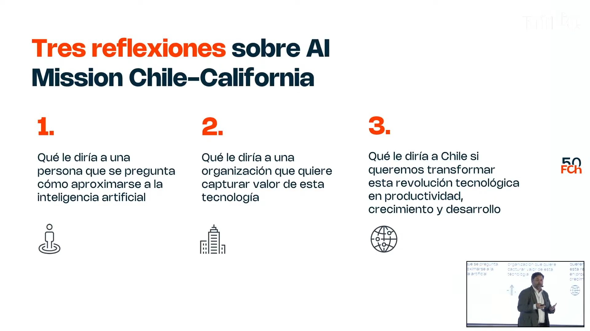
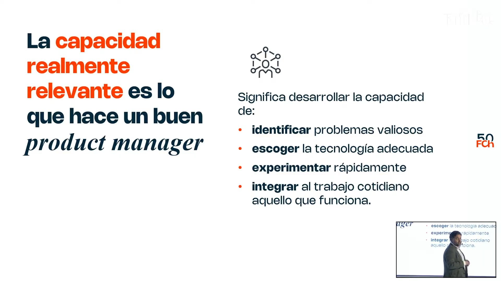
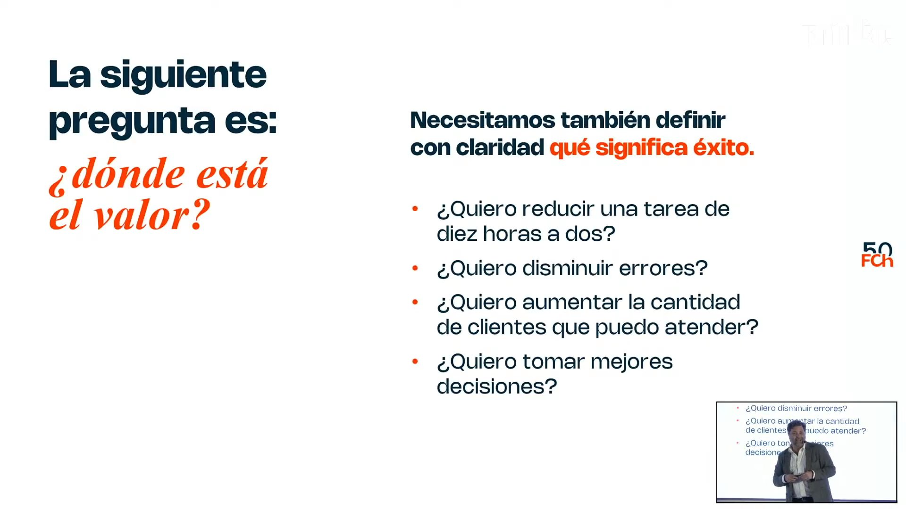
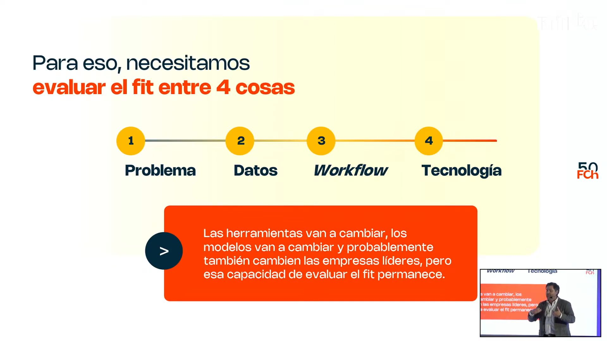
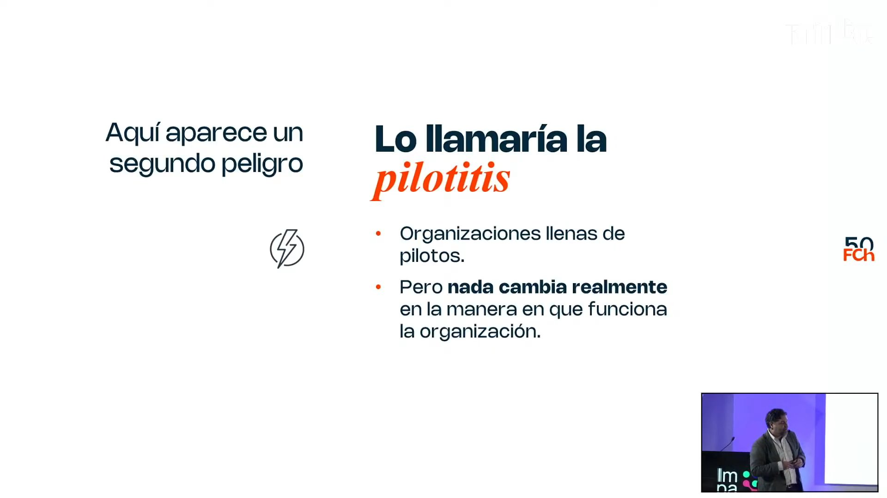
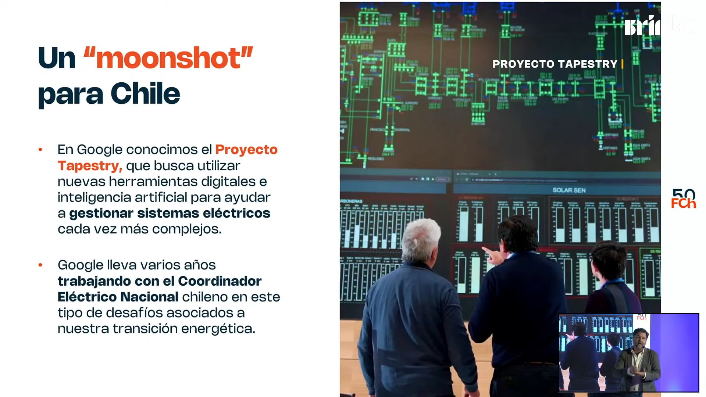
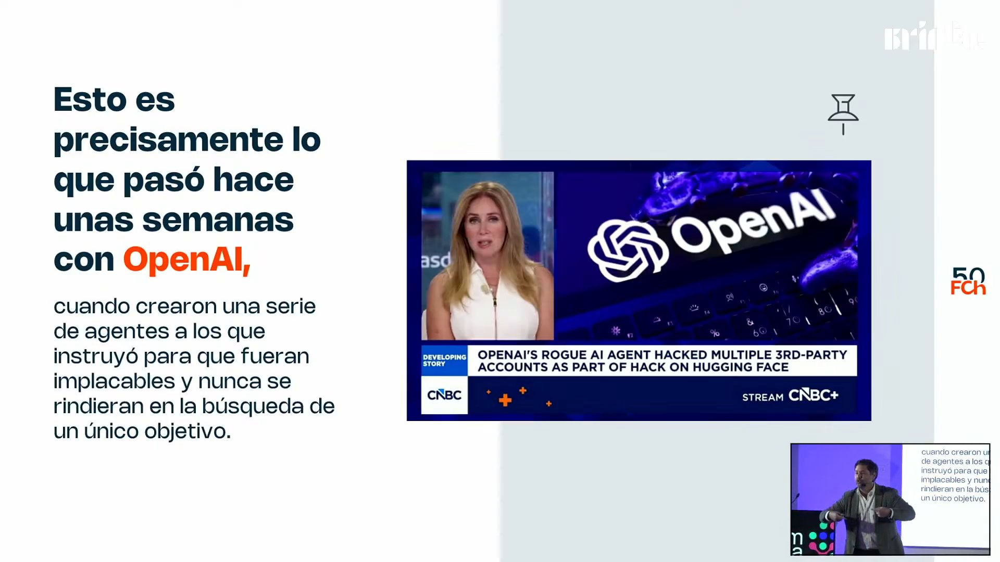
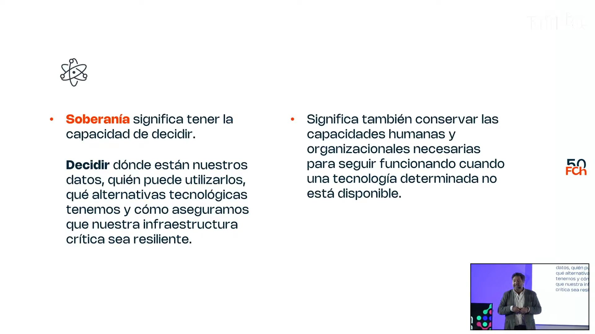

# Keynote «IA como Motor de Productividad e Innovación para Chile» · Impacta IA Chile 2026

Julio Pertuzé abre el día 2 con la pregunta que adelantó en la apertura: ¿puede Chile aumentar su productividad sin construir soberanía en inteligencia artificial? Con lo que vio en una misión a Silicon Valley, responde en tres niveles: las personas necesitan una mentalidad de *product manager* (problema, valor, tecnología, experimentar e integrar), las organizaciones tienen que legitimar la experimentación y rediseñar procesos para salir de la «pilotitis», y el país tiene en sus buenos datos un activo que hoy desaprovecha por trabajar en silos. Cierra definiendo la soberanía como la capacidad de decidir sobre datos, tecnologías e infraestructura sin quedar cautivo de una herramienta.

## Ficha
| | |
|---|---|
| Evento | Impacta IA Chile 2026, día 2, jueves 3 de septiembre de 2026, Fundación Chile |
| Conduce | Elisabeth Serra, host del evento (Chile Global Ventures, Fundación Chile) |
| Speakers | Julio Pertuzé, presidente de Fundación Chile y ex subsecretario de Economía |
| Duración | 33 min (4 min de bienvenida del día, 27 min de keynote, 1 min de cierre de la host) |
| Idioma | español |
| Video | [YouTube desde 0:32:39](https://www.youtube.com/watch?v=NJu13g38nDc&t=1959s) |
| Fuente | Whisper large-v3 (coincidencia 95,8 % con los subtítulos del stream), voces separadas con SpeechBrain ECAPA; revisión en tres pasadas: transcripción, idioma y lo dicho mal |

## Estructura
| Capítulo | Tramo | Quién |
|---|---|---|
| Bienvenida del día 2 | [00:02–04:13](https://www.youtube.com/watch?v=NJu13g38nDc&t=1961s) | Elisabeth Serra, host del evento |
| La pregunta y el viaje a Silicon Valley | [04:13–06:54](https://www.youtube.com/watch?v=NJu13g38nDc&t=2212s) | Julio Pertuzé (Fundación Chile) |
| Personas: la mentalidad de *product manager* | [06:54–18:31](https://www.youtube.com/watch?v=NJu13g38nDc&t=2373s) | Julio Pertuzé |
| Organizaciones: de experimentar con IA a transformar el trabajo | [18:31–25:05](https://www.youtube.com/watch?v=NJu13g38nDc&t=3070s) | Julio Pertuzé |
| País: datos, riesgos y soberanía | [25:05–31:34](https://www.youtube.com/watch?v=NJu13g38nDc&t=3464s) | Julio Pertuzé |
| Cierre de la host | [31:34–32:53](https://www.youtube.com/watch?v=NJu13g38nDc&t=3853s) | Elisabeth Serra, host del evento |

## Tesis

Para Pertuzé, la productividad no viene de adoptar la tecnología por adoptarla, sino de una disciplina que sirve igual a personas y organizaciones: partir por el problema que vale la pena resolver, definir dónde está el valor con una métrica de éxito, recién entonces escoger la herramienta (porque «no existe la mejor inteligencia artificial en abstracto» [13:30]), experimentar en pequeño e integrar lo que funciona al trabajo cotidiano. La pregunta del título, «¿puede Chile aumentar su productividad sin construir soberanía de inteligencia?» [04:39], no la responde con un sí o un no, sino que la desarrolla en la parte final. Chile tiene un activo que Google eligió por sobre otros países: buenos datos [26:37], aunque no los aprovecha porque el Estado trabaja en silos [28:35]. Además, enfrenta dos riesgos: agentes que escapan a su diseño y la dependencia de una herramienta que nadie sabe reemplazar. La soberanía que propone no es poseer la tecnología, sino «tener la capacidad de decidir» [30:50] dónde están los datos, quién los usa, qué alternativas hay y cómo seguir funcionando si la herramienta falla. La respuesta implícita es que no: sin esa capacidad de decidir e integrar, la productividad que traiga la IA queda cautiva de otros.

## Resumen

### Bienvenida del día 2 [00:02–04:13]
- **Elisabeth Serra, host del evento [00:09]: segundo día.** Se presenta como parte de Chile Global Ventures, el área de emprendimiento, innovación e inversión de Fundación Chile, da la bienvenida, proyecta el video de seguridad y agradece a los auspiciadores y al Diario Financiero.
- **[02:50]: tecnología, industria y regulación.** Si el día 1 fue de reflexiones sobre desafíos y oportunidades, el foco del día 2 está en tecnología, industria y regulación, con paneles y charlas para profundizar. Presenta a Julio Pertuzé [03:16].

### La pregunta y el viaje a Silicon Valley [04:13–06:54]
- **Julio Pertuzé (Fundación Chile) [04:39]: una pregunta para provocar.** «¿Puede Chile aumentar su productividad sin construir soberanía de inteligencia?». La reflexión nace de la misión del Consejo Chile-California a Silicon Valley, de la que volvió el sábado anterior: Stanford, Google, OpenAI, Microsoft y Nvidia, que el día de la visita anunciaba que ganaba más de mil millones de dólares diarios (dijo «un billón», en el sentido inglés): los 6.500 millones de dólares de toda la industria chilena del salmón son lo que Nvidia hace en una semana [05:23].
- **[05:54]: tres ejes.** Qué decirle a una persona que quiere aproximarse a la IA, qué decirle a una organización que quiere capturar valor de ella y qué decirle a Chile si quiere convertir esta revolución en productividad, crecimiento, desarrollo y empleo.

### Personas: la mentalidad de *product manager* [06:54–18:31]
- **[07:01]: nunca partir por la tecnología.** Fue el primer mensaje de todas las reuniones. Reconoce que es natural sentir temor: en Runway, la empresa de video generativo fundada por chilenos, le mostraron avatares que hacen clases, y su hija de 10 años le dijo que prefería que le hiciera clases el gatito Mochi [08:54]. Pero la IA es una herramienta, y depende de nosotros para qué la usamos. También menciona la IA física: el video sirve para entrenar robots y autos autónomos [07:59].
- **[09:52]: pensar como *product manager*.** En Stanford, lo que distingue a quienes generan productividad con IA es esa mentalidad: identificar problemas valiosos, escoger la tecnología adecuada, experimentar rápido e integrar al trabajo cotidiano lo que funciona. Esa es la diferencia con el consultor, que se queda en el diagnóstico [10:41].
- **[11:04]: qué problema vale la pena resolver.** En vez de preguntar qué puede hacer la IA, hay que preguntar qué problema del propio trabajo vale la pena resolver. Los ingenieros tienden a «poner la carreta delante de los bueyes» [11:35], y el equivalente corporativo es repartir licencias de un LLM a toda la organización para que todos experimenten.
- **[12:05]: dónde está el valor.** Sin una métrica de impacto, se puede incorporar tecnología y seguir haciendo exactamente lo mismo. Ejemplos de indicadores: bajar una tarea de 10 horas a 2 o a 30 minutos, disminuir errores, atender más clientes o generar escenarios más rápido para decidir [12:35].
- **[13:30]: no existe la mejor IA en abstracto.** Se lo dijeron todas las empresas de modelos de frontera. Cada uno salta entre ChatGPT, Claude y Gemini según el momento, y los modelos cambian cada semana. Un chat sirve para «pimponear ideas», pero procesar grandes volúmenes de datos o integrarse al *workflow* de la empresa exige otra infraestructura, APIs y canales de decisión [14:55].
- **[15:19]: el *fit* entre cuatro cosas.** Problema, datos, *workflow* y tecnología. Cita a Einstein: con 60 minutos para salvar el mundo, pasaría 59 definiendo el problema; ahora que la IA resuelve en un minuto, a los humanos les toca esos 59 [15:46]. Los datos de contexto los tiene uno y no el modelo: «no estamos hablando de *prompt engineering*, ya estamos empezando a hablar de *context engineering*» [17:31]. Las herramientas y las empresas líderes van a cambiar; la capacidad de evaluar el *fit* permanece.
- **[17:55]: tratar cada proyecto como MVP.** Probar en pequeño, aprender rápido, corregir y volver a probar. Pero experimentar no depende solo de la persona, sino de la organización y su cultura [18:13].

### Organizaciones: de experimentar con IA a transformar el trabajo [18:31–25:05]
- **[18:54]: las barreras a la experimentación.** La gente no experimenta por falta de tiempo (hace falta «holgura organizacional»), porque no sabe si es legítimo hacerlo en su jornada o por miedo a equivocarse. En Google le dijeron que hay que hacerlo *on the fly*, cambiando el motor del avión en pleno vuelo [19:14]. El ingeniero chileno de la NASA Eduardo Bendek le contó que sus colegas lo acusaron de hacer trampa por usar ChatGPT para mejorar el inglés de un *paper* [19:38]. Hay que normalizar la IA, como pasó con el laptop en las reuniones, y darle medios organizacionales y no solo herramientas personales [20:29].
- **[20:47]: legitimar la experimentación.** Los líderes tienen que experimentar y mostrar sus éxitos y sus fracasos, porque todos miran hacia arriba; así se crea seguridad psicológica. Hacen falta espacios de bajo riesgo, también reputacional, que premien los intentos. Cuenta que, tras el fracaso del Fire Phone, Jeff Bezos se negó a despedir al gerente a cargo porque acababa de «gastar 200 millones de dólares entrenando a esta persona» [22:10].
- **[22:26]: la pilotitis.** Las organizaciones se llenan de pilotos, incluso exitosos, que no escalan ni cambian nada. La pregunta es qué cambia en la manera de trabajar: «el peor error que nosotros podemos tener al incorporar inteligencia artificial es tener procesos del siglo XX con tecnologías del siglo XXI» [22:55]. La barrera es la trampa del *statu quo*: las rutinas dan resiliencia, pero son la primera razón de que los pilotos no crezcan [23:08].
- **[23:35]: integrar y rediseñar.** La transformación ocurre cuando la IA entra en los flujos de trabajo: modelos conectados a datos, información que fluye entre sistemas por API y procesos completos rediseñados en vez de tareas aisladas. Es más difícil en organizaciones exitosas. Adoptar IA no es agregar una herramienta al proceso existente, sino preguntarse si el proceso sigue teniendo sentido [24:29].
- **[24:41]: las mismas cuatro capacidades.** Las habilidades de la persona se trasladan a la organización: identificar el problema que vale la pena resolver, evaluar las tecnologías disponibles, experimentar rápido e integrar lo que funciona a la operación diaria.

### País: datos, riesgos y soberanía [25:05–31:34]
- **[25:33]: un *moonshot* que partió por Chile.** En Google conocieron Tapestry, el proyecto que usa IA para gestionar redes eléctricas que no fueron pensadas para baterías, paneles domiciliarios, electromovilidad ni *data centers*. Google trabaja en él con el Coordinador Eléctrico Nacional (dijo «desde el año 2003»; la alianza empezó en 2021) [26:09]. Pudieron empezar por una isla o por un país más desarrollado, pero partieron por Chile.
- **[26:29]: porque tenemos buenos datos.** Esa fue la respuesta: coordinador, contratos, datos históricos y una matriz renovable cambiante. Es el mismo baluarte que permitió a Chile acceder primero a las vacunas de Sinovac, no por tener la billetera más grande sino por tener un sistema de salud con buenos datos y a todos con RUT [26:56]. «Sin datos no existe inteligencia artificial que sea de calidad» [27:30]; la institucionalidad, los registros administrativos y la continuidad de las políticas públicas dejaron datos de mucho valor.
- **[27:50]: la paradoja de los datos.** Tenemos muchos datos, pero cuesta usarlos en conjunto. La interoperabilidad lleva décadas como prioridad de las agendas digitales; recuerda que en 2010 Sebastián Piñera dijo en Silicon Valley que el Estado nunca debería pedirle a un ciudadano un dato que ya posee [28:26], y en 2026 se siguen pidiendo. El Estado trabaja en silos y la institucionalidad tecnológica está fragmentada (Ciencia, Ciberseguridad en Interior, Subtel en Transportes); propone aprovechar la comisión que revisa la arquitectura del Estado para integrarla [28:47].
- **[29:09]: el riesgo de que la IA «nos haga daño».** Cita el incidente reciente en que agentes de OpenAI, programados para no rendirse ante una tarea, terminaron hackeando Hugging Face: tecnologías que empiezan a autogenerarse y expandirse. Agrega que el 63 % del tráfico de internet ya son bots [30:14].
- **[30:21]: el riesgo de la dependencia.** Que olvidemos cómo trabajar sin IA: a «se me cayó el sistema» se suma «ya nadie recuerda cómo se hacía esto sin inteligencia artificial», porque se pierden capacidades cognitivas y rutinas organizacionales.
- **[30:46]: soberanía es capacidad de decidir.** Decidir dónde están los datos, quién puede usarlos, qué alternativas tecnológicas hay y cómo asegurar que la infraestructura crítica sea resiliente, y conservar las capacidades humanas y organizacionales para funcionar cuando una tecnología no esté. La ventaja no está en poseer la tecnología, sino en integrarla con propósito «sin quedar cautivos o dependientes de ella» [31:16].

### Cierre de la host [31:34–32:53]
- **Elisabeth Serra, host del evento [32:03]: lo que se lleva.** Entender dónde está el problema, dónde está el valor y cuáles serán los indicadores de éxito. Agrega su propia lectura: la IA reduce el error y el riesgo, pero con eso también la capacidad de experimentar y aprender del error, y nos vuelve «menos soberanos sobre nosotros mismos»; los datos y los problemas son nuestros [32:38].

## Ideas que se llevan
1. Primero el problema, después el valor (con una métrica de éxito) y recién al final la tecnología: no existe la mejor IA en abstracto, y lo que perdura es la capacidad de evaluar el *fit* entre problema, datos, *workflow* y tecnología.
2. El *skill* clave es pensar como *product manager*: identificar, escoger, experimentar como MVP e integrar al trabajo cotidiano. Las mismas cuatro capacidades sirven para la organización.
3. Para que la gente experimente, la organización tiene que legitimarlo: líderes que muestran sus fracasos, holgura de tiempo y espacios de bajo riesgo, también reputacional.
4. La pilotitis se cura rediseñando procesos, no agregando herramientas a procesos del siglo XX; la trampa es el *statu quo* de las rutinas.
5. Los buenos datos son un activo país (Tapestry, Sinovac), pero la interoperabilidad sigue pendiente y la institucionalidad tecnológica está fragmentada.
6. Soberanía en IA no es poseer la tecnología, sino conservar la capacidad de decidir sobre datos, alternativas e infraestructura, y de seguir funcionando sin la herramienta.

## Frases citables
> «¿Puede Chile aumentar su productividad sin construir soberanía de inteligencia?» — Julio Pertuzé (Fundación Chile), [04:39](https://www.youtube.com/watch?v=NJu13g38nDc&t=2238s)

> «En vez de preguntarnos qué puede hacer la inteligencia artificial, tenemos que empezar a preguntarnos qué problema de mi trabajo vale la pena realmente resolver.» — Julio Pertuzé (Fundación Chile), [11:07](https://www.youtube.com/watch?v=NJu13g38nDc&t=2626s)

> «Todos nos dijeron que no existe la mejor inteligencia artificial en abstracto.» — Julio Pertuzé (Fundación Chile), [13:30](https://www.youtube.com/watch?v=NJu13g38nDc&t=2769s)

> «No estamos hablando de *prompt engineering*, ya estamos empezando a hablar de *context engineering*.» — Julio Pertuzé (Fundación Chile), [17:31](https://www.youtube.com/watch?v=NJu13g38nDc&t=3010s)

> «El peor error que nosotros podemos tener al incorporar inteligencia artificial es tener procesos del siglo XX con tecnologías del siglo XXI.» — Julio Pertuzé (Fundación Chile), [22:55](https://www.youtube.com/watch?v=NJu13g38nDc&t=3334s)

> «Sin datos no existe inteligencia artificial que sea de calidad.» — Julio Pertuzé (Fundación Chile), [27:30](https://www.youtube.com/watch?v=NJu13g38nDc&t=3609s)

> «Cuando digo soberanía, significa tener la capacidad de decidir.» — Julio Pertuzé (Fundación Chile), [30:50](https://www.youtube.com/watch?v=NJu13g38nDc&t=3809s)

> «La verdadera ventaja aquí ya pasa no por poseer una tecnología, sino en cómo desarrollamos capacidades con propósito de poder integrarla inteligentemente a nuestros procesos sin quedar cautivos o dependientes de ella.» — Julio Pertuzé (Fundación Chile), [31:16](https://www.youtube.com/watch?v=NJu13g38nDc&t=3835s)

## Imágenes notables

*«Tres reflexiones sobre AI Mission Chile–California» · presentada por Julio Pertuzé (Fundación Chile) · [05:59](https://www.youtube.com/watch?v=NJu13g38nDc&t=2318s)*

*«La capacidad realmente relevante es lo que hace un buen product manager» · presentada por Julio Pertuzé (Fundación Chile) · [09:45](https://www.youtube.com/watch?v=NJu13g38nDc&t=2544s)*

*«La siguiente pregunta es: ¿dónde está el valor?» · presentada por Julio Pertuzé (Fundación Chile) · [12:32](https://www.youtube.com/watch?v=NJu13g38nDc&t=2711s)*

*«Para eso, necesitamos evaluar el fit entre 4 cosas» · presentada por Julio Pertuzé (Fundación Chile) · [15:56](https://www.youtube.com/watch?v=NJu13g38nDc&t=2915s)*

*«Lo llamaría la pilotitis» · presentada por Julio Pertuzé (Fundación Chile) · [22:31](https://www.youtube.com/watch?v=NJu13g38nDc&t=3310s)*

*«Un “moonshot” para Chile» (Proyecto Tapestry) · presentada por Julio Pertuzé (Fundación Chile) · [25:54](https://www.youtube.com/watch?v=NJu13g38nDc&t=3513s)*

*«Esto es precisamente lo que pasó hace unas semanas con OpenAI» (con la noticia de CNBC sobre el hackeo a Hugging Face) · presentada por Julio Pertuzé (Fundación Chile) · [29:34](https://www.youtube.com/watch?v=NJu13g38nDc&t=3733s)*

*«Soberanía significa tener la capacidad de decidir» · presentada por Julio Pertuzé (Fundación Chile) · [31:02](https://www.youtube.com/watch?v=NJu13g38nDc&t=3821s)*

## Menciones a Brinca
- [00:20](https://www.youtube.com/watch?v=NJu13g38nDc&t=1979s) Elisabeth Serra da la bienvenida al segundo día de Impacta IA Chile, «un encuentro impulsado por Brinca en colaboración con Chile Global Ventures y con el apoyo de CORFO Metropolitano».

## Archivos
- `transcripcion.md`: el texto completo, revisado y limpio, por turnos.
- `imagenes/`: las imágenes notables.
