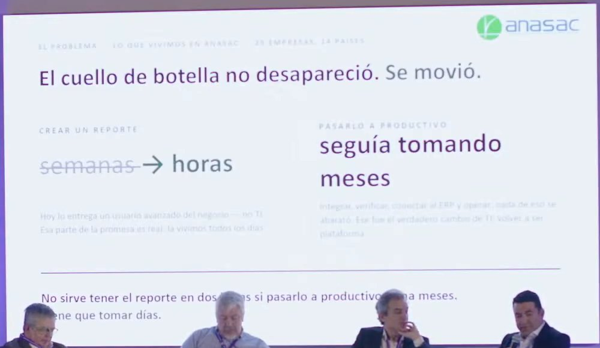
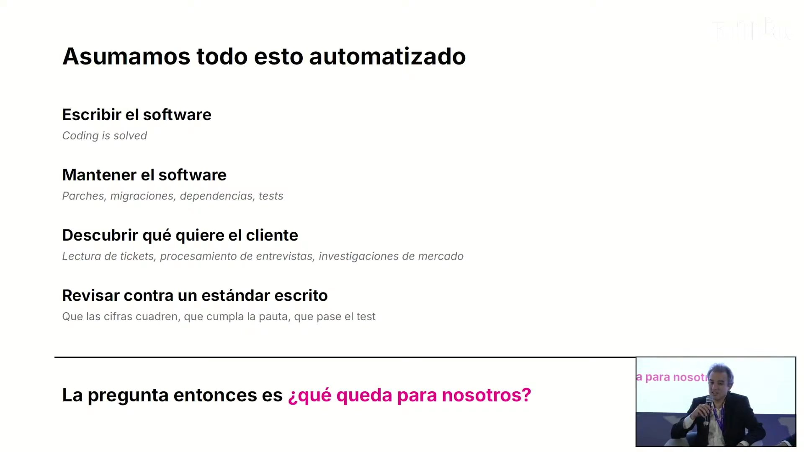
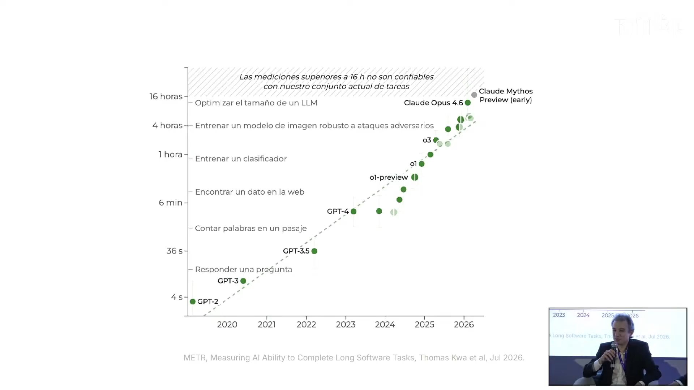
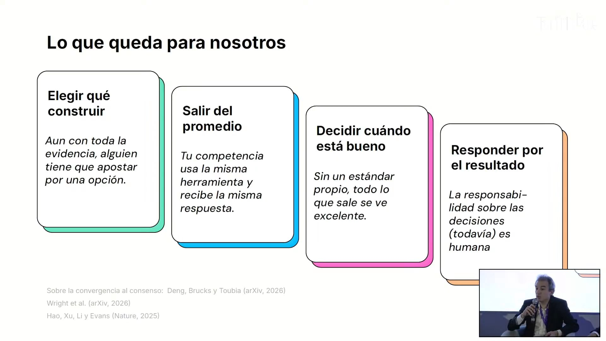
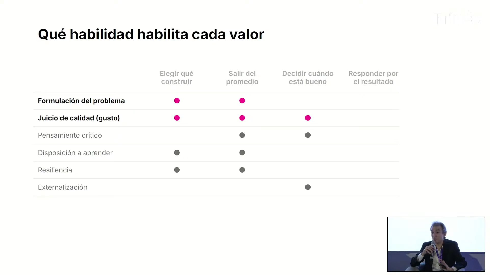
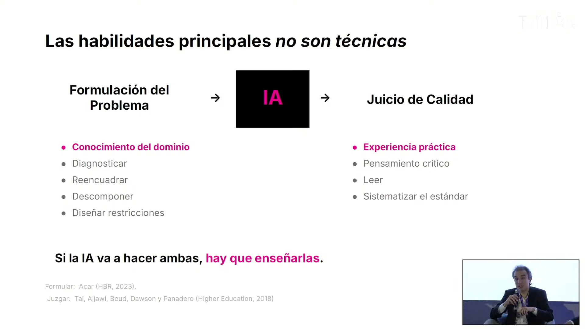

# Panel «La revolución del vibe coding al interior de las empresas: nuevos paradigmas» · Impacta IA Chile 2026

Con el vibe coding, crear una aplicación dejó de ser lo difícil: la gente del negocio llega con reportes y apps casi listos, sin pedir permiso. El panel muestra dónde quedó el problema. Ponerlo en producción, integrarlo y gobernarlo sigue tomando meses, y lo escaso pasa a ser el criterio humano para elegir qué construir, juzgar la calidad y responder por el resultado.

## Ficha
| | |
|---|---|
| Evento | Impacta IA Chile 2026, día 2, jueves 3 de septiembre de 2026, Fundación Chile |
| Conduce | Elisabeth Serra, host del día 2 (Fundación Chile, Chile Global Ventures) |
| Modera | Marcos Thomas, CEO y fundador de Tesserix Capital, director de innovación de Brinca y ex SVP de innovación de Banco Santander |
| Speakers | Ángel Izurieta, Vice President Latinoamérica de Huawei Cloud · Carlos Araya, gerente de finanzas y tecnología de ANASAC · Nicolás Rivas, gerente de soluciones de IA de Brinca, cofundador de Salesia y doctor en física |
| Duración | 54 min (7 min de presentación y encuadre, ponencias de 5, 7 y 7 min, rondas de interacción de 9 y 15 min y 4 min de cierre) |
| Idioma | español, con términos en inglés (*vibe coding*, *prompt*, *shadow AI*, *use / compose / build*, *AI literacy*, *FinOps*) |
| Video | [YouTube desde 1:06:13](https://www.youtube.com/watch?v=NJu13g38nDc&t=3973s) |
| Fuente | Whisper large-v3 (coincidencia 92,9 % con los subtítulos del stream), voces separadas con SpeechBrain ECAPA; revisión en tres pasadas: transcripción, idioma y lo dicho mal |

## Estructura
| Capítulo | Tramo | Quién |
|---|---|---|
| Presentación y encuadre del moderador | [00:08–06:59](https://www.youtube.com/watch?v=NJu13g38nDc&t=3973s) | Elisabeth Serra; Marcos Thomas (Tesserix Capital) |
| Ponencia de Ángel Izurieta: el iceberg del vibe coding | [06:59–12:28](https://www.youtube.com/watch?v=NJu13g38nDc&t=4384s) | Ángel Izurieta (Huawei Cloud) |
| Ponencia de Carlos Araya: el cuello de botella se movió | [12:28–19:04](https://www.youtube.com/watch?v=NJu13g38nDc&t=4713s) | Carlos Araya (ANASAC) |
| Ponencia de Nicolás Rivas: lo que queda para nosotros | [19:04–25:53](https://www.youtube.com/watch?v=NJu13g38nDc&t=5109s) | Nicolás Rivas (Brinca) |
| Interacción: autonomía, paso a producción y lo que debe saber un líder | [25:53–34:36](https://www.youtube.com/watch?v=NJu13g38nDc&t=5518s) | Carlos Araya, Ángel Izurieta, Nicolás Rivas |
| Interacción: qué usar, qué componer y qué construir | [34:36–49:42](https://www.youtube.com/watch?v=NJu13g38nDc&t=6041s) | Carlos Araya, Ángel Izurieta, Nicolás Rivas |
| Cierre: innovar, adoptar y escalar | [49:42–54:02](https://www.youtube.com/watch?v=NJu13g38nDc&t=6947s) | los tres panelistas, en 30 segundos cada uno |

## Tesis

El vibe coding cambia quién puede crear dentro de una empresa [03:52], pero no elimina el trabajo: lo cambia de lugar. Lo que se abarató es escribir el código. Integrar, verificar, conectar al ERP y operar sigue tomando meses, y por eso «la velocidad local no sirve, porque no se convierte en velocidad empresarial» [17:53]. Debajo de la app que se ve hay un 99 % de seguridad, datos integrados y sistemas legados [07:22], y lo que no se habilita desde la empresa termina como *shadow AI* [11:16]. Con ejecución abundante, lo escaso es el criterio [25:42]: elegir qué construir y apostar por ello, salir del promedio al que llevan unos pocos modelos, juzgar cuándo algo está bueno y responder por el resultado. La respuesta organizacional que comparten los tres panelistas es dar libertad para crear, gobernar por dónde se crea (accesos, datos reales, catálogo, costos) y medir cada iniciativa por si llega a producción y mueve el estado de resultados.

## Resumen

### Presentación y encuadre del moderador [00:08–06:59]
- **Elisabeth Serra [00:08]: otro título.** La host presenta el panel como «la IA generativa y los agentes autónomos están transformando la arquitectura del software corporativo» y lee los cargos de los cuatro participantes.
- **Marcos Thomas (Tesserix Capital) [02:03]: tres bloques y algo para el lunes.** El panel tendrá un contexto inicial, cuatro minutos por panelista y una conversación, con la idea de llevarse algo concreto para aplicar el lunes.
- **[02:52]: cambia quién puede crear.** Hasta 2024, una buena idea en finanzas, operaciones o recursos humanos había que traducírsela a alguien que supiera programar. Con vibe coding esa frontera desaparece y se pasa de la idea a algo funcionando en horas. Más que una revolución de productividad, la capacidad de crear se distribuye, y eso obliga a nuevas preguntas: si se debe construir, qué parte debe ser propia, cómo gobernarla y cómo saber si crea valor [03:52].
- **[04:34]: usar, componer o construir.** Desarrollar modelos de frontera exige cada vez más capital, cómputo, energía y talento, mientras usarlos es cada vez más barato. Las empresas pueden usar la inteligencia que otros desarrollan, componerla con sus datos, procesos y contexto, o construir algo propio cuando hay diferenciación real.
- **[05:41]: los tres ángulos.** Ángel Izurieta aporta la infraestructura que hace seguro, integrado y escalable el vibe coding; Carlos Araya, la prueba de realidad de una empresa físico-digital vista a la vez como CFO y como responsable de tecnología; Nicolás Rivas, la «infraestructura humana»: qué capacidades necesitan las personas cuando la ejecución se automatiza.

### Ponencia de Ángel Izurieta: el iceberg del vibe coding [06:59–12:28]
- **Ángel Izurieta (Huawei Cloud) [07:22]: el 1 % fuera del agua.** La app que se genera es la punta del iceberg; para que tenga grado empresarial hay que ocuparse de lo que está abajo.
- **[08:15]: primer pilar, la seguridad.** Si finanzas, recursos humanos y marketing hacen apps «a lo loco», hay que controlar a qué datos accede cada una y con qué permisos, para que una app no termine publicando el sueldo del gerente general en un post viral.
- **[09:09]: segundo pilar, romper los silos.** Una app de un área necesita datos de otras, repartidos en distintos sistemas. Recuerda a Julio Pertuzé (dia2-01): el valor de la IA generativa está en el contexto, no en el prompt, porque los modelos ya entienden bien lo que se escribe mal. Integrar exige volver a pensar en workflows y procesos, como en la reingeniería de hace 30 años, «enamorados del problema» y no de la tecnología.
- **[10:42]: tercer pilar, modernizar los sistemas legados.** No es fácil leer la cartola de un core bancario o un sistema que solo está en la planta.
- **[11:16]: el riesgo del shadow AI.** Si la organización no da herramientas, la gente usa las de su casa y les entrega datos confidenciales. Hay que dar un marco y un lugar seguro.
- **Marcos Thomas [12:01]: el resumen.** Generar es cada vez más fácil; operar con confianza y a escala, no necesariamente.

### Ponencia de Carlos Araya: el cuello de botella se movió [12:28–19:04]
- **Carlos Araya (ANASAC) [13:08]: llegaron las apps al 80 %.** ANASAC es un grupo químico industrial chileno con 12 unidades de negocio y cerca de 25 sociedades en 14 países. Hace algunos meses empezó a ver lo que no había visto en 10 años a cargo de tecnología: gente del negocio que no sabía programar llegaba con reportes y aplicaciones casi listos, hechos con herramientas como Claude o Codex, sin pedir permiso. «La forma de desarrollar cambió sin darnos cuenta.»
- **[14:32]: desapareció la fila de entrada.** Antes había una fila en analítica y en desarrollo tecnológico, donde se priorizaba y evaluaba. La gente se la saltó. Un reporte que tomaba meses ahora sale en horas.
- **[15:26]: el taco se corrió a la salida.** Como cuando se ensancha un tramo de autopista, el cuello de botella pasó a integrar el reporte, verificarlo, cumplir con la ciberseguridad, conectarlo al ERP y operarlo. Nada de eso se abarató; se hizo más complejo, y tecnología tuvo que «volver a ser plataforma».
- **[16:28]: aplicaciones que nadie imaginó.** Áreas muy específicas, que solo existen en esa empresa, empezaron a crear aplicaciones de negocio que tecnología nunca habría propuesto.
- **[17:10]: el agente que termina en un Excel.** Probaron un agente gratuito de Anthropic para conciliar unas 150 cuentas bancarias: lo que tomaba horas a un analista lo hace en tres minutos, pero el resultado termina en un Excel que hay que integrar al flujo de la empresa. «La velocidad local no sirve, porque no se convierte en velocidad empresarial» [17:53]. La ventaja ya no la tiene el desarrollador sino la persona del negocio que sabe qué hay que hacer.
- **Marcos Thomas [18:24]: el resumen.** Se eliminó la fila de entrada, no la de salida; la velocidad de una app no es la velocidad de la empresa.

### Ponencia de Nicolás Rivas: lo que queda para nosotros [19:04–25:53]
- **Nicolás Rivas (Brinca) [19:28]: asumamos todo automatizado.** Escribir software, mantenerlo, descubrir qué quiere el cliente (como hacen ya los product managers que procesan entrevistas y tickets con IA) y revisar contra un estándar.
- **[20:34]: la tendencia.** Muestra el gráfico de METR: cada año los modelos resuelven tareas que a un humano le toman más tiempo.
- **[21:05]: cuatro respuestas a qué nos queda.** Elegir qué construir, en el sentido de apostar: alguien tiene que poner el *skin in the game*. Salir del promedio: varios estudios muestran que la IA lleva a la convergencia, porque todos usan unos pocos modelos; por eso discrepa de Ángel, ya que el buen prompt es lo que saca del promedio. Decidir cuándo algo está bueno: criterio de calidad o gusto. Y responder por el resultado.
- **[22:19]: dos habilidades, el input y el output.** Formular bien el problema y hacer el juicio de calidad. La formulación es donde entra el conocimiento: nunca ha sido más relevante, por ejemplo, saber programar, aunque el código lo escriba la IA. El juicio se construye con experiencia práctica, y empieza por algo básico: leer lo que entregó la IA [23:54].
- **[24:19]: el juicio también se puede sistematizar.** No es algo exclusivamente humano: viene del conocimiento tácito, que se puede escribir como rúbrica para que la IA evalúe. Por ahora, formular y juzgar son los roles más relevantes de la persona frente a la IA.
- **Marcos Thomas [25:42]: el resumen.** Cuando la ejecución deja de ser escasa, lo escaso es el criterio.

### Interacción: autonomía, paso a producción y lo que debe saber un líder [25:53–34:36]
- **Carlos Araya [26:50]: lo que entusiasma y lo que preocupa.** Le entusiasma que el negocio cree cosas que tecnología no imaginaba. Le preocupa que no se conecten a datos reales, que dos áreas dupliquen lo mismo y que lo creado no se integre: sin eso, el vibe coding producirá «la siguiente generación» de la planilla Excel de un giga que solo una persona entiende [27:50]. También le preocupa dónde quedan los datos con la nueva ley de protección de datos, y que los procesos de decisión sean más lentos que la tecnología: de 10 decisiones al año se pasó a 10 a la semana [28:40].
- **[29:12]: libertad para crear, control del «por dónde».** Daría libertad completa al negocio, porque lo contrario «es como cortar las alas». El foco del control es otro: dar accesos al dato real, métodos que permitan integrar y un catálogo para detectar desarrollos duplicados. «Más que controlar el qué hacemos o el cómo lo hacemos, desarrollar el por dónde lo hacemos» [30:00].
- **Ángel Izurieta [30:27]: del prototipo a algo que no se caiga a las 3 de la mañana.** El vibe coding sirve para probar ideas y descentralizar la innovación, pero llevar ese «pilotito» a producción exige todo lo anterior, para que los ejecutivos duerman tranquilos cuando la app ya opera [32:12]. Cuando Ángel le pregunta por Santander, Marcos bromea que, menos mal, no estaba en tecnología [31:32].
- **Nicolás Rivas [32:35]: la alfabetización mínima de un líder es hacer vibe coding.** Sin experiencia de primera mano no se cree, o parece magia que algo de un año salga en una semana. El líder necesita una visión clara de qué es relevante para la empresa y de qué será de su equipo cuando su trabajo se automatice, y ver la IA como herramienta de innovación y no solo de productividad [33:57]. No se trata de decirle a la gente que aprenda, sino de usarla él mismo.

### Interacción: qué usar, qué componer y qué construir [34:36–49:42]
- **Marcos Thomas [34:36]: la paradoja.** Si se puede construir casi cualquier cosa, decidir qué no construir se vuelve la decisión importante.
- **Carlos Araya [36:16]: separar productividad personal de procesos sistémicos.** Una licencia de IA es como el notebook de hace 20 años: a nadie se le ocurre pedirle ROI [37:10]; ahí lo escaso es el tiempo de las personas. En los procesos sistémicos se aplica todo el rigor, porque una iniciativa mal elegida cuesta plata, tiempo y algo más importante, el empuje: la credibilidad frente al comité y los accionistas.
- **[37:41]: tres criterios.** ¿Impacta el estado de resultados? (si vale la pena). ¿Tenemos los datos? (si se puede). ¿Toca nuestra habilidad central, como la logística para Amazon o el diseño para Apple? Si es algo que hacen todas las empresas, *use*; si el valor está en los datos propios, *compose*, que es la mayoría; si fortalece la habilidad central, *build* [39:13].
- **[40:15]: dos estados de resultados.** Una iniciativa mueve el de la empresa (bajar costos, mejorar margen, algo que el cliente no nota) o el del cliente (lo que diferencia frente a la competencia).
- **Ángel Izurieta [41:51]: el modelo es lo que menos importa.** Las brechas entre modelos son marginales; en las comunidades se discute por un 2 % de diferencia entre Claude y Gemini. Lo propio son dos cosas: los datos y el contexto de la empresa [42:44] y el conocimiento de quien está «en el barro», como el que ajusta los parámetros del químico o la temperatura del horno [43:40].
- **[44:52]: dos mundos de IA.** La del ciudadano de a pie, para una receta o un plan de viaje, y la de grado empresarial, una «cajita» cerrada de la que los datos no salen.
- **Nicolás Rivas [46:27]: aprender qué no hacer es estrategia.** Pide tres cosas al líder: conocer la tecnología y tener escenarios de hacia dónde va «la pelota», porque nadie habla de dónde estaremos en seis meses; tener claro para qué existe su área y cuáles son sus procesos críticos, con la osadía de replantearlos y gestionar el cambio [47:31]; y mirar a los competidores con amplitud, porque esto «es una selva» [49:01]: mañana un informático con título de abogado puede automatizar un documento por el que un estudio cobra un millón y ofrecerlo a 10.000 pesos.

### Cierre: innovar, adoptar y escalar [49:42–54:02]
- **Carlos Araya [50:25]: innovar.** El CEO debe cambiar la pregunta «¿y esto qué hace?», que acumula demos, por «¿cuándo va a estar en productivo, cuánto impacta al negocio y quién es el responsable?».
- **Nicolás Rivas [51:10]: adoptar.** El CEO debe usar la IA en su día a día y para sus propias decisiones; convencido, será su mejor evangelista.
- **Ángel Izurieta [51:54]: escalar.** Centralizaría tres cosas: accesos y control de identidad; gobierno, para que las iniciativas no queden en la pilotitis; y FinOps, porque en una economía de tokens la cuenta puede subir al infinito [52:28].
- **Marcos Thomas [52:46]: cierre.** Espera que el lunes algo de lo dicho ayude a hacer distinto y a producir valor, «que es lo más difícil».

## Ideas que se llevan
1. El cuello de botella no desapareció, se movió: crear una app toma horas, pero integrarla, asegurarla y operarla sigue tomando meses. La velocidad local no es velocidad de empresa (Araya).
2. Debajo de cada app hay un 99 % de seguridad, datos sin silos y sistemas legados; si la empresa no da herramientas seguras, aparece el *shadow AI* (Izurieta).
3. Hay que dar libertad para crear y controlar el «por dónde»: datos reales, plataformas, catálogo de desarrollos, identidad y costos (Araya, Izurieta).
4. Con ejecución abundante, lo escaso es el criterio: elegir qué construir, salir del promedio, decidir cuándo está bueno y responder por el resultado. Se entrena con conocimiento del dominio y experiencia práctica (Rivas).
5. *Use, compose o build*: decidir por impacto en el estado de resultados, disponibilidad de datos y cercanía a la habilidad central. Lo diferencial no es el modelo, sino los datos propios y el conocimiento de la gente (Araya, Izurieta).
6. El líder tiene que usar la IA él mismo, preguntar cuándo llega una iniciativa a producción y quién responde por ella, y vigilar los costos de tokens (Rivas, Araya, Izurieta).

## Frases citables
> «Estamos cambiando quién tiene la capacidad de crear dentro de una empresa.» — Marcos Thomas (Tesserix Capital), [03:52](https://www.youtube.com/watch?v=NJu13g38nDc&t=4197s)

> «La velocidad local no sirve, porque no se convierte en velocidad empresarial.» — Carlos Araya (ANASAC), [17:53](https://www.youtube.com/watch?v=NJu13g38nDc&t=5038s)

> «Más que controlar el qué hacemos o el cómo lo hacemos, desarrollar el por dónde lo hacemos.» — Carlos Araya (ANASAC), [30:00](https://www.youtube.com/watch?v=NJu13g38nDc&t=5765s)

> «Si no nos preocupamos de la duplicidad, de la integración y de que los datos estén conectados […], el vibe coding nos va a llevar a la siguiente generación de Excel gigantesco.» — Carlos Araya (ANASAC), [27:50](https://www.youtube.com/watch?v=NJu13g38nDc&t=5635s)

> «La ejecución deja de ser escasa, pero el criterio empieza a realmente ser la escasez que uno busca solventar.» — Marcos Thomas (Tesserix Capital), [25:42](https://www.youtube.com/watch?v=NJu13g38nDc&t=5507s)

> «Creo que nunca ha sido más relevante, por ejemplo, saber programar. Aunque el código lo escriba la inteligencia artificial.» — Nicolás Rivas (Brinca), [23:09](https://www.youtube.com/watch?v=NJu13g38nDc&t=5354s)

> «Lo que menos importa hoy día, por lejos, es el modelo de inteligencia artificial que tú uses.» — Ángel Izurieta (Huawei Cloud), [41:51](https://www.youtube.com/watch?v=NJu13g38nDc&t=6476s)

> «Una cosa es que yo pueda construir esta app, pero otra cosa es que […] a las 3 de la mañana no ejecuta el proceso.» — Ángel Izurieta (Huawei Cloud), [31:35](https://www.youtube.com/watch?v=NJu13g38nDc&t=5860s)

## Imágenes notables

*«El cuello de botella no desapareció. Se movió.» · presentada por Carlos Araya (ANASAC) · [13:26](https://www.youtube.com/watch?v=NJu13g38nDc&t=4771s) · parcial: solo se vio en la pantalla del escenario, recortada del plano general. Crear un reporte pasó de semanas a horas; pasarlo a productivo sigue tomando meses.*

*«Asumamos todo esto automatizado» · presentada por Nicolás Rivas (Brinca) · [20:01](https://www.youtube.com/watch?v=NJu13g38nDc&t=5166s) · escribir y mantener el software, descubrir qué quiere el cliente y revisar contra un estándar: ¿qué queda para nosotros?*

*«Duración de las tareas que completan los modelos (METR)» · presentada por Nicolás Rivas (Brinca) · [20:36](https://www.youtube.com/watch?v=NJu13g38nDc&t=5201s) · de GPT-2 a Claude Opus 4.6 y Claude Mythos Preview, en escala logarítmica; fuente: METR, *Measuring AI Ability to Complete Long Software Tasks*.*

*«Lo que queda para nosotros» · presentada por Nicolás Rivas (Brinca) · [21:05](https://www.youtube.com/watch?v=NJu13g38nDc&t=5230s) · elegir qué construir, salir del promedio, decidir cuándo está bueno y responder por el resultado.*

*«Qué habilidad habilita cada valor» · presentada por Nicolás Rivas (Brinca) · [22:20](https://www.youtube.com/watch?v=NJu13g38nDc&t=5305s) · matriz de seis habilidades por cuatro valores; destaca la formulación del problema y el juicio de calidad.*

*«Las habilidades principales no son técnicas» · presentada por Nicolás Rivas (Brinca) · [22:53](https://www.youtube.com/watch?v=NJu13g38nDc&t=5338s) · formulación del problema → IA → juicio de calidad: «si la IA va a hacer ambas, hay que enseñarlas».*

## Menciones a Brinca
- [00:56](https://www.youtube.com/watch?v=NJu13g38nDc&t=4021s) La host presenta a Nicolás Rivas como gerente de soluciones de inteligencia artificial de Brinca y, en [01:18](https://www.youtube.com/watch?v=NJu13g38nDc&t=4043s), a Marcos Thomas como director de innovación de Brinca.
- [06:24](https://www.youtube.com/watch?v=NJu13g38nDc&t=4349s) Marcos Thomas: «Nicolás Rivas, desde Brinca, nos lleva a una infraestructura humana».
- [19:06](https://www.youtube.com/watch?v=NJu13g38nDc&t=5111s) Marcos Thomas le da la palabra a «Nicolás, para ti, desde Brinca».
- [19:28](https://www.youtube.com/watch?v=NJu13g38nDc&t=5133s) Nicolás Rivas (Brinca) abre su ponencia sobre lo que queda para las personas cuando la ejecución se automatiza.

## Archivos
- `transcripcion.md`: el texto completo, revisado y limpio, por turnos.
- `imagenes/`: las imágenes notables.
