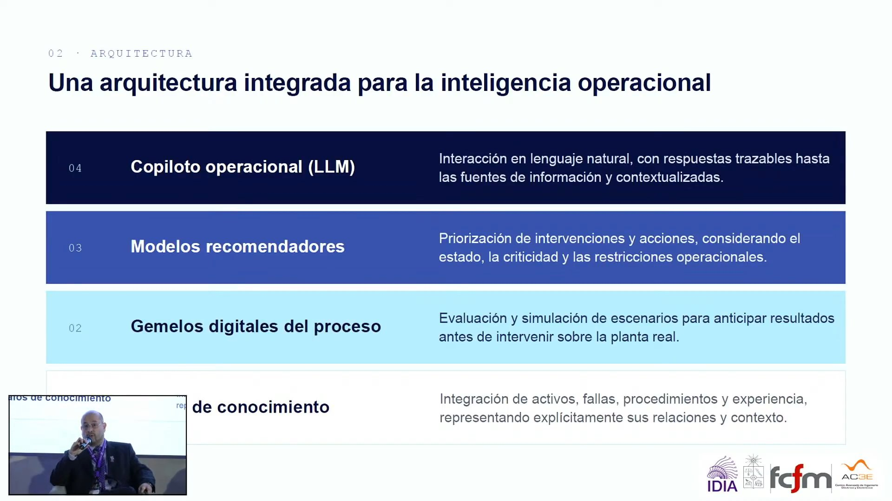
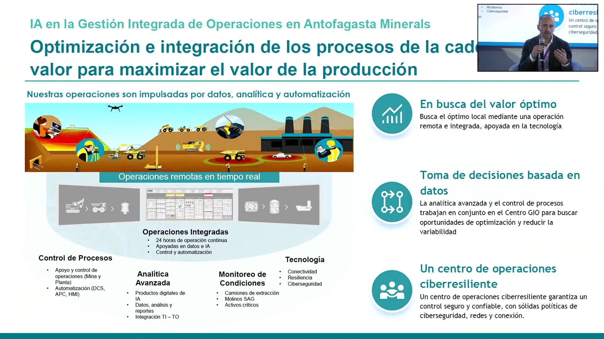
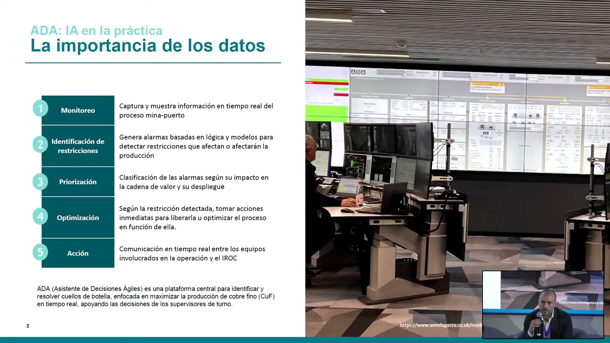
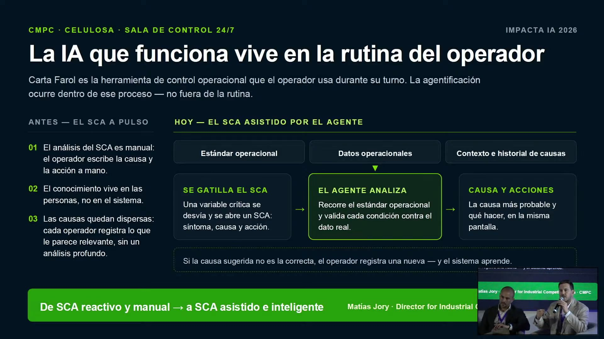
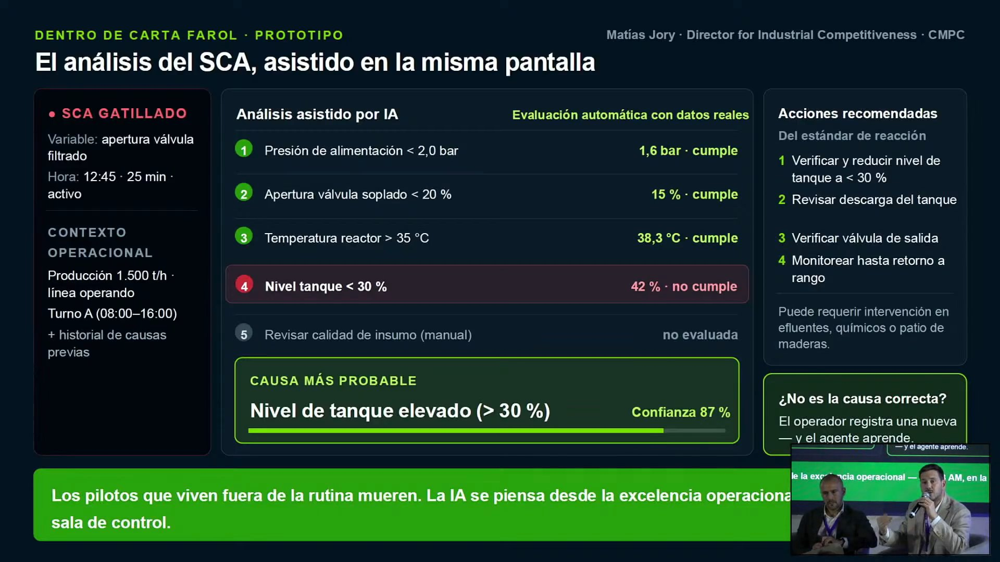

# Panel «IA Industrial, gemelos digitales y logística» · Impacta IA Chile 2026

El panel más técnico del evento llega a una conclusión poco técnica: en la industria, la IA genera valor cuando se monta sobre el conocimiento de los operadores, sobre estándares operacionales y sobre la rutina que ya existe, no cuando se parte de los datos disponibles. Marcos Orchard (Universidad de Chile) propone la arquitectura que va del grafo de conocimiento al copiloto operacional; Nicolás Tagle (Antofagasta Minerals) y Matías Jory (CMPC) muestran cómo lo hacen en un centro integrado de operaciones y en una sala de control de celulosa. El cierre apunta a Chile: la minería y la celulosa pueden ser la base de un ecosistema que exporte tecnología.

## Ficha
| | |
|---|---|
| Evento | Impacta IA Chile 2026, día 2, jueves 3 de septiembre de 2026, Fundación Chile |
| Modera | Julio Riutort, director académico del Executive MBA de la Universidad Adolfo Ibáñez y profesor asociado de Finanzas |
| Speakers | Marcos Orchard, profesor titular del Departamento de Ingeniería Eléctrica de la Universidad de Chile, director del Centro de Aceleración Sostenible de Electromovilidad e investigador del AC3E · Nicolás Tagle, superintendente de Analítica Avanzada de Minera Los Pelambres (Antofagasta Minerals) · Matías Jory, Director of Industrial Competitiveness de CMPC |
| Conduce | Elisabeth Serra, host del día 2 (Fundación Chile) |
| Duración | 52 min (2 min de presentación, 1 min de encuadre, 5 min de Marcos Orchard, 6 min de Nicolás Tagle, 5 min de Matías Jory, 11 min de la ronda sobre cuellos de botella, 13 min de la ronda sobre conocimiento, 8 min de la ronda sobre ventaja competitiva, 1 min de cierre) |
| Idioma | español |
| Video | [YouTube desde 3:59:45](https://www.youtube.com/watch?v=NJu13g38nDc&t=14385s) |
| Fuente | Whisper large-v3 (coincidencia 93,1 % con los subtítulos del stream), voces separadas con SpeechBrain ECAPA; revisión en tres pasadas: transcripción, idioma y lo dicho mal |

## Estructura
| Capítulo | Tramo | Quién |
|---|---|---|
| Presentación del panel | [00:05](https://www.youtube.com/watch?v=NJu13g38nDc&t=14390s)–01:47 | Elisabeth Serra |
| Encuadre del moderador | [01:47](https://www.youtube.com/watch?v=NJu13g38nDc&t=14492s)–02:53 | Julio Riutort (UAI) |
| Marcos Orchard: de los datos a la decisión | [02:53](https://www.youtube.com/watch?v=NJu13g38nDc&t=14558s)–07:26 | Marcos Orchard (Universidad de Chile) |
| Nicolás Tagle: el centro integrado de operaciones y ADA | [07:26](https://www.youtube.com/watch?v=NJu13g38nDc&t=14831s)–13:15 | Nicolás Tagle (Antofagasta Minerals), presentado por el moderador |
| Matías Jory: la IA que vive en la rutina del operador | [13:15](https://www.youtube.com/watch?v=NJu13g38nDc&t=15180s)–18:29 | Matías Jory (CMPC), presentado por el moderador |
| Del piloto a la decisión: cuellos de botella y modelo operativo | [18:29](https://www.youtube.com/watch?v=NJu13g38nDc&t=15494s)–29:53 | Riutort pregunta; responden Orchard, Jory y Tagle |
| Del conocimiento de las personas a la decisión sistemática | [29:53](https://www.youtube.com/watch?v=NJu13g38nDc&t=16178s)–42:36 | Riutort pregunta; responden Orchard, Tagle y Jory |
| Ventaja competitiva: Chile como ecosistema y exportador de tecnología | [42:36](https://www.youtube.com/watch?v=NJu13g38nDc&t=16941s)–50:38 | Riutort pregunta; responden Jory, Tagle y Orchard |
| Cierre | [50:38](https://www.youtube.com/watch?v=NJu13g38nDc&t=17423s)–51:57 | Julio Riutort y Elisabeth Serra |

## Tesis

El moderador plantea el panel no como una discusión sobre si la IA funciona, sino sobre la distancia entre el piloto y la decisión [02:08]. Los tres panelistas coinciden en que esa distancia no se cubre con más datos: «ya pasamos la etapa donde el cuello de botella eran los datos» [22:45]. Se cubre partiendo por el dolor del negocio y no por la data disponible [19:48, 23:49], con un dueño del problema que sostenga la herramienta [27:43], con estándares operacionales y un sistema de gestión que la vuelvan parte de la operación [35:54, 41:43], y con el conocimiento de los operadores codificado en ontologías y grafos de conocimiento para que las respuestas sean trazables [33:37, 35:04]. Jory lo resume en su lámina: «los pilotos que viven fuera de la rutina mueren» [17:06]. En la última ronda, la mirada pasa de la empresa al país: la minería y la celulosa, industrias de proceso continuo donde Chile es referente, pueden sostener un ecosistema de proveedores, universidades y centros que desarrolle IA industrial para exportar [43:59, 45:58, 47:58].

## Resumen

### Encuadre del moderador [01:47–02:53]
- **Julio Riutort (UAI) [01:47]: de la idea a la decisión.** Anuncia «quizás el panel más técnico del día», con los pies en la tierra «o bajo ella». No se discutirá si la IA funciona, sino la distancia entre su uso en pilotos y su escala hasta la decisión: dónde viven los datos, dónde viven las decisiones y cómo se conecta la experiencia de las personas con la calidad de la data.

### Marcos Orchard: de los datos a la decisión [02:53–07:26]
- **Marcos Orchard (Universidad de Chile) [02:53]: construir inteligencia operacional.** Propone mover la conversación desde la data a la decisión, con grafos de conocimiento, *large language models*, gemelos digitales y modelos de decisión.
- **[03:53]: tres desafíos.** El dato existe, pero está disperso en historiadores, bitácoras, planos y protocolos que no se integran. El criterio y la experiencia residen en las personas y rara vez quedan documentados: en fábricas aeronáuticas de Estados Unidos temían que los jóvenes ingenieros se fueran a la IA mientras jubilaban quienes sabían fabricar los equipos [04:47]. Y las decisiones llegan tarde porque el especialista gasta el tiempo en reconstruir el contexto operacional [05:19].
- **[05:40]: una arquitectura en capas.** Primero una memoria estructurada con ontología y grafo de conocimiento (en la industria *oil and gas* francesa «lo único que querían era ontología»); sobre ella, gemelos digitales, modelos recomendadores y un copiloto operacional en lenguaje natural, todo trazable (ver la primera imagen).
- **[06:40]: los modelos son datos.** Hay que cuidar la ciberseguridad de un modelo como la de una base de datos de la operación: con suficiente capacidad se puede recuperar la data con que fue entrenado, algo que preocupaba a DARPA hace dos años.

### Nicolás Tagle: el centro integrado de operaciones y ADA [07:26–13:15]
- **Nicolás Tagle (Antofagasta Minerals) [07:37]: la IA como tecnología habilitadora.** Partieron con pilotos y pruebas de concepto para ganarse la confianza de la operación; la clave es un modelo operativo en que la IA no sea un *gadget* sino una herramienta transformacional para una minería más eficiente, segura, productiva y sustentable.
- **[09:12]: operar desde Santiago, de la mina al puerto.** El centro integrado de operaciones opera de forma remota y centralizada todo el proceso minero buscando un óptimo global (ver la segunda imagen). Para eso hacen falta tres cosas: datos gobernados y con calidad (en minería es difícil incluso medir lo que ocurre), identificar dónde están las oportunidades reales de valor y conectar a los equipos de IA con las especialidades mineras, junto a una disciplina nueva, la ingeniería en ciencia de datos [10:27].
- **[11:02]: contexto antes que automatización.** Un operador mira varias pantallas a la vez; lo primero es darle rápido el contexto de qué pasa, por qué y qué va a pasar, y solo después automatizar.
- **[11:49]: ADA, el asistente de decisiones ágiles.** La plataforma consolida la información en un solo lugar y, con datos, reglas e IA, monitorea la operación, identifica restricciones, prioriza y recomienda acciones para liberarlas (ver la tercera imagen). El objetivo es sacar al operador de las decisiones repetitivas que no aportan valor [12:47].

### Matías Jory: la IA que vive en la rutina del operador [13:15–18:29]
- **Matías Jory (CMPC) [13:21]: la IA tiene que vivir en la rutina.** «Esta es nuestra receta, pueden haber otras»: la IA funciona cuando está en el día a día de quien opera la fábrica.
- **[14:24]: el SCA antes de la IA.** Cuando una variable crítica se sale de rango, el operador llena en Carta Farol un SCA (síntoma, causa, acción). La adherencia era de 95 % [17:57], pero la calidad era baja: cada operador anotaba lo que entendía a las 3 o 4 de la mañana, y en una planta de celulosa con procesos interconectados la causa es difícil de ver.
- **[15:41]: un agente dentro de la herramienta que ya existía.** Cuando se gatilla el SCA, el agente revisa el estándar operacional, valida cada condición contra los datos del proceso, lee bitácoras e informes de jefe de turno y propone la causa más probable y las acciones (ver la cuarta y la quinta imagen). El operador valida o registra otra causa, y el sistema aprende [17:01]. «No agregamos una pantalla nueva, no creamos una rutina nueva» [17:49].

### Del piloto a la decisión: cuellos de botella y modelo operativo [18:29–29:53]
- **Julio Riutort [18:29]:** recoge la frase de Jory, «los pilotos que viven fuera de la rutina mueren», y pregunta qué tiene que cambiar en la organización para pasar de pilotos a mejores decisiones: datos, tecnología, incentivos u otra cosa.
- **Marcos Orchard [19:48]: partir por el dolor, no por los datos.** Partir *bottom-up*, buscando qué hacer con los algoritmos y autoconvenciéndose de que hay valor, es un enfoque inapropiado. Hay que preguntar qué decisiones se toman mal y necesitan apoyo; el dolor aglutina voluntades. Desde el mundo del PHM (*Prognostics and Health Management*, ligado al mantenimiento predictivo), recuerda que la discusión entre una unidad central y microequipos por área no tiene respuesta única [21:11]; lo cultural es no enfrentar a mantenimiento con operaciones y apoyarse en el ecosistema de universidades y centros. «Ya pasamos la etapa donde el cuello de botella eran los datos» [22:45]: el problema es entender su calidad y que los resultados queden a disposición de quien decide.
- **Matías Jory [23:49]: primero un centro, después las fábricas.** Hace ocho años le decían «tenemos todos estos datos, ¿qué podemos hacer con eso?». CMPC armó primero un equipo central (infraestructura *cloud*, ciencia e ingeniería de datos, desarrollo de software) y hoy tiene un modelo que algunos llaman federal, con especialistas en cada fábrica [24:57]. Calcula que esos equipos locales avanzan tres a cinco veces más rápido que si cada fábrica hubiera partido sola.
- **Nicolás Tagle [26:20]: negocio, dueño y capacidad técnica.** En minería hay modelos centralizados, descentralizados e híbridos; AMSA usa uno híbrido, con un equipo corporativo que provee plataformas, contratos y lineamientos, y equipos especializados en cada compañía. Su receta junta tres cosas: impacto en el negocio, un dueño del problema y las capacidades técnicas [27:43]. El ejemplo [28:26]: un modelo de IA para estimar el desgaste interno de los molinos evitaba detenciones innecesarias, pero el proyecto paró cuando se fue su dueño. Ahora incorporan las herramientas a los planes de capacitación para que no queden a criterio del usuario y pasen «a ser parte del ADN».

### Del conocimiento de las personas a la decisión sistemática [29:53–42:36]
- **Julio Riutort [29:53]:** con el caso del molino, pregunta cómo convertir la experiencia que reside en las personas en conocimiento que la empresa use de manera sistemática.
- **Marcos Orchard [31:18]: la IA no reemplaza el conocimiento existente.** La presión por resultados inmediatos amenaza la visión de largo plazo; para que una iniciativa no caiga cuando se va su *champion*, propone relaciones estructurales entre industria, centros de formación, universidades y centros de investigación. Los proyectos requieren horas de conversación con quienes vivieron los problemas, para codificar ese conocimiento de forma trazable [32:22], y hacerlos partícipes hace que el diseño respete la cultura de decisión de la empresa [33:37]. En un gemelo digital, las verdaderas entradas del sistema están en la sala de control; en una contingencia real hay poca data y la respuesta la da el criterio. Por eso ontologías y grafos de conocimiento: sin ellos, la IA da respuestas, «pero no van a ser trazables» [35:04].
- **Nicolás Tagle [35:26]: estandarizar antes de recomendar.** Se piden muchos recomendadores para operar molinos o celdas de flotación, pero a menudo no existen estándares operacionales; primero hay que llevar el conocimiento a una gestión documental gobernada, con equipos de excelencia operacional. En un caso con una operadora de flotación [36:49], estandarizar tomó bastante y montar la IA encima fue relativamente simple. Hoy trabajan en Cerebro [37:43], un sistema para asistir decisiones en todos los niveles que integra información no estructurada (radio, WhatsApp, correo) con la de sensores; el desafío abierto es la semántica y la ontología que conectan los procesos.
- **Matías Jory [38:53]: sin sistema de gestión, la IA es una quimera.** En CMPC un proyecto de IA es un proyecto más para mejorar el estándar operacional dentro de un sistema de gestión con objetivo único (metas que cascadean desde el EBITDA hasta el operador), estándares, mejora continua y control. Además digitalizaron la rutina: bitácoras, rondas de mantención y operación quedan en un sistema propio, minuto a minuto [40:36]. Cuando lo intentaron sin esa base, «si no estábamos ahí 24/7 al lado del viejito, se perdía» [41:43].

### Ventaja competitiva: Chile como ecosistema y exportador de tecnología [42:36–50:38]
- **Julio Riutort [42:36]:** pregunta qué decisiones son las más urgentes para los líderes y dónde pueden las empresas chilenas construir una ventaja competitiva basada en IA industrial.
- **Matías Jory [43:59]: un ecosistema en manufactura continua.** Chile tiene dos grandes industrias de proceso continuo, la minería y la forestal; las grandes empresas pueden financiar a proveedores pequeños y trabajar con la academia, como CMPC con la Universidad de Concepción en automatización e IA. Para un proveedor minero es relativamente simple pasar a la celulosa, y «están las lucas para financiarlo» [45:11].
- **Nicolás Tagle [45:58]: exportar tecnología.** La tecnología que usa la minería es principalmente extranjera; Chile, referente en minería y en celulosa, podría desarrollar IA para Canadá, Australia, Estados Unidos o Brasil potenciando a sus pequeños proveedores. Dentro de cada compañía la ventaja es de costos, porque en minería no se compite por precio [47:08].
- **Marcos Orchard [47:58]: la pregunta correcta no era fabricar baterías.** Desde el Centro de Aceleración Sostenible de Electromovilidad recuerda que en 2009 se preguntaba si Chile fabricaría baterías; para él esa no era la pregunta. La oportunidad está en las tecnologías aún inmaduras, como la electrificación minera, donde se necesita evidencia: cómo cambiar el despacho de vehículos eléctricos en la mina sin perder producción [49:11]. Ahí «ni siquiera los OEM tienen esas respuestas», y Chile tiene industria, universidades y centros para desarrollarlas.

### Cierre [50:38–51:57]
- **Julio Riutort [50:38]:** agradece la experiencia concreta de las empresas y la mirada de la academia.
- **Elisabeth Serra [51:05]:** destaca cómo la IA está trascendiendo a las distintas industrias e invita al almuerzo.

## Ideas que se llevan
1. El cuello de botella ya no son los datos: hay que partir por el dolor del negocio y las decisiones que se toman mal, no por la data disponible (Orchard, Jory).
2. La IA que funciona vive en la rutina del operador: CMPC puso un agente dentro de la herramienta y del formulario que ya se llenaban, sin agregar pantallas ni rutinas (Jory).
3. Un proyecto necesita a la vez impacto en el negocio, un dueño del problema y capacidad técnica; sin dueño, se cae aunque genere valor (Tagle).
4. Antes de recomendar hay que estandarizar: estándares operacionales, sistema de gestión y conocimiento codificado en ontologías y grafos, para que la IA sea trazable (Tagle, Jory, Orchard).
5. La minería y la celulosa pueden sostener un ecosistema de proveedores, universidades y centros que exporte IA industrial (Jory, Tagle, Orchard).

## Frases citables
> «Creo que ya pasamos la etapa donde el cuello de botella eran los datos.» — Marcos Orchard (Universidad de Chile), [22:45](https://www.youtube.com/watch?v=NJu13g38nDc&t=15750s)

> «Si tú aplicas herramientas de inteligencia artificial sin tener esto bien estructurado, vas a tener respuestas de todas maneras. Vas a lograr cosas, pero no van a ser trazables.» — Marcos Orchard (Universidad de Chile), [35:09](https://www.youtube.com/watch?v=NJu13g38nDc&t=16494s)

> «Al final del día no agregamos una pantalla nueva, no creamos una rutina nueva.» — Matías Jory (CMPC), [17:49](https://www.youtube.com/watch?v=NJu13g38nDc&t=15454s)

> «Pensar que uno va a mejorar con un proyecto de inteligencia artificial es una quimera, porque se va a perder.» — Matías Jory (CMPC), [41:48](https://www.youtube.com/watch?v=NJu13g38nDc&t=16893s)

> «Que ojalá no sepan que fue una herramienta que se desarrolló internamente, sino que ya pase a ser parte del ADN.» — Nicolás Tagle (Antofagasta Minerals), [29:44](https://www.youtube.com/watch?v=NJu13g38nDc&t=16169s)

> «Montar la parte de inteligencia artificial sobre eso fue relativamente simple.» — Nicolás Tagle (Antofagasta Minerals), [37:29](https://www.youtube.com/watch?v=NJu13g38nDc&t=16634s)

## Imágenes notables

Cinco láminas de contenido, las cinco capturadas completas del stream. Quedan fuera la portada de Marcos Orchard y su lámina sobre los desafíos de conocimiento, que solo se vio lavada en la pantalla del escenario y no se lee.

*«Una arquitectura integrada para la inteligencia operacional» · presentada por Marcos Orchard (Universidad de Chile) · [06:08](https://www.youtube.com/watch?v=NJu13g38nDc&t=14753s) · las cuatro capas, de los grafos de conocimiento al copiloto operacional (LLM); el recuadro de cámara tapa el inicio de la capa 01.*

*«Optimización e integración de los procesos de la cadena de valor para maximizar el valor de la producción» · presentada por Nicolás Tagle (Antofagasta Minerals) · [07:50](https://www.youtube.com/watch?v=NJu13g38nDc&t=14855s) · el centro de operaciones integradas, de la mina al puerto.*

*«ADA: IA en la práctica. La importancia de los datos» · presentada por Nicolás Tagle (Antofagasta Minerals) · [11:53](https://www.youtube.com/watch?v=NJu13g38nDc&t=15098s) · los cinco pasos del asistente de decisiones ágiles, enfocado en la producción de cobre fino.*

*«La IA que funciona vive en la rutina del operador» · presentada por Matías Jory (CMPC) · [13:37](https://www.youtube.com/watch?v=NJu13g38nDc&t=15202s) · el SCA antes y después del agente, dentro de Carta Farol.*

*«El análisis del SCA, asistido en la misma pantalla» · presentada por Matías Jory (CMPC) · [17:06](https://www.youtube.com/watch?v=NJu13g38nDc&t=15411s) · prototipo con los chequeos contra el estándar, la causa más probable y las acciones; el recuadro de cámara tapa el final de la cita de la banda verde.*

## Menciones a Brinca
- [01:49](https://www.youtube.com/watch?v=NJu13g38nDc&t=14494s) Julio Riutort agradece a Brinca y a Fundación Chile por la invitación.

## Archivos
- `transcripcion.md`: el texto completo, revisado y limpio, por turnos.
- `imagenes/`: las imágenes notables.
