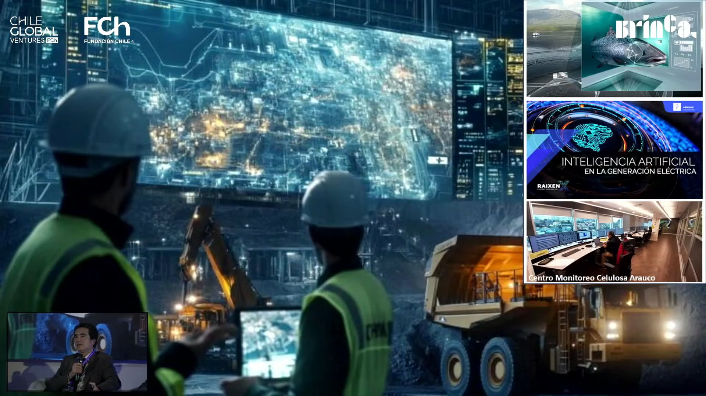
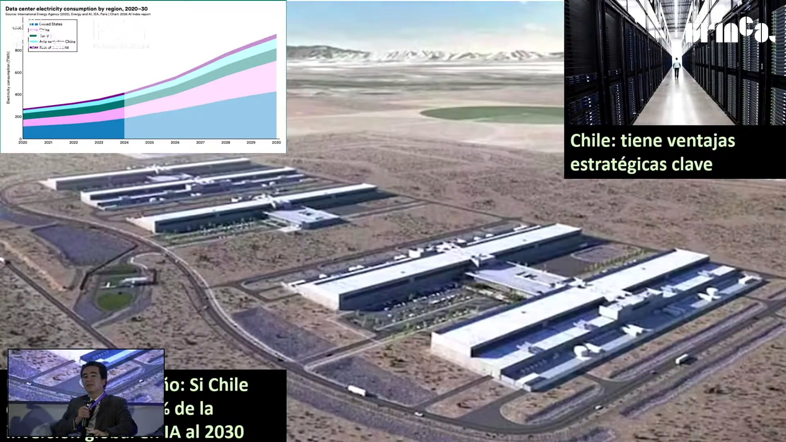

# Panel «Datacenters e IA: ¿una oportunidad para Chile?» · Impacta IA Chile 2026

Los tres panelistas coinciden en que Chile tiene lo que piden los data centers de IA: energía renovable que hoy se bota, desierto, agua desalada, cables submarinos y certeza jurídica, en un momento en que Estados Unidos y Europa los resisten. Lo que falta es intención: una política de Estado que arme el paquete y salga a venderlo, como las concesiones de Lagos, liderada desde Hacienda o Economía. Qué pedir a cambio: Ignacio Briones dice que no impuestos ni empleo, sino una cuota de la capacidad de cómputo para que los sectores productivos chilenos entrenen sus propios algoritmos; Rodrigo Durán propone un pacto que dé beneficios a la industria a cambio de esa cuota.

## Ficha
| | |
|---|---|
| Evento | Impacta IA Chile 2026, día 2, jueves 3 de septiembre de 2026, Fundación Chile |
| Presenta | Elisabeth Serra, host del día 2 (Fundación Chile) |
| Modera | Pablo Correa, socio fundador y gerente comercial y de desarrollo de Brinca |
| Speakers | Ignacio Briones, economista, académico de la UAI, presidente de Horizontal y exministro de Hacienda · Rodrigo Durán, gerente del Centro Nacional de Inteligencia Artificial (CENIA) y director ejecutivo del Índice Latinoamericano de IA · Cristián López, Google Cloud (la host lo presentó como representante e integrador de soluciones; la placa del escenario dice *country manager*) |
| Duración | 59 min (1,5 min de presentación de la host, 2,5 min de encuadre del moderador, 19 min de primera ronda, 17,5 min de segunda ronda, 18 min de preguntas del público, 1 min de cierre) |
| Idioma | español |
| Video | [YouTube desde 5:56:55](https://www.youtube.com/watch?v=NJu13g38nDc&t=21415s) |
| Fuente | Whisper large-v3 (coincidencia 93,9 % con los subtítulos del stream), voces separadas con SpeechBrain ECAPA; revisión en tres pasadas: transcripción, idioma y lo dicho mal |

## Estructura
| Capítulo | Tramo | Quién |
|---|---|---|
| Presentación del panel | [00:07–01:36](https://www.youtube.com/watch?v=NJu13g38nDc&t=21420s) | Elisabeth Serra, host del día 2 |
| Encuadre del moderador | [01:36–04:02](https://www.youtube.com/watch?v=NJu13g38nDc&t=21510s) | Pablo Correa (Brinca) |
| Primera ronda: las ventajas de Chile y qué ganaría el país | [04:02–23:05](https://www.youtube.com/watch?v=NJu13g38nDc&t=21655s) | Rodrigo Durán, Ignacio Briones (con tres láminas), Cristián López |
| Segunda ronda: qué haría falta para acelerar | [23:05–40:32](https://www.youtube.com/watch?v=NJu13g38nDc&t=22798s) | Cristián López, Ignacio Briones, Rodrigo Durán |
| Preguntas del público | [40:32–58:38](https://www.youtube.com/watch?v=NJu13g38nDc&t=23846s) | dos personas del público; responden los tres panelistas |
| Cierre | [58:38–59:22](https://www.youtube.com/watch?v=NJu13g38nDc&t=24931s) | Pablo Correa, Elisabeth Serra |

## Tesis

Chile tiene una ventaja objetiva para atraer data centers de IA, y la está dejando pasar por falta de intención. Los tres panelistas enumeran la misma lista: un potencial renovable de 50 a 80 veces la capacidad instalada, con energía que hoy se vierte por falta de transmisión [10:02]; el desierto, donde «no crece nada» y no hay grandes ciudades al lado; agua desalada, como la que ya usa la gran minería; cables submarinos hacia Estados Unidos, Asia y el Caribe; y la mejor protección de datos de la región [13:42]. Mientras Estados Unidos frena proyectos que «chupan energía» y agua, Chile podría capturar apenas el 1 % de la inversión mundial, unos US$ 10 mil millones al año, más que toda la minería [12:27]. Lo que no hay es una política de Estado: hay que armar el paquete (terreno, permisos, fibra, agua, energía) y salir a venderlo [27:41], con un responsable de peso en Hacienda o Economía, porque «cualquier política que nace en el Ministerio de Ciencia está destinada al fracaso» [54:07]. Y a cambio, Durán propone un pacto con beneficios para la industria a cambio de una cuota de cómputo de uso público, como se hizo con los observatorios astronómicos [06:07], y Briones pide, más que impuestos o empleo directo (que serán pocos), una parte de la capacidad para la academia y para que todos los sectores productivos entrenen sus propios algoritmos [15:14].

## Resumen

### Encuadre del moderador [01:36–04:02]
- **Pablo Correa (Brinca) [01:36]: la pregunta no es si, sino cómo.** Los data centers son a la vez una preocupación y una de las oportunidades más grandes para el desarrollo del país. Chile tiene ventajas (matriz energética renovable, estabilidad institucional y la conectividad que ha empujado Google con sus cables submarinos), y la ventana es ahora, no en tres años: según McKinsey, la inversión en data centers llegará a unos 7 billones de dólares al 2030 [03:03]. Abre la palabra para oír a la política pública, a la academia y a los *hyperscalers*.

### Primera ronda: las ventajas de Chile y qué ganaría el país [04:02–23:05]
- **Rodrigo Durán (CENIA) [04:02]: ventajas que el norte global está perdiendo.** En el norte global instalar data centers es cada día más cuestionado [04:36] porque el costo energético y el consumo de agua compiten con la población; en Chile no deberían competir. Según el Índice Latinoamericano de IA, la electricidad es cerca del 80 % del opex de un data center, así que Chile debería apalancarse en esa ventaja antes que, por ejemplo, subsidiar ingenieros de software.
- **[05:40]: un pacto como el de los observatorios.** El beneficio no puede ser solo el pago de impuestos (ni tarifas como las de Brasil, que cobra por exportar datos). Propone un pacto público-privado: beneficios tributarios, permisos más rápidos, acceso a bienes fiscales o invariabilidad, a cambio de una cuota de cómputo a disposición pública con contrato preferente. El ex VP de CORFO Benavente lo planteó en el gobierno anterior sin avances [06:28]. El modelo son los observatorios: el acuerdo con la ESO garantizó el 10 % de las horas a la academia chilena y hoy cerca del 20 % de los centros basales y Milenio son de astronomía, con industria óptica en La Serena [07:14]. Esa conversación «no la estamos teniendo».
- **Ignacio Briones (UAI / Horizontal) [08:15]: importar consumo en vez de exportar energía.** Aclara que está lejos de ser experto en IA y presenta una idea escrita con Sergio Rademacher (ex Microsoft): Chile tiene un gran valor opción como *hub* regional de megadata centers. Muestra tres láminas. La energía es una opción de producto: el potencial renovable está entre 50 y 80 veces la capacidad instalada, y hoy se vierte por problemas de transmisión [10:02]. Como exportarla cruzando la cordillera no es viable, hay que dar vuelta la ecuación: «en vez de exportar energía, importemos consumo» [10:33], y los data centers son grandes consumidores de electricidad.
- **[10:58]: los recursos naturales sí tienen valor agregado.** Antes de seguir, discute que la minería no agregue valor: sacar cobre a 600 metros bajo tierra operado desde Las Condes es pura tecnología, y la IA hace más productivos todos esos procesos. «Producir es saber cómo producir mejor, es información» (lámina 2).
- **[11:50]: el 1 %.** McKinsey estimó entre 2026 y 2030 una inversión de 7,9 trillones de dólares, más de 5 en infraestructura de megadata centers. Si Chile capturara solo el 1 %, serían US$ 10 mil millones al año, «más que toda la minería» [12:27]. Imagina un campus en el desierto de Atacama con permisos preaprobados, fibra, agua desalada y la electricidad que se bota, más respaldo para operar 24/7 (lámina 3).
- **[13:16]: certeza jurídica y conectividad.** Quien dice datos dice protección de datos, y Chile es, «por lejos», el país que mejor los protege en la región; además tiene dos megacables submarinos y vienen más. Con Estados Unidos frenando proyectos que «chupan energía» y agua, Chile es un país confiable para recibirlos, pero hay que ofrecer «el paquete armado» con una política de Estado [14:42].
- **[15:14]: qué gana Chile.** La inversión trae poco empleo y los impuestos son difíciles de cobrar, pero esa discusión «es de segundo orden». Lo importante es reservar tiempo de cómputo para formar capital humano, como en los observatorios, y sobre todo una parte de la capacidad para que todos los sectores productivos chilenos entrenen sus propios algoritmos: un valor opción sobre el PIB [16:09].
- **Cristián López (Google Cloud) [17:04]: Chile ya es un *hub*.** Google opera un data center en Chile desde 2015 y su región cloud empresarial desde 2021 [17:22]. La contra de Chile es la distancia, que se resuelve con conectividad: el cable Curie a Los Ángeles (2019), Humboldt hacia Australia (listo el próximo año) y Alisios, recién anunciado, hacia Panamá y República Dominicana [18:42]; solo Brasil tiene una inversión parecida. Los otros dos grandes también llegaron: uno abrió su región y AWS abre la suya a fines de año.
- **[20:09]: el cuello de botella es la transmisión.** El agua se trata de evitar para no competir con el consumo ciudadano; la apuesta es la energía renovable, solar y eólica, en el norte y en el sur. Recibe llamados de quienes ya tienen predio, permisos, energía y agua. El problema de Chile no es la cantidad de energía sino transmitirla, y la conversación debe pasar de megawatts a gigawatts [21:40]. Sus otras ventajas: menos fricción en la permisología y una regulación estricta de la protección de datos [22:42].

### Segunda ronda: qué haría falta para acelerar [23:05–40:32]
- **Pablo Correa [23:05]:** pide a cada uno dos o tres decisiones, públicas o privadas, para capturar ese 1 %.
- **Cristián López [23:47]: incentivos y promoción país.** Las tecnológicas invierten según casos de negocio, así que los incentivos tributarios son un acelerador. Lo segundo es vender mejor lo que Chile tiene: en Estados Unidos la energía ya es tan escasa que Google compró una empresa eléctrica para abastecer su data center sin competir con la ciudadanía [24:35]. El gobierno ha hecho giras para vender Chile; hay que hacerlo con más fuerza.
- **Ignacio Briones [26:00]: infraestructura como las concesiones de Lagos.** Los tres *hyperscalers* llegaron por generación espontánea, pero un megadata center es «otra escala» y exige otra intencionalidad. La analogía es la política de concesiones de Lagos, que construyó la infraestructura en que el país era deficitario; hoy se es deficitario «contra el futuro» [26:39]. Hay que llevar a los privados un paquete armado: terreno fiscal en el desierto, *master plan*, fibra, agua de las desaladoras (la gran minería ya funciona con agua desalada), energía y certeza jurídica. «Ese paquetito yo creo que vale oro», pero hay que salir a venderlo [27:41]. Lo tributario es de segundo orden si una parte de la capacidad queda de libre uso para el país.
- **[29:00]: algo hay, pero lento.** La carrera mundial es por infraestructura y si Chile no la aprovecha, otro la tendrá. Las resistencias serán ambientales [30:07], aunque el entrenamiento no necesita estar cerca de las ciudades y el desierto ofrece los menores costos sociales. El empleo directo será poco, incluso en la construcción; la ganancia es indirecta, en todos los sectores que usen esa capacidad.
- **Rodrigo Durán [32:17]: el mercado local es chico.** Los proveedores ya tienen infraestructura en Brasil y el Cono Sur no justifica otra inversión por sí solo. Para construir el caso de negocio hay que crear demanda: alfabetización en IA (Hazlo con IA, con Google y Sofofa, llega a unas 200 mil personas, 150 mil pymes y 50 mil funcionarios públicos [33:32]) y empujones como los de Singapur, con *vouchers* condicionados a aumentos de productividad [33:43]. Chile está «significativamente atrás» en consumo de APIs, tokens e inversión en software frente a economías de sofisticación similar, porque los tomadores de decisiones son más escépticos de lo que deberían [34:45].
- **[36:04]: un marco antes que un chatbot.** Muchas empresas quieren IA porque el directorio la pidió, y miden el piloto por si al directorio le gustó. El CENIA propone partir de la estrategia: dónde se gana y se pierde plata, y qué aplicación de IA acelera cada proceso, en tres niveles (aumentar capacidades, reconfigurar procesos y transformar modelos de negocio). Retrasar la inversión «es súper ingenuo» [38:14].
- **[38:28]: lo que se ve en las pymes.** Hazlo con IA, gratuito y por trabajador, ha documentado cerca de 1.200 casos en empresas de 10 a 50 trabajadores: ganancias de productividad individuales («antes tenía que salir a las 7 y ahora puede salir a las 5»), captura de valor en procesos en las pymes más organizadas, ganancias en el EBITDA y, en unas pocas, nuevos modelos de negocio [39:56].

### Preguntas del público [40:32–58:38]
- **Público [41:02]: ¿es una burbuja?** Con OpenAI y Anthropic camino a salir a bolsa y comparaciones con los ferrocarriles del siglo XIX, ¿qué tan sostenible es usar una tecnología casi gratis y quién la termina pagando?
- **Cristián López [41:51]: es un cambio de era, no una burbuja.** Reconoce efectos burbuja (cita la subida de la acción de Dell tras sus resultados, que exagera: dijo «400 % en un día» y fue cerca de 10 % [42:29]), pero la carrera de los *hyperscalers* es por infraestructura y las empresas están rediseñando sus procesos desde cero: un cliente le pidió «una hoja en blanco» [43:12]. La adopción tiene tres capítulos: personas, procesos y tecnología [43:37]. Las grandes tecnológicas capacitan (Google con Capacita+, AWS con el gobierno) e invierten en los laboratorios de modelos, como Google con Anthropic, a la que también le vende infraestructura: el ecosistema es simbiótico.
- **Ignacio Briones [46:26]: se puede cobrar, y Chile debería usar sus datos.** No sabe cómo se cobrará, pero se puede, porque no es un bien público. La segunda reflexión es más amplia: Chile está «en pañales» en infraestructura de datos. Brasil hizo PIX desde el Banco Central [48:02]; Chile debería pensar una «carretera pública de datos» interoperable, como el *open banking* que él empujó, llevada a exámenes médicos y consultas. «Eso es eficiencia a la vena, es competencia a la vena y la tecnología está» [50:12]; lo que falta es voluntad política frente a los incumbentes.
- **Público [51:07]: ¿hay un esfuerzo público-privado?** Viene del congreso de hidrógeno verde Hyvolution, donde hay plan nacional y hojas de ruta; en data centers no ve ni lo uno ni lo otro.
- **Rodrigo Durán [52:52]: no, y no se dará solo.** Azure, Google Cloud y AWS compiten por un mercado chico y no tienen incentivos para colaborar [53:01]. Existe la asociación Chile Data Centers, más ligada a la infraestructura física. Hubo un impulso desde el Ministerio de Ciencia en el gobierno anterior, pero «cualquier política que nace en el Ministerio de Ciencia está destinada al fracaso» [54:07]: tiene que liderarla Hacienda o Economía. El CENIA ha levantado evidencia, pero «es un kiosco» [54:58].
- **Ignacio Briones [55:30]:** es lo mismo que las concesiones de Lagos: un objetivo claro que siguió en todos los gobiernos. Tiene reservas sobre la economía del hidrógeno verde, aunque podría servir para exportar amoníaco verde y como respaldo de los data centers. Falta un responsable con *seniority*.
- **Cristián López [56:44]: ya se conversa en La Moneda.** Google y otros han hablado con el segundo piso de La Moneda [57:08]. Cita como ejemplo el acuerdo de Google con el gobierno de El Salvador [57:27], un programa con ejes de beneficio país a cambio de inversión. Coincide en que debe impulsarlo alguien con fuerza política.

## Ideas que se llevan
1. Chile tiene lo que piden los data centers de IA (energía renovable que se bota, desierto, agua desalada, cables submarinos y certeza jurídica) justo cuando el norte global los resiste (Durán, Briones, López).
2. Exportar energía no es viable; importar consumo sí: con el 1 % de la inversión mundial, US$ 10 mil millones al año, más que toda la minería (Briones).
3. A cambio de las condiciones favorables, hay que pedir una cuota de cómputo para formar capital humano y para que los sectores productivos entrenen sus propios algoritmos, como en los observatorios (Durán); para Briones eso pesa más que los impuestos o el empleo directo.
4. El cuello de botella es la transmisión eléctrica, no la energía: la conversación debe pasar de megawatts a gigawatts (López).
5. Sin una política de Estado liderada por Hacienda o Economía y un paquete armado que se salga a vender, la oportunidad no ocurre por generación espontánea (Briones, Durán).
6. Para que el caso de negocio cierre hay que crear demanda local: adopción en pymes, alfabetización y empujones condicionados a productividad (Durán).

## Frases citables
> «En vez de exportar energía, importemos consumo.» — Ignacio Briones (UAI / Horizontal), [10:33](https://www.youtube.com/watch?v=NJu13g38nDc&t=22047s)

> «¿Qué tal si Chile capturara apenas el 1 % de esa inversión […]? Bueno, son 10 mil millones de dólares de inversión anual, que es más que toda la minería.» — Ignacio Briones (UAI / Horizontal), [12:27](https://www.youtube.com/watch?v=NJu13g38nDc&t=22161s)

> «Ese paquetito yo creo que vale oro. Pero hay que salir a venderlo. Hay que intencionarlo como país. No ocurre por generación espontánea.» — Ignacio Briones (UAI / Horizontal), [27:41](https://www.youtube.com/watch?v=NJu13g38nDc&t=23075s)

> «El problema que tiene Chile hoy día no es la cantidad de energía, es cómo la logro transmitir.» — Cristián López (Google Cloud), [21:25](https://www.youtube.com/watch?v=NJu13g38nDc&t=22700s)

> «Cualquier política que nace en el Ministerio de Ciencia está destinada al fracaso […]. Esto tiene que ser algo que lidere un ministerio como Hacienda, o un ministerio como Economía.» — Rodrigo Durán (CENIA), [54:05](https://www.youtube.com/watch?v=NJu13g38nDc&t=24659s)

> «Es súper ingenuo retrasar una inversión que es inevitable y habilitante para tener un mínimo de competitividad en los próximos 10 años.» — Rodrigo Durán (CENIA), [38:14](https://www.youtube.com/watch?v=NJu13g38nDc&t=23708s)

> «Eso es eficiencia a la vena, es competencia a la vena, y la tecnología está.» — Ignacio Briones (UAI / Horizontal), [50:12](https://www.youtube.com/watch?v=NJu13g38nDc&t=24426s)

## Imágenes notables

Ignacio Briones proyectó tres láminas, que el stream mostró a pantalla completa con un recuadro del panelista abajo a la izquierda. Los logos de Chile Global Ventures, Fundación Chile y Brinca son la gráfica del stream, no de las láminas. La primera, un mosaico de fotos de los sectores en que Chile tiene ventaja comparativa (litio, turismo, solar, minería, data centers, forestal, salmón y acuicultura), no se guardó: ilustra lo que dice sin agregar contenido. Tampoco la portada, «Chile ¿hub regional de megadatacenters?», que solo se vio en la pantalla del escenario.

*«La IA en los sectores productivos» (lámina sin título; el título es descriptivo) · presentada por Ignacio Briones (UAI / Horizontal) · [11:08](https://www.youtube.com/watch?v=NJu13g38nDc&t=22082s). Collage: una faena minera nocturna frente a una pantalla con un gemelo digital, un salmón analizado con IA, la placa «Inteligencia artificial en la generación eléctrica» de Raixen y el «Centro Monitoreo Celulosa Arauco». Ilustra su digresión: los recursos naturales sí agregan valor cuando se operan con tecnología.*

*«Chile: tiene ventajas estratégicas clave» · presentada por Ignacio Briones (UAI / Horizontal) · [12:01](https://www.youtube.com/watch?v=NJu13g38nDc&t=22135s). Sobre la foto aérea de un campus de data centers en el desierto, el gráfico de la IEA (*Data center electricity consumption by region, 2020–30*, vía el AI Index 2026), que proyecta el consumo eléctrico de los data centers de unos 400 TWh en 2024 a cerca de 900 TWh en 2030, con Estados Unidos y China a la cabeza. La banda inferior la tapa en parte el recuadro del panelista: se lee «…ío: Si Chile […] % de la […] IA al 2030», que corresponde al desafío del 1 % de la inversión global.*

## Menciones a Brinca
- [01:20](https://www.youtube.com/watch?v=NJu13g38nDc&t=21494s) La host presenta a Pablo Correa, moderador, como «socio fundador y director gerente comercial de desarrollo en Brinca».
- El logo de Brinca aparece en la gráfica del stream durante todo el panel, también sobre las láminas de Ignacio Briones.

## Archivos
- `transcripcion.md`: el texto completo, revisado y limpio, por turnos.
- `imagenes/`: las imágenes notables (dos láminas de Ignacio Briones).
