# Webinar «The Adaptive Advantage: Who's Winning With AI and How» · Wharton AI Horizons

Los tres autores del cuarto informe de adopción de IA de Wharton y GBK Collective presentan sus resultados: el uso de la IA ya es casi universal en las grandes empresas de EE. UU., pero solo un 7% de los managers+ cumple a la vez los tres marcadores de éxito del estudio (ROI fuertemente positivo, flujos de trabajo transformados y organización alineada). Lo que acompaña a los mejores retornos no es la tecnología: es medir crecimiento y no solo eficiencia, tener un dueño dedicado, terminar el rediseño del trabajo y no perder a la gente por el camino, porque mientras más alto el cargo, más avanzada parece la IA.

## Ficha
| | |
|---|---|
| Serie | Wharton Webinar Series · AI Horizons, de Wharton Human-AI Research |
| Fecha | martes 20 de octubre de 2026, por Zoom |
| Organiza | Wharton Human-AI Research (The Wharton School, University of Pennsylvania) y GBK Collective |
| Speakers | Stefano Puntoni, Sebastian S. Kresge Professor of Marketing y Faculty Co-Director de Wharton Human-AI Research · Prasanna (Sonny) Tambe, Professor of Operations, Information and Decisions y Faculty Co-Director de Wharton Human-AI Research · Jeremy Korst, Founder and CEO de Mindspan Labs, Lecturer en Wharton y Partner de GBK Collective |
| Duración | 58 min de contenido (1,5 min de apertura, 38 min de presentación del estudio y 18,5 min de preguntas y respuestas); la grabación dura 60 min y los 2 últimos son la reunión ya cerrada |
| Idioma | inglés |
| Estudio comentado | [Wharton-GBK AI Adoption Report 2026, en Knowledge at Wharton](https://knowledge.wharton.upenn.edu/special-report/2026-ai-adoption-report/) |
| Fuente | Whisper large-v3 sin subtítulos de referencia; voces separadas con SpeechBrain ECAPA y asignadas por el recuadro con nombre de Zoom; revisión en tres pasadas contra las láminas y el informe |

## Estructura
| Capítulo | Tramo | Quién |
|---|---|---|
| Apertura y presentación de los speakers | [00:00–01:37] | Stefano Puntoni; saludan Tambe y Korst |
| El estudio y los tres marcadores de éxito | [01:37–06:48] | Stefano Puntoni (Wharton) |
| Adopción casi universal, éxito escaso | [06:48–11:45] | Jeremy Korst (GBK Collective) |
| Medir crecimiento, no solo eficiencia | [11:45–15:22] | Stefano Puntoni (Wharton) |
| Un CAIO dedicado, una plataforma y el costo | [15:22–19:54] | Jeremy Korst (GBK Collective) |
| Flujos de trabajo transformados y agentes | [19:54–24:32] | Prasanna (Sonny) Tambe (Wharton) |
| Personas y procesos: la brecha entre niveles | [24:32–30:19] | Prasanna (Sonny) Tambe (Wharton) |
| Habilidades y recortes de personal | [30:19–35:34] | Jeremy Korst (GBK Collective) |
| Cinco conclusiones y agradecimientos | [35:34–39:57] | Stefano Puntoni (Wharton) |
| Preguntas y respuestas | [39:57–58:25] | los tres, leyendo las preguntas del panel de Zoom |

## Tesis

El estudio, una encuesta en línea a unas 1.400 personas de grandes empresas de EE. UU. hecha en julio de 2026, deja de contar solo cuánto se usa la IA y define el éxito con tres marcadores [04:46]. El uso diario de los managers+ subió 16 puntos, a 62% [10:45], pero el 28% reporta ROI fuertemente positivo, el 20% de los departamentos transformó sus flujos y el 39% está alineado: solo el 7% cumple los tres, las «organizaciones adaptativas» [10:16]. El hallazgo que Puntoni prefiere es que los departamentos que miden al menos un indicador de crecimiento reportan ROI fuerte casi tres veces más que los que solo miden eficiencia (35% contra 13%) [13:39], mientras la mayoría sigue esperando de la IA sobre todo productividad [14:49]. Los transformados de verdad reportan 67% de ROI fuerte contra 19% [21:57], y lo que frena ya no es la tecnología sino las personas y los procesos [25:11]. La brecha más persistente es la del rango: los ejecutivos ven una organización mucho más preparada que la que ven sus empleados [28:59]. Las cinco recetas: terminar el rediseño, reconstruir cómo se gestiona el trabajo en vez de recortar, tener un dueño dedicado de la IA, medir crecimiento y darles a los agentes autoridad real con monitoreo [36:29]. Todo es correlación y autorreporte, y los speakers lo repiten.

## Resumen

### Apertura y presentación de los speakers [00:00–01:37]
- **Stefano Puntoni (Wharton) [00:00]: la serie y el estudio.** Abre el webinar de la serie AI Horizons y presenta el cuarto informe de adopción, hecho con GBK Collective desde el comienzo, hace cuatro años. Presenta a Tambe y a Korst, «the K in GBK Collective».

### El estudio y los tres marcadores de éxito [01:37–06:48]
- **Stefano Puntoni (Wharton) [01:37]: cómo nació.** Deja 15 a 20 minutos para preguntas por el panel de Zoom. El estudio fue idea de Korst en 2023 [02:19]: tras ChatGPT nadie sabía qué hacían las empresas con la IA generativa, «why don't we ask them?».
- **[02:52]: la muestra.** Unas 1.400 personas de grandes empresas de EE. UU., en línea durante el verano. La mayoría son managers+ (de gerentes a CEO); este año se sumaron unos 400 trabajadores de nivel de entrada y medio. Mide uso, sentimiento, impacto, inversión y ROI (autorreportado, «we don't have hard data on monetary returns»), agentes y gobierno, proveedores y capital humano, con cortes por industria, función, tamaño y rango.
- **[04:46]: la fórmula de éxito.** Tres marcadores nuevos: ROI fuertemente positivo en el departamento; transformación de flujos (IA integrada en los procesos centrales, agentes en uso y cambios profundos), y alineamiento organizacional, un índice de factores como formación suficiente y una visión clara del liderazgo. Advierte que «you could have made a different list». Además separa a los departamentos que miden solo eficiencia de los que miden al menos un indicador de crecimiento.

### Adopción casi universal, éxito escaso [06:48–11:45]
- **Jeremy Korst (GBK Collective) [06:48]: de rastreador a organizaciones adaptativas.** Los resultados le resuenan con lo que ve en educación ejecutiva y en Mindspan Labs, su consultora de adopción de IA. Más líderes reportan valor: casi un 30% de los managers+ ve ROI fuertemente positivo [08:07]. Defiende medir la percepción porque es la que mueve las decisiones de inversión.
- **[08:42]: uno de cada cinco transformó sus flujos.** Hizo «the harder work of rethinking workflows», no solo mejores presentaciones o correos más rápidos. El alineamiento, que también reportan McKinsey, BCG y PwC, llega a cerca del 40% [09:47], y no todos los niveles de la organización lo ven igual [10:02]. Un 7% cumple los tres marcadores: será la nueva vara del estudio [10:16].
- **[10:33]: más uso, menos entusiasmo.** El uso pasó de mensual a semanal y ahora a diario: más del 60% de los managers+ [10:45]. «Excited» cayó 8 puntos y subieron «cautious», «skeptical» y «worried» [11:07]. Lo lee como la realidad de toda transformación: del entusiasmo por lo posible a hacerlo funcionar.

### Medir crecimiento, no solo eficiencia [11:45–15:22]
- **Stefano Puntoni (Wharton) [11:45]: su hallazgo favorito.** Comparte en el chat su artículo de HBR sobre usar la IA para crecer. Separaron los KPI con que se mide el ROI en productividad (horas ahorradas, costos operativos) y crecimiento (satisfacción del cliente, ingresos nuevos) [12:46]. Quienes miden solo eficiencia reportan ROI fuerte en un 13%; quienes miden al menos un indicador de crecimiento, en un 35% [13:39]. Es correlación, pero confirma que la gran promesa de la tecnología está en la innovación y el crecimiento orgánico [14:01].
- **[14:18]: lo que esperan para los próximos 12 a 24 meses.** La productividad gana por amplio margen [14:49]; lo ve como una preocupación porque arriesga perder la promesa de largo plazo.

### Un CAIO dedicado, una plataforma y el costo [15:22–19:54]
- **Jeremy Korst (GBK Collective) [15:22]: la productividad no alcanza.** Con inversiones de más de un billón de dólares en infraestructura, «productivity is probably not gonna cut it for return» [15:36]. Cita una cifra de Gartner que no calza con ninguna conocida, «Para FM»).
- **[16:12]: el CAIO.** El cargo de Chief AI Officer va con más ROI, aunque lo dijo al revés: la lámina muestra que el 58% de quienes tienen un CAIO recién designado reporta ROI fuerte (nota 1 de la transcripción). Muchos de los nuevos CAIO son cargos sumados a uno existente. Advierte que el CAIO no debe ser el único líder de IA: su mandato es transversal [16:44].
- **[17:15]: una plataforma.** Estandarizar una sola plataforma va con más ROI, otra vez dicho al revés (nota 2): el 50% de quienes estandarizan reporta ROI fuerte, pero solo el 19% lo hace. No significa dejar de experimentar.
- **[18:03]: el costo sube.** El costo de herramientas y licencias empata con los problemas de desempeño de la IA como barrera principal al ROI, empujado por el *token maxing* y los agentes [18:44]. El 56% de quienes confían en poder seguir su gasto en IA reporta ROI fuerte [19:33].

### Flujos de trabajo transformados y agentes [19:54–24:32]
- **Prasanna (Sonny) Tambe (Wharton) [19:59]: los agentes obligan a rediseñar.** A diferencia de los asistentes conversacionales, que se pueden entregar sin cambiar el cargo, los agentes son transversales y autónomos, «agents are quite different» [20:34], y fuerzan la pregunta del rediseño en 2026.
- **[21:06]: tres condiciones.** Cerca de tres cuartos cambió sus flujos [21:23] y casi tantos usan agentes, pero muchos menos tienen la IA plenamente integrada: solo uno de cada cinco cumple las tres condiciones, y son esos los que reportan ROI fuerte [21:57]. Los extremos van bien (los que fueron con todo y los que se contuvieron); sufren los del medio, que tienen agentes sin haber transformado el trabajo [22:14]. Tambe lo toma de otra parte del informe (p. 16).
- **[22:53]: la autonomía sigue al riesgo.** Dos tercios dejan a la IA actuar en tareas internas de bajo impacto; en acciones de cara al cliente baja de la mitad, y en las financieras o legales, más [23:20]. La barrera principal, lejos, es la seguridad y la privacidad, con incidentes de hackeo recientes en las noticias [23:59]; después vienen la regulación y la confianza.

### Personas y procesos: la brecha entre niveles [24:32–30:19]
- **Prasanna (Sonny) Tambe (Wharton) [24:32]: del asombro a lo concreto.** «It's people and processes» [25:11]: el 65% dice que lo que frena a su departamento son las personas y los procesos, no la tecnología, y pesan más que hace un año el rediseño de cargos y la reasignación de responsabilidades.
- **[25:55]: el desafío es aprender, no aceptar.** Falta talento avanzado en IA, pero lo que sigue es la rampa de habilidades (aprendizaje continuo, programas de formación), no la disposición a usar la tecnología.
- **[26:57]: la brecha más persistente.** Por primera vez hay muestra de entrada y nivel medio para comparar. Los managers+ ven más preparación en todas las dimensiones; la mayor brecha está en la formación (22 puntos). Su forma de leer el gráfico: 18 puntos sería, por ejemplo, 80% contra 62% [28:35].
- **[28:59]: sube con el rango.** En tres niveles, cada marcador mejora con el cargo: casi 40 puntos de diferencia entre entrada y VP+ en IA integrada en los flujos, y unos 25 en confianza para usar la IA (dijo 20; nota 3 de la transcripción).

### Habilidades y recortes de personal [30:19–35:34]
- **Jeremy Korst (GBK Collective) [30:19]: el desalineamiento duele.** Lo cuenta entre los desafíos más dolorosos de los líderes: quienes hacen el trabajo describen algo distinto de lo que creen líderes que están a varios grados de distancia. Remite a su artículo de HBR sobre el «messy middle».
- **[31:05]: mejorar o reemplazar habilidades.** Crédito a Puntoni por la pregunta. Desde el comienzo del estudio los líderes creen que la IA mejora las habilidades y reconocen que reemplaza algunas, en el rango de dos tercios; la pregunta es si reemplaza las buenas o las malas. Cerca del 40% teme que se pierdan habilidades críticas en su equipo o las propias [32:36].
- **[32:47]: de crear a revisar.** Más de la mitad de los trabajadores de entrada y nivel medio dice que su trabajo pasó de crear resultados a revisar lo que produce la IA, y más del 80% de los VP+ [33:15]. Menciona a un colega que escribió sobre la «cognitive surrender» [33:33]: revisar bien se vuelve un imperativo de gestión.
- **[33:59]: recortes y alineamiento.** Los departamentos que no recortaron personal por la IA están mucho más alineados (53% contra 20%; lo dijo al revés, nota 4), y los de mayor ROI no recortaron más que el resto. Donde hubo recortes se disparan las preocupaciones: inquietudes éticas, 85% contra 52% [35:01]. Correlación, no causa.

### Cinco conclusiones y agradecimientos [35:34–39:57]
- **Stefano Puntoni (Wharton) [35:34]: era previsible.** No sorprende más resistencia donde se recortó personal por la IA. Recuerda que todo es correlación y autorreporte, pero con triangulación y validez aparente [36:13].
- **[36:29]: las cinco conclusiones.** Terminar el rediseño; reconstruir cómo se gestiona el trabajo en vez de recortar dotación, porque cuando los líderes dicen eficiencia la gente oye despidos [37:10]; tener un dueño dedicado de la IA, más agente de cambio que técnico [37:44], sin que eso libere al resto del C-suite; medir crecimiento y no solo eficiencia, y darles a los agentes autoridad real con barandas y monitoreo.
- **[38:57]: agradecimientos.** Al equipo de GBK Collective, en especial a Brandon y Rachel [39:14], y a la Wharton AI & Analytics Initiative. Sacaron el informe antes de las elecciones de mitad de período para que lo vieran más ojos [39:35].

### Preguntas y respuestas [39:57–58:25]
- **[40:06] ¿Qué tan seguros están de que el ROI se define y cuantifica igual y con rigor entre los participantes? (asistente anónimo; la lee Jeremy Korst).** Korst: muy poco, y a propósito [40:26]. Buscan la percepción de quienes deciden las inversiones, que en esta etapa es lo que mueve las decisiones. «We're at Wharton, so chances are we will» medir el ROI con más rigor en el futuro [41:13].
- **[41:25] ¿Las puntuaciones de progreso más altas en los cargos altos podrían ser el deseo de los ejecutivos de verse bien, o de que su empresa se vea bien? (Enzo Alda; la lee Stefano Puntoni).** Puntoni: puede ser, y tiene muchas causas [41:50]: distinto punto de vista, horizonte e información; ilusión de quienes hicieron la apuesta; información que no sube; foco de corto plazo abajo, y amenaza psicológica. Su broma a los líderes: no se sienten amenazados «because you don't do anything» [42:50]. Korst [43:20]: más de la mitad de los líderes dice año tras año que su organización va por delante, «so the math would say that at least some of their perceptions are wrong» [43:34].
- **[43:40] ¿Cómo evolucionará el estudio con el ritmo de la innovación? (Justin; la lee Prasanna (Sonny) Tambe).** Tambe: el informe tiene mucho que no se mostró, como el uso de IA propia en el trabajo (*shadow AI*) [44:16], los modelos de código abierto y el sentimiento público hacia la IA. Korst [44:58]: le interesan los equipos híbridos, con agentes que quizá deban aparecer en el organigrama [45:04].
- **[45:31] La productividad debería traducirse en menos costos o en más ingresos; ¿por qué tanta gente ve productividad sin ninguno de los dos? (Doug Wyatt; la lee Stefano Puntoni).** Puntoni: lo ideal sería que la capacidad liberada fuera a crecer, como el día a la semana para proyectos propios de Google [46:01], pero el foco en productividad es en realidad un foco en costos [46:46]. Con datos recientes que reunió junto a la startup Conveo: casi todos ahorran tiempo con la IA, pero ese tiempo «just disappear[s]» en otras tareas de la cola [47:09].
- **[47:35] ¿Por qué no se ve todavía en los datos macro? (Jeremy Korst, a partir de una conversación con la prensa; en el panel hay una pregunta parecida de «Moose», que cita un blog de Jeremy Siegel para WisdomTree).** Korst: otras tecnologías de propósito general tardaron décadas en aparecer en las cifras macro; la pregunta es si esta vez se atraviesa la curva J más rápido [48:28].
- **[48:45] ¿Qué paralelos hay con el auge y la caída de internet? (Chris Naderney; la lee Prasanna (Sonny) Tambe).** Tambe: la electricidad tardó 50 a 100 años e internet 10 a 20 [49:02]; en todos los casos faltaba un ecosistema completo, y hoy se construye «as the plane is flying». La pregunta es si la transformación puede seguir el ritmo de la tecnología. Las burbujas de la electricidad e internet dejaron activos reutilizables [50:03]; está por verse si esta también.
- **[50:25] Los directorios miran el resultado financiero y empujan a la eficiencia; ¿encuestaron a directores? (asistente anónimo; la lee Stefano Puntoni).** Puntoni: no. La IA la dirigen TI, operaciones y finanzas, que miden costos, y el roadmap termina siendo de reducción de costos; como profesor de marketing pide que marketing se siente en la mesa para enfocarse en servir mejor al cliente [51:18]. Korst [51:50]: hay directorios, como los de *private equity*, que piden eficiencia y otros que exigen ideas de crecimiento; la productividad sola ya no basta para competir, «it's going to be a need to have» [52:46].
- **[53:24] ¿Preguntaron si la IA impulsa la relocalización (*reshoring*) del trabajo del conocimiento? (Evan; la lee Stefano Puntoni).** No lo preguntaron; sería interesante.
- **[53:47] ¿Cómo abordan las organizaciones la calidad y la confiabilidad de sistemas agénticos construidos sobre modelos probabilísticos? (Prem; la lee Stefano Puntoni).** Korst [54:12]: el estudio no lo cubre. Recomienda un marco de Serguei Netessine y Masha Shunko para decidir el nivel de autonomía según el riesgo y la reversibilidad de cada tarea [54:41], además de los *evals* del lado técnico.
- **[55:12] ¿Cambia todo con robots humanoides superinteligentes en tres a cinco años? (Timothy; la lee Stefano Puntoni).** Puntoni es escéptico del plazo y no hace predicciones más allá de 24 meses [55:33].
- **[55:41] ¿Cuáles son los mayores desafíos de una adopción transformadora? (Atira; la lee Prasanna (Sonny) Tambe).** Tambe: la rendición de cuentas por los agentes que cruzan áreas, no solo a quién culpar sino quién puede desconectarlos cuando algo sale mal [56:02]; las empresas responden de todas las formas.
- **[56:15] Palabras finales.** Korst: certeza donde se necesita, variabilidad donde ayuda, y gestión de equipos híbridos; Mindspan Labs trabaja con una docena de agentes [57:23]. Puntoni [57:33]: cerca de la mitad de quienes usan ChatGPT en el trabajo lo hace con una cuenta personal [57:42].

## Láminas

Puntoni compartió su pantalla con la presentación y las capturas muestran la lámina completa; en un par de ellas asoman en el borde la barra de Zoom o un emoji de reacción. Son las 16 láminas de contenido, en orden; faltan la portada, la de los speakers y la de preguntas y respuestas. Todas citan como fuente el informe «The Adaptive Advantage: Who's Winning With AI and How», de Wharton Human-AI Research y GBK Collective, de octubre de 2026.

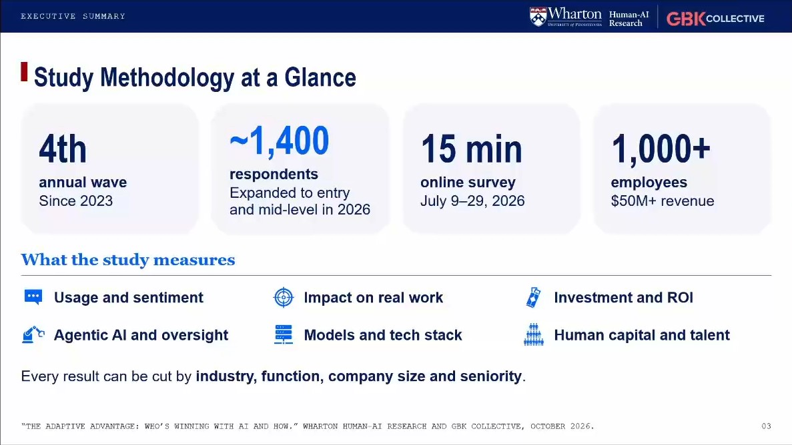
*«Study Methodology at a Glance» · presentada por Stefano Puntoni (Wharton) · [02:06–04:48]*

Cuarta ola anual desde 2023, unos 1.400 encuestados (ampliada este año a los niveles de entrada y medio), una encuesta en línea de 15 minutos entre el 9 y el 29 de julio de 2026, y empresas de más de 1.000 empleados y más de 50 millones de dólares de ingresos. Puntoni agrega que unos 400 son de entrada y nivel medio (el informe dice 409, contra 1.007 managers+) y advierte que el ROI es autorreportado, sin datos duros de retorno.

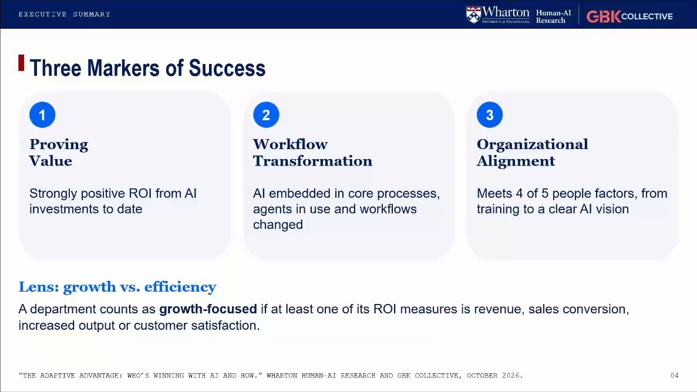
*«Three Markers of Success» · presentada por Stefano Puntoni (Wharton) · [04:48–06:46]*

Los tres marcadores: probar valor (ROI fuertemente positivo), transformar los flujos (IA integrada, agentes en uso y flujos cambiados) y alinear la organización (cumplir 4 de 5 factores de personas). Abajo, el lente: un departamento cuenta como enfocado en crecimiento si al menos uno de sus indicadores de ROI es ingresos, conversión, volumen de producción o satisfacción del cliente. Puntoni admite que la lista de factores podría haber sido otra; el informe precisa los cinco: formación, visión de largo plazo, libertad para elegir cómo usar la IA, no estar frenados por personas y procesos, y ausencia de resistencia real.

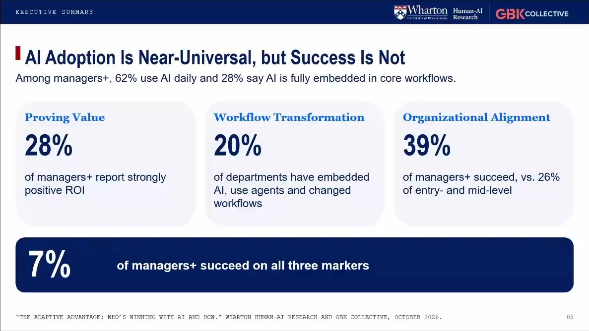
*«AI Adoption Is Near-Universal, but Success Is Not» · presentada por Jeremy Korst (GBK Collective) · [06:46–10:31]*

Entre los managers+, el 62% usa IA a diario y el 28% la tiene plenamente integrada; el 28% reporta ROI fuertemente positivo, el 20% de los departamentos transformó sus flujos y el 39% está alineado (26% entre entrada y nivel medio). Solo el 7% cumple los tres. Korst redondea («almost 30%», «one in five», «about 40%») y anuncia que el 7% será la nueva vara para los próximos años.

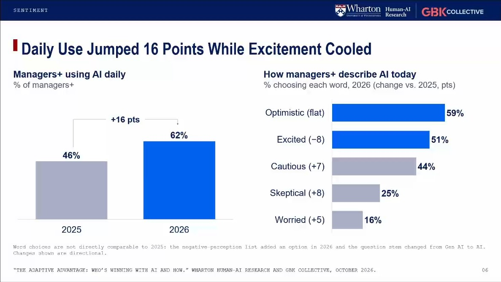
*«Daily Use Jumped 16 Points While Excitement Cooled» · presentada por Jeremy Korst (GBK Collective) · [10:31–11:47]*

El uso diario pasó de 46% en 2025 a 62% en 2026; «optimistic» se mantiene en 59% y «excited» cae 8 puntos, a 51%, mientras suben «cautious» (44%), «skeptical» (25%) y «worried» (16%). La nota de la lámina, que Korst no mencionó, advierte que las palabras no son del todo comparables con 2025 porque cambió la lista y la pregunta pasó de «Gen AI» a «AI». Él lo lee como el paso del entusiasmo a hacer funcionar la tecnología.

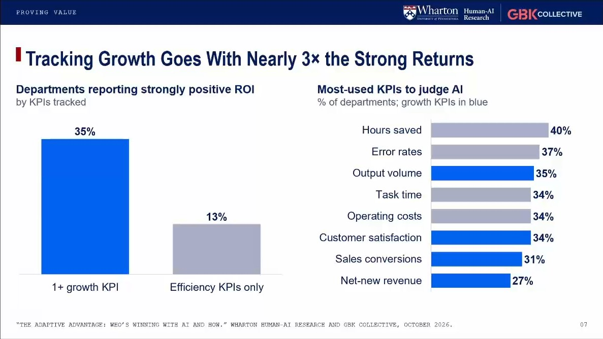
*«Tracking Growth Goes With Nearly 3× the Strong Returns» · presentada por Stefano Puntoni (Wharton) · [11:47–14:19]*

El 35% de los departamentos que miden al menos un indicador de crecimiento reporta ROI fuertemente positivo, contra el 13% de los que miden solo eficiencia. A la derecha, los indicadores más usados: horas ahorradas (40%), tasas de error (37%), volumen de producción (35%), tiempo por tarea y costos operativos (34%); los de crecimiento están en azul. Puntoni dice «more than twice» donde el título dice casi tres veces, insiste en que es correlación y lo conecta con su artículo de HBR sobre la IA para crecer.

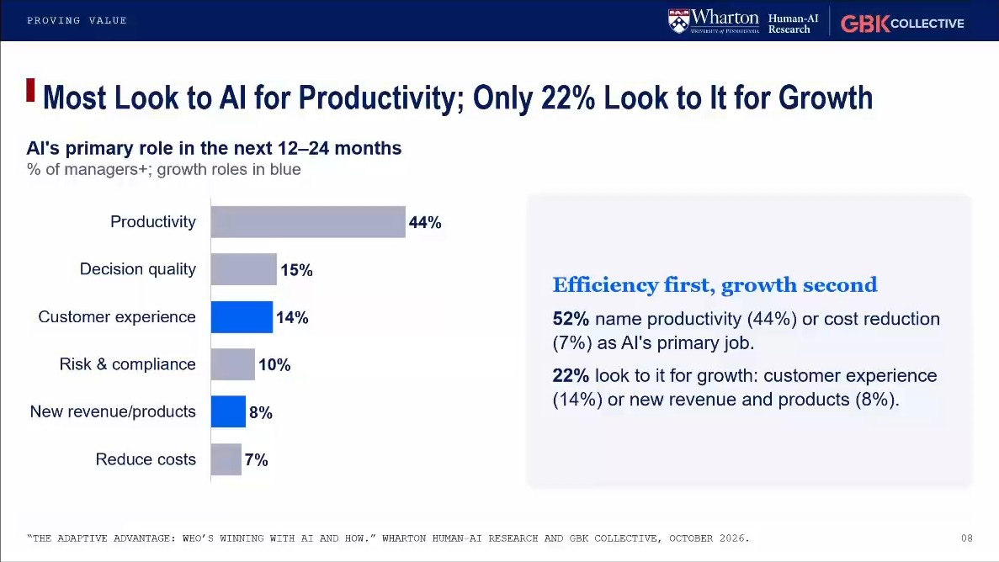
*«Most Look to AI for Productivity; Only 22% Look to It for Growth» · presentada por Stefano Puntoni (Wharton) · [14:19–15:20]*

El rol principal de la IA en los próximos 12 a 24 meses: productividad 44%, calidad de las decisiones 15%, experiencia del cliente 14%, riesgo y cumplimiento 10%, ingresos o productos nuevos 8% y reducción de costos 7%. En total, el 52% piensa en productividad o costos y el 22% en crecimiento. Puntoni no da las cifras; lo presenta como un riesgo de perder la promesa de largo plazo.

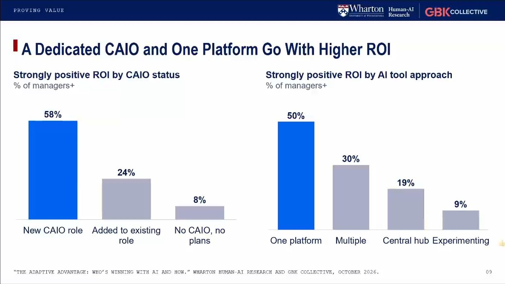
*«A Dedicated CAIO and One Platform Go With Higher ROI» · presentada por Jeremy Korst (GBK Collective) · [15:20–17:57]*

ROI fuertemente positivo: 58% donde hay un CAIO recién designado, 24% donde el cargo se sumó a uno existente y 8% sin CAIO; 50% con una sola plataforma, 30% con varias herramientas aprobadas, 19% con un hub central y 9% de los que aún experimentan. Korst leyó las dos barras al revés («for those who are reporting strongly positive ROI, nearly 60% reported to have a CAIO»; notas 1 y 2). El informe matiza que dos tercios ya tienen un CAIO o equivalente, pero el crecimiento de este año es casi todo reasignación, y que solo el 19% estandariza una plataforma. Korst agrega, desde su práctica, que el CAIO no debe ser el único líder de IA.

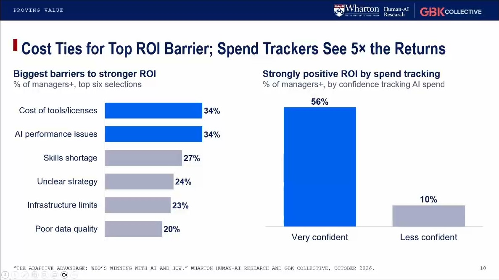
*«Cost Ties for Top ROI Barrier; Spend Trackers See 5× the Returns» · presentada por Jeremy Korst (GBK Collective) · [17:57–19:54]*

Las barreras principales al ROI: costo de herramientas y licencias y problemas de desempeño de la IA, ambos con 34%, por delante de la falta de habilidades (27%). El 56% de quienes confían mucho en poder seguir su gasto en IA reporta ROI fuerte, contra el 10% de los demás. Korst lo liga al *token maxing* y a los agentes; el informe agrega que solo el 40% tiene esa confianza y que parte de la diferencia puede ser entusiasmo más que capacidad.

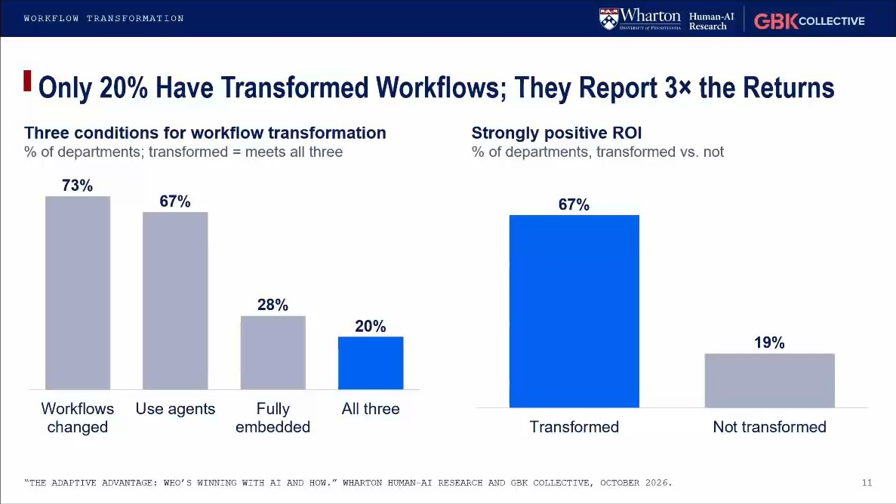
*«Only 20% Have Transformed Workflows; They Report 3× the Returns» · presentada por Prasanna (Sonny) Tambe (Wharton) · [19:54–22:52]*

El 73% de los departamentos cambió sus flujos, el 67% usa agentes y el 28% tiene la IA plenamente integrada; solo el 20% cumple las tres condiciones. Entre los transformados, el 67% reporta ROI fuerte, contra el 19% del resto. Tambe agrega que a los extremos les va bien y que sufren los del medio, con agentes pero sin rediseño; el informe precisa que solo el 17% deja actuar a los agentes sin que una persona apruebe cada paso.

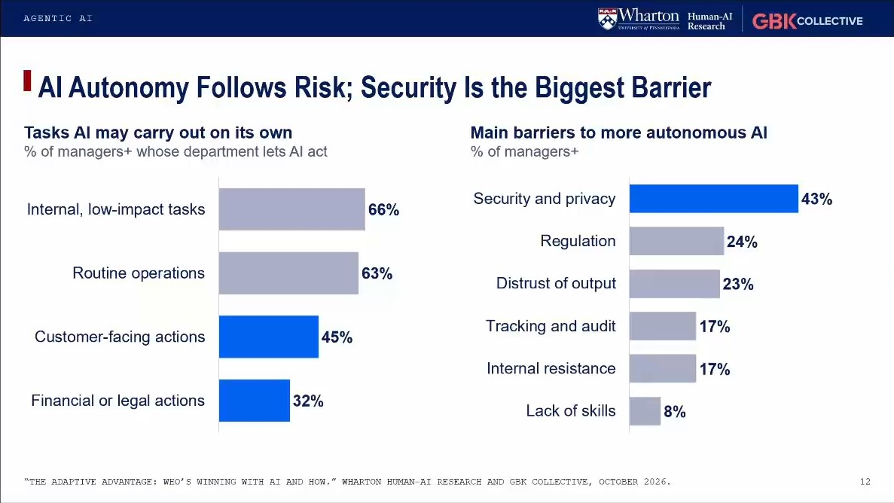
*«AI Autonomy Follows Risk; Security Is the Biggest Barrier» · presentada por Prasanna (Sonny) Tambe (Wharton) · [22:52–24:32]*

Lo que la IA puede hacer sola: tareas internas de bajo impacto (66%), operaciones rutinarias (63%), acciones de cara al cliente (45%) y acciones financieras o legales (32%). Las barreras a más autonomía: seguridad y privacidad (43%), regulación (24%), desconfianza en el resultado (23%), trazabilidad y auditoría y resistencia interna (17%) y falta de habilidades (8%). Tambe liga la seguridad a los incidentes de hackeo de los últimos meses.

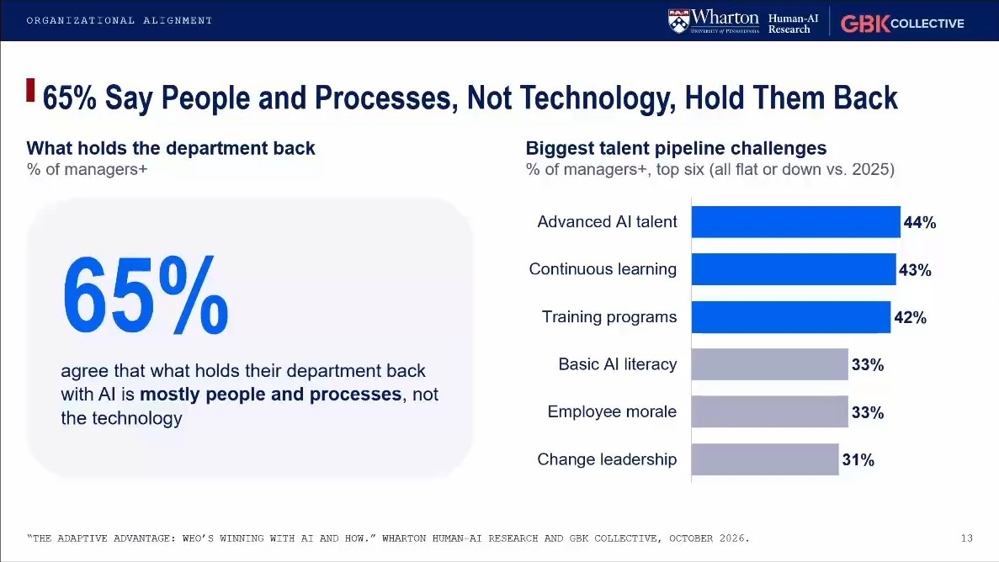
*«65% Say People and Processes, Not Technology, Hold Them Back» · presentada por Prasanna (Sonny) Tambe (Wharton) · [24:32–26:58]*

El 65% de los managers+ dice que a su departamento lo frenan las personas y los procesos, no la tecnología. Los mayores desafíos de talento: talento avanzado en IA (44%), aprendizaje continuo (43%), programas de formación (42%), alfabetización básica (33%), moral (33%) y liderazgo del cambio (31%), todos iguales o más bajos que en 2025. Tambe subraya que el problema es la rampa para aprender, no la aceptación.

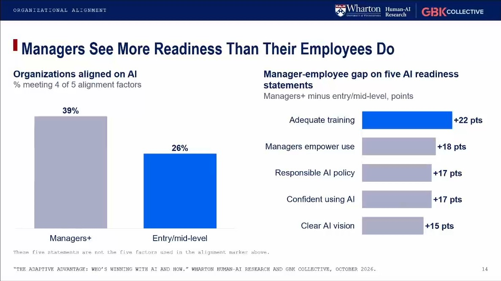
*«Managers See More Readiness Than Their Employees Do» · presentada por Prasanna (Sonny) Tambe (Wharton) · [26:58–28:58]*

El 39% de los managers+ describe una organización alineada, contra el 26% de entrada y nivel medio. Las brechas en cinco afirmaciones de preparación: formación adecuada (+22 puntos), los jefes empoderan el uso (+18), política de IA responsable (+17), confianza para usarla (+17) y visión clara (+15). La lámina aclara que esas cinco no son los cinco factores del marcador. Es lo que el informe llama el hallazgo más consistente: aparece en todas las industrias y en todos los departamentos salvo compras.

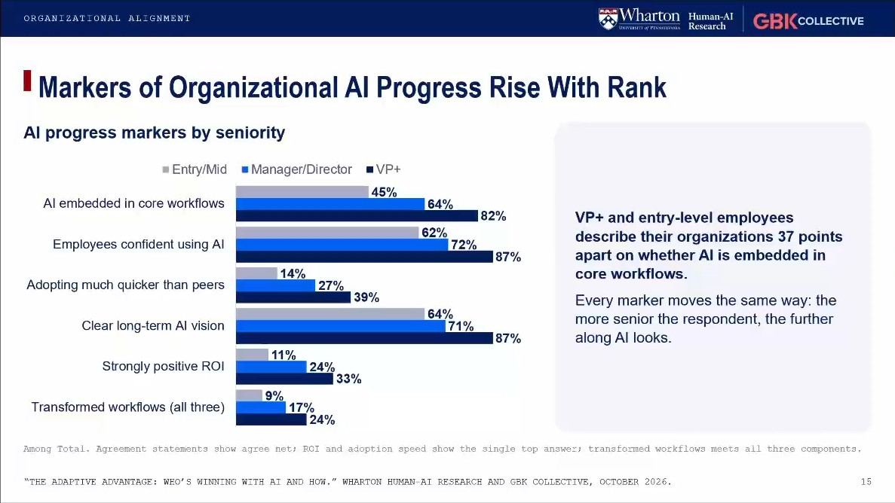
*«Markers of Organizational AI Progress Rise With Rank» · presentada por Prasanna (Sonny) Tambe (Wharton) · [28:58–30:17]*

Cada marcador sube con el rango (entrada/medio, gerente/director, VP+): IA integrada en los flujos 45%, 64% y 82%; confianza para usarla 62%, 72% y 87%; visión clara 64%, 71% y 87%; ROI fuerte 11%, 24% y 33%; flujos transformados 9%, 17% y 24%. VP+ y entrada quedan a 37 puntos sobre si la IA está integrada. Tambe dijo «about a 20% gap» para la confianza, donde la lámina muestra 25 (nota 3).

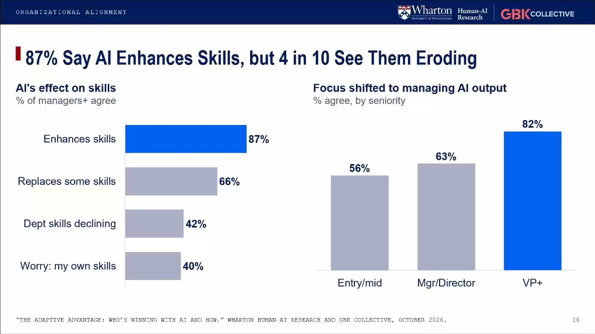
*«87% Say AI Enhances Skills, but 4 in 10 See Them Eroding» · presentada por Jeremy Korst (GBK Collective) · [30:17–33:58]*

El 87% de los managers+ cree que la IA mejora las habilidades, el 66% que reemplaza algunas, el 42% ve que las de su departamento declinan y el 40% teme por las propias. A la derecha, quienes dicen que su foco pasó a gestionar lo que produce la IA: 56% en entrada y medio, 63% en gerentes y directores, 82% en VP+. Korst le da el crédito de la pregunta a Puntoni, dice que lo importante es si se reemplazan las habilidades buenas o las malas y menciona la «cognitive surrender» de quien solo revisa.

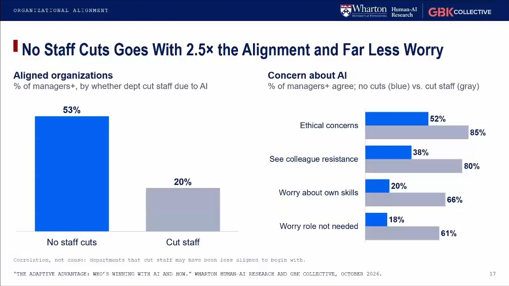
*«No Staff Cuts Goes With 2.5× the Alignment and Far Less Worry» · presentada por Jeremy Korst (GBK Collective) · [33:58–35:45]*

El 53% de los departamentos sin recortes de personal por la IA está alineado, contra el 20% de los que recortaron. Donde hubo recortes, crecen las preocupaciones: éticas (85% contra 52%), resistencia de colegas (80% contra 38%), por las propias habilidades (66% contra 20%) y por el propio cargo (61% contra 18%). Korst leyó la barra izquierda al revés (nota 4) y agrega, con el informe, que los de mayor ROI no recortaron más que el resto; Puntoni remata que no sorprende más resistencia donde se recortó.

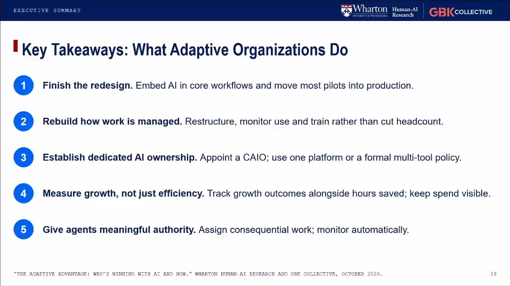
*«Key Takeaways: What Adaptive Organizations Do» · presentada por Stefano Puntoni (Wharton) · [35:45–39:00]*

Cinco recetas: terminar el rediseño (integrar la IA y llevar la mayoría de los pilotos a producción), reconstruir cómo se gestiona el trabajo en vez de recortar, establecer un dueño dedicado (un CAIO y una plataforma o una política formal de varias), medir crecimiento además de horas ahorradas sin perder de vista el gasto, y dar a los agentes autoridad significativa con monitoreo automático. Puntoni agrega que el CAIO es más un agente de cambio que un técnico y que la responsabilidad se comparte con todo el C-suite.

## Lo que el webinar agrega al informe

- **El origen del estudio [02:19].** Fue idea de Korst en 2023, cuando nadie sabía qué hacían las empresas con la IA generativa tras ChatGPT.
- **La defensa de medir percepción [40:26].** Korst explica que el ROI autorreportado es una decisión deliberada: lo que mueve las inversiones en esta etapa es la percepción de quienes deciden. Con humor, promete medirlo con más rigor algún día porque «we're at Wharton».
- **El CAIO no es el único líder de IA [16:44].** Korst, desde su consultoría: el cargo debe tener un mandato transversal para que el cambio ocurra de forma orgánica en todo el negocio. Puntoni lo describe como un agente de cambio más que un técnico [37:44]. En el panel de preguntas, Korst respondió por escrito que en su práctica las organizaciones exitosas ven el rol menos como tecnológico y más como de habilitación del negocio.
- **Seguridad y hackeos [24:04].** Tambe liga la barrera de seguridad y privacidad a los incidentes recientes en las noticias.
- **«Cognitive surrender» [33:33].** Korst menciona el riesgo de que quienes pasan de crear a revisar dejen de pensar, y lo vuelve un imperativo de gestión.
- **Por qué los ejecutivos ven más avance [41:50].** Puntoni enumera hipótesis que el estudio no mide: punto de vista, horizonte, información que no sube, apuesta personal, foco de corto plazo abajo y amenaza psicológica. Quiere medirlas el próximo año. Korst agrega que más de la mitad de los líderes se cree por delante del resto, «so the math would say that at least some of their perceptions are wrong» [43:34].
- **El tiempo ahorrado se esfuma [47:09].** Con datos que Puntoni reunió aparte, junto a la startup Conveo, casi todos ahorran tiempo con la IA, pero lo gastan en otras tareas de la cola y no en pensar o innovar. Para él, la productividad funciona como un fin y no como un medio para crecer [46:46].
- **La curva J y las burbujas [48:28].** Korst y Tambe comparan con la electricidad y el PC: las tecnologías de propósito general tardan en verse en las cifras macro. Tambe agrega que esas burbujas dejaron activos reutilizables, y que está por verse si esta también [50:03].
- **Marketing en la mesa [51:18].** Puntoni culpa del sesgo a la eficiencia a que la IA la dirigen TI, operaciones y finanzas, y pide que marketing participe. Korst [51:56]: los directorios de *private equity* piden eficiencia; los equipos de gestión que conoce entienden que la productividad ya es una condición mínima y que también necesitan ideas de crecimiento.
- **Riesgo y reversibilidad [54:41].** Korst recomienda un marco de Serguei Netessine y Masha Shunko para decidir cuánta autonomía darle a la IA en cada tarea según el riesgo y la reversibilidad.
- **Quién desconecta al agente [56:02].** El informe ya dice que la responsabilidad por los errores de un agente no está resuelta (ningún dueño pasa del 30%); Tambe agrega el ángulo de quién puede «pull the plug» cuando algo sale mal.
- **Mindspan Labs con agentes [57:23].** Korst cuenta que su empresa trabaja con una docena de agentes y lo prueba en tiempo real.
- **ChatGPT en cuentas personales [57:42].** Puntoni destaca que cerca de la mitad de quienes usan ChatGPT para trabajar lo hace con una cuenta personal (el informe da 51% de los usuarios de OpenAI entre los managers+).
- **Nada de predicciones a más de 24 meses [55:33].** Puntoni, ante una pregunta sobre robots humanoides superinteligentes.
- **La definición de «fully embedded».** En respuesta escrita a una pregunta de Francisco Martínez, de Brinca (ver «Menciones a Brinca»), Korst explicó que viene de la pregunta «To what extent is AI integrated into your department's core business processes and workflows?», y que «fully embedded» es el punto más alto de una escala de cinco, redactado para el encuestado como «Fully embedded; AI is integral to how our core work gets done».

## Ideas que se llevan
1. Usar la IA ya no distingue a nadie: el 62% de los managers+ la usa a diario. Lo que distingue es cumplir a la vez ROI, transformación y alineamiento, y solo el 7% lo logra.
2. Medir al menos un indicador de crecimiento va con casi tres veces más ROI fuerte que medir solo eficiencia. La mayoría todavía espera de la IA sobre todo productividad.
3. Los agentes obligan a rediseñar el trabajo. Tener agentes sin haber transformado los flujos es la peor posición: los transformados reportan 67% de ROI fuerte y el resto, 19%.
4. El freno está en las personas y los procesos, y en la rampa de aprendizaje, no en la aceptación de la tecnología.
5. Mientras más alto el cargo, más preparada parece la organización. La formación es donde más difieren jefes y empleados, y un plan que solo ve la vista de arriba no sobrevive a la implementación.
6. Recortar personal por la IA va con menos alineamiento y más preocupación, y los de mayor ROI no recortaron más que el resto.
7. El costo de licencias y tokens ya empata como barrera al ROI; saber cuánto se gasta en IA va con más retorno.
8. Un dueño dedicado de la IA ayuda si actúa como agente de cambio transversal, no como el único responsable.

## Frases citables
> «The big promise of this technology in the long run is not going to be time saving productivity but it's going to be innovation and organic growth.» (La gran promesa de esta tecnología en el largo plazo no va a ser la productividad por ahorro de tiempo, sino la innovación y el crecimiento orgánico.) — Stefano Puntoni (Wharton), [14:01]

> «Productivity is probably not gonna cut it for return.» (Probablemente la productividad no alcance para el retorno.) — Jeremy Korst (GBK Collective), [15:36]

> «Agents are quite different. Agents are cross-functional. They're, of course, as you know, autonomous.» (Los agentes son bastante distintos. Son transversales y, por supuesto, como saben, autónomos.) — Prasanna (Sonny) Tambe (Wharton), [20:34]

> «It's people and processes.» (Son las personas y los procesos.) — Prasanna (Sonny) Tambe (Wharton), [25:11]

> «You do not feel threatened by this technology because you don't do anything.» (Ustedes no se sienten amenazados por esta tecnología porque no hacen nada.) — Stefano Puntoni (Wharton), bromeando sobre los altos ejecutivos, [42:52]

> «So the math would say that at least some of their perceptions are wrong.» (Así que, por aritmética, al menos algunas de esas percepciones están equivocadas.) — Jeremy Korst (GBK Collective), [43:34]

> «Companies see productivity as an end in itself rather than a means to growth.» (Las empresas ven la productividad como un fin en sí mismo y no como un medio para crecer.) — Stefano Puntoni (Wharton), [46:46]

> «Productivity alone isn't enough to compete. It's going to be a need to have.» (La productividad por sí sola no basta para competir. Va a ser lo mínimo necesario.) — Jeremy Korst (GBK Collective), [52:46]

> «I make no prediction beyond 24 months max, and even that one feels a little bit shaky.» (No hago predicciones a más de 24 meses, y hasta esa me parece un poco inestable.) — Stefano Puntoni (Wharton), [55:33]

## Menciones a Brinca
- **La pregunta de Francisco Martínez (Brinca) en el panel de Zoom, a las 14:13 del reloj de Zoom (cerca del [41:00] de la grabación).** «How would you characterize "AI fully embedded in process". This still might be ambiguous for some respondants or practicioners.» No se leyó en voz alta. Jeremy Korst la respondió por escrito a las 14:16: «"To what extent is AI integrated into your department's core business processes and workflows?" and "fully embedded" is the top point of a five-point scale, worded for the respondent as "Fully embedded; AI is integral to how our core work gets done."» La pregunta queda a la vista en el panel desde [43:38].
- Nadie menciona a Brinca en voz alta durante el webinar.

## Archivos
- `transcripcion.md`: el texto completo, revisado y limpio, por turnos.
- `imagenes/`: las 16 láminas de contenido.
